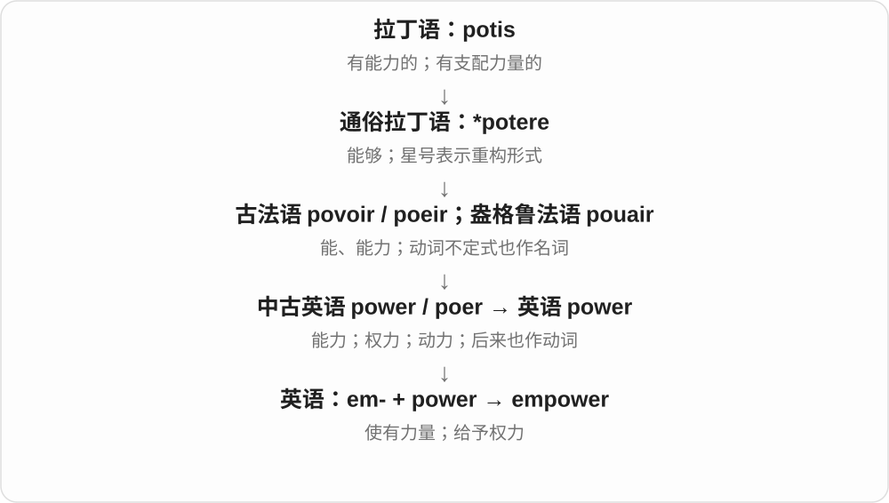
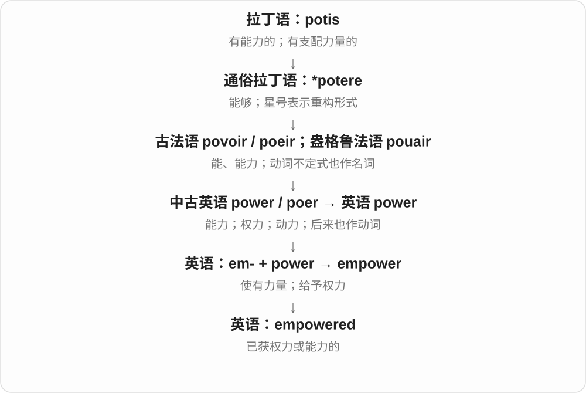
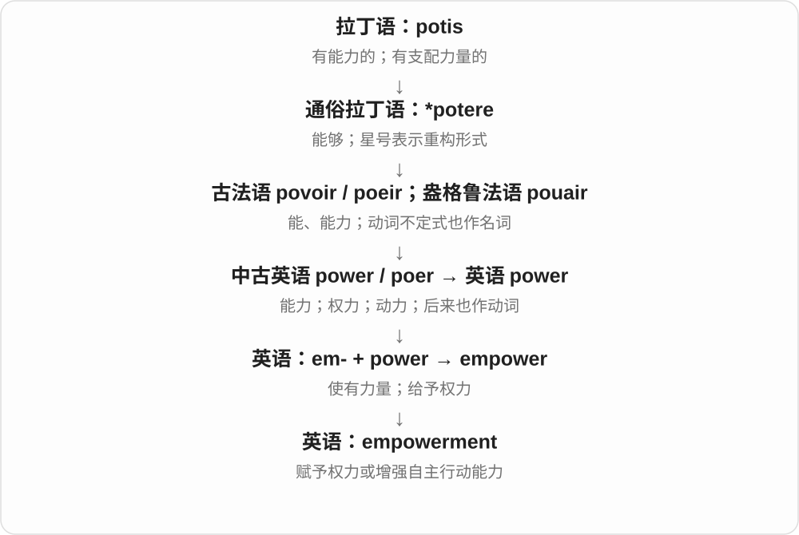

# 2832 · empower — 赋能；授权；使有能力

[逐词精讲目录](../00_逐词精讲目录.md) · [总目录](../00_总目录_按常用程度.md)

## 核心词根与来源

empower 在英语中以 em- 与 power 形成，既可正式授权，也可说增强行动能力。empowered 是已获权限或能力，empowerment 是这一过程或状态。

**EMPOWER：让人获得行动的权限或能力**

能作决定，也有工具和信心把决定做出来。

- **动作与结果**：empower · empowered
- **过程和状态**：empowerment

## 词形与演化规律

empower someone to do；empowerment 不等于只有口头鼓励，具体给予什么权利、资源要看句子。

## 单词速览（按词族由简到繁）

同一基础词的相关扩展放在一起，先读基础形式，再读扩展；各组之间优先读常用的。具体词源关系见各词讲解。

| 单词 | 音标 | 核心意思 |
|---|---|---|
| [empower](#w-3) | 英 /ɪmˈpaʊə/；美 /ɪmˈpaʊər/ | 授权；使有能力或信心采取行动 |
| [empowered](#w-1) | 英 /ɪmˈpaʊəd/；美 /ɪmˈpaʊərd/ | 获授权的；有能力自主行动的 |
| [empowerment](#w-2) | 英 /ɪmˈpaʊəmənt/；美 /ɪmˈpaʊərmənt/ | 授权；自主能力的增强；赋权 |

## 逐词讲解

### 1. empower — 授权；使有能力或信心采取行动

**音标**：英 /ɪmˈpaʊə/；美 /ɪmˈpaʊər/

**先抓住这个画面**

empower 是把可用的按钮交给别人：可以是真正的决策权，也可以是技能、信息和信心。

**怎么拆**

em- 是 en- 在 p 前的形式，加 power；英语内部构词，表示使拥有力量。

**怎么变成今天的意思**

正式语境中 empower someone to do something 是授权做某事；教育和社会语境中，也可表示帮助人具备自己行动的能力。单纯夸奖不一定构成 empower，关键在能否更主动地做事。

**常见搭配与例句**

empower someone to do；empower employees；empower local communities。

> The policy empowers staff to solve small problems without approval.

这项制度授权员工自行解决小问题，无须另行审批。

> Learning to read empowered her to manage her own affairs.

学会阅读让她能够自己处理事务。

**别混淆**

authorize 强调给予正式许可；empower 还可以通过知识、资源和信心增强人的行动能力。

### 2. empowered — 获授权的；有能力自主行动的

**音标**：英 /ɪmˈpaʊəd/；美 /ɪmˈpaʊərd/

**先抓住这个画面**

empowered 是手里终于有了工具、权限，心里也有“我能处理”的底气。

**怎么拆**

empower + -ed，过去分词可描述得到授权或增强能力后的状态。

**怎么变成今天的意思**

be empowered to sign 是得到签字权限；feel empowered 则侧重觉得自己有能力、有自主性。它描述获得行动空间，不等于比别人地位高。

**常见搭配与例句**

be empowered to；feel empowered；empowered employees。

> Only two officers are empowered to sign this document.

只有两名负责人获授权签署这份文件。

> After the workshop, she felt empowered to speak at meetings.

参加工作坊后，她觉得自己更有底气在会上发言了。

**别混淆**

powerful 说本身力量强；empowered 常带有通过授权、学习或支持获得自主能力的过程感。

### 3. empowerment — 授权；自主能力的增强；赋权

**音标**：英 /ɪmˈpaʊəmənt/；美 /ɪmˈpaʊərmənt/

**先抓住这个画面**

empowerment 是让原本只能等别人决定的人，逐渐能掌握自己的选择。

**怎么拆**

empower + -ment，表示给予权力、能力的过程或结果。

**怎么变成今天的意思**

employee empowerment 可能包括下放决策权；economic empowerment 可包括收入、资源和控制资源的能力。要从上下文看具体给了什么，别只把它当成空泛的“鼓励”。

**常见搭配与例句**

employee empowerment；economic empowerment；community empowerment。

> The program links financial education with economic empowerment.

这个项目把财务知识教育与经济自主能力的提升联系起来。

> Employee empowerment requires clear limits as well as trust.

向员工授权既需要信任，也需要明确权限边界。

**别混淆**

encouragement 是鼓励；empowerment 更强调实际能力、资源或决定权的增加。

## 这一组要分清什么

empower 与 enable 都可能说使能，但授权义更突出 power；不能在所有技术搭配里任意互换。

## 串起来练习

The policy empowered local teams to make their own decisions.

政策授权地方团队自行作决定。
