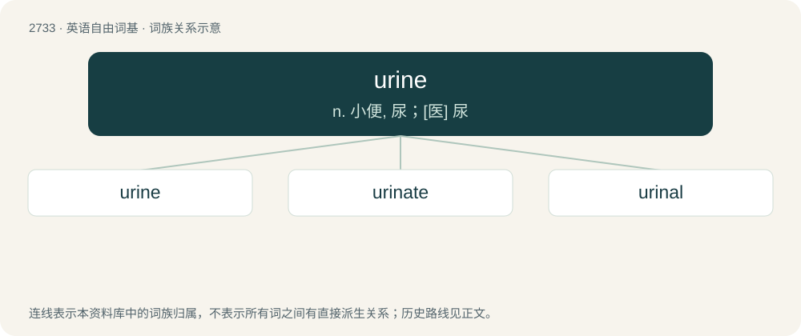

# 2834 · urine — n. 小便, 尿；\[医\] 尿

[总目录](../00_总目录_按常用程度.md)

**类型**：英语自由词基　｜　**来源语言**：见词源记录

## 核心含义与来源

- 核心含义：n. 小便, 尿；\[医\] 尿
- 英文含义：Liquid waste consisting of water, salts, and urea, which is made in the kidneys, stored in the bladder, then released through the urethra.
- 词形：urine

**来源记录 1**（名词；Liquid waste consisting of water, salts, and urea, which is made in the kidneys, stored in the bladder, then released through the urethra.）

From Middle English uryne, from Latin ūrīna (“urine”), from Proto-Indo-European \*uh₁r-, zero grade of \*woh₁-r̥ (“water, liquid, milk”). Related to \*h₁ówHdʰr̥ (“udder”) (see udder). Cognate with Old English ūriġ (“wet, moist”). Displaced native English land (“urine”) (from Middle English land, from Old English hland (“urine”)), though lant survives with a specialized sense.

## 词族图

## 单词速览（常用到不常用）

| 单词 | 音标 | 释义 |
|---|---|---|
| [urine](#w-1) | 英 /ˈjʊəɹɪn/；美 /ˈjʊɹɪn/ | n. 小便, 尿；\[医\] 尿 |
| [urinate](#w-2) | 英 /ˈjʊəɹɪneɪt/；美 /ˈjʊɹɪneɪt/ | vi. 小便, 撒尿；\[医\] 排尿 |
| [urinal](#w-3) | 英 /jʊəˈraɪnəl/；美 /ˈjʊɹɪnəl/ | 【英文】Synonym of urinary. |

## 逐词详解

### 1. urine

**词性**：名词　｜　**音标**：英 /ˈjʊəɹɪn/；美 /ˈjʊɹɪn/

**中文释义**：n. 小便, 尿；\[医\] 尿

**英文义项**：Liquid waste consisting of water, salts, and urea, which is made in the kidneys, stored in the bladder, then released through the urethra.

**词源与演化**：

From Middle English uryne, from Latin ūrīna (“urine”), from Proto-Indo-European \*uh₁r-, zero grade of \*woh₁-r̥ (“water, liquid, milk”). Related to \*h₁ówHdʰr̥ (“udder”) (see udder). Cognate with Old English ūriġ (“wet, moist”). Displaced native English land (“urine”) (from Middle English land, from Old English hland (“urine”)), though lant survives with a specialized sense.

**例句**：

> There was blood in his urine.

该用例对应义项：liquid excretory product

### 2. urinate

**词性**：动词　｜　**音标**：英 /ˈjʊəɹɪneɪt/；美 /ˈjʊɹɪneɪt/

**中文释义**：vi. 小便, 撒尿；\[医\] 排尿

**英文义项**：To pass urine from the body.

**构词拆分**：urine + -ate

**词源与演化**：

Borrowed from Medieval Latin urinātus, perfect passive participle of urinō (“urinate”) (see -ate (verb-forming suffix)), equivalent to urine + -ate. Compare French uriner.

**例句**：

> Our new puppy still urinates on the carpet, but we're housebreaking her.

该用例对应义项：To pass urine from the body.

### 3. urinal

**词性**：形容词　｜　**音标**：英 /jʊəˈraɪnəl/；美 /ˈjʊɹɪnəl/

**英文义项**：Synonym of urinary.

**构词拆分**：urine + -al

**词源与演化**：

From Middle French urinal, from Late Latin ūrīnālis, equivalent to urine + -al.
