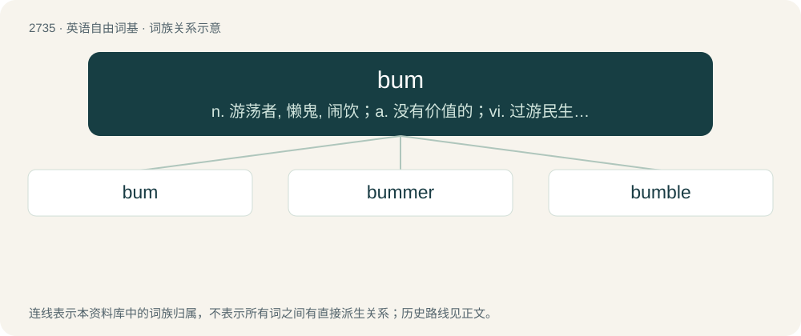

# 2836 · bum — n. 游荡者, 懒鬼, 闹饮；a. 没有价值的；vi. 过游民生活, 乞讨, 流浪

[总目录](../00_总目录_按常用程度.md)

**类型**：英语自由词基　｜　**来源语言**：见词源记录

## 核心含义与来源

- 核心含义：n. 游荡者, 懒鬼, 闹饮；a. 没有价值的；vi. 过游民生活, 乞讨, 流浪
- 英文含义：The buttocks.
- 词形：bum

**多个词源／构词路径**：同一拼写可能有不同来源；以下按词性和含义分别列出。

**来源记录 1**（名词；The buttocks.）

Attested since the 1300s, as Middle English bom (found in John Trevisa's 1387 Translation of the 'Polychronicon' of Ranulph Higden, "his bom is oute"), of uncertain origin. Sometimes suggested to be a shortening of botme, botom, bottum (“bottom”), but this is contradicted by the fact that bottom is not attested in reference to the buttocks until the late 1700s. Suggested by some old and modern references to be onomatopoeic. Compare also Old Irish, Scottish Gaelic bun (“base, bottom”). The anal sex senses (noun and verb), as well as the adjective (esp. the first) sense, are expletive-avoiding (i.e. Bowdlerized) shortenings of bumfuck.

**来源记录 2**（名词；A homeless person, usually a man.）

1864, back-formation from bummer, from German Bummler (“loafer”), from bummeln (“to loaf”).

**来源记录 3**（动词；To depress; to make unhappy.）

Back-formation from bum out.

**来源记录 4**（名词；A humming noise.）

See boom.

## 词族图

## 单词速览（常用到不常用）

| 单词 | 音标 | 释义 |
|---|---|---|
| [bum](#w-1) | /bʌm/ | n. 游荡者, 懒鬼, 闹饮；a. 没有价值的；vi. 过游民生活, 乞讨, 流浪 |
| [bummer](#w-2) | /ˈbʌ.mɚ/ | 【英文】A disappointment, a pity, a shame. |
| [bumble](#w-3) | /ˈbʌmbəl/ | 【英文】To boom, as a Eurasian bittern. |

## 逐词详解

### 1. bum

**词性**：名词　｜　**音标**：/bʌm/

**中文释义**：n. 游荡者, 懒鬼, 闹饮；a. 没有价值的；vi. 过游民生活, 乞讨, 流浪

**英文义项**：The buttocks. / The anus.

**词源与演化**：

Attested since the 1300s, as Middle English bom (found in John Trevisa's 1387 Translation of the 'Polychronicon' of Ranulph Higden, "his bom is oute"), of uncertain origin. Sometimes suggested to be a shortening of botme, botom, bottum (“bottom”), but this is contradicted by the fact that bottom is not attested in reference to the buttocks until the late 1700s. Suggested by some old and modern references to be onomatopoeic. Compare also Old Irish, Scottish Gaelic bun (“base, bottom”). The anal sex senses (noun and verb), as well as the adjective (esp. the first) sense, are expletive-avoiding (i.e. Bowdlerized) shortenings of bumfuck.

**例句**：

> Okay, everyone sit on your bum and try and touch your toes.

该用例对应义项：The buttocks.

### 2. bummer

**词性**：名词　｜　**音标**：/ˈbʌ.mɚ/

**英文义项**：A disappointment, a pity, a shame. / A psychedelic crisis; hallucinogenic drug use producing undesirable dysphoric psychological effects, most often fear, paranoia, and especially horrifying hallucinations; a bad trip.

**构词拆分**：bum + -er

**词源与演化**：

From bum (“make unhappy”) + -er (agent noun suffix), originally US drug slang.

**例句**：

> That's a total bummer.

该用例对应义项：A disappointment, a pity, a shame.

### 3. bumble

**词性**：动词　｜　**音标**：/ˈbʌmbəl/

**英文义项**：To boom, as a Eurasian bittern. / To buzz or bum.

**构词拆分**：bum + -le

**词源与演化**：

\* Verb: Frequentative of boom and/or bum, equivalent to bum + -le. \* Noun: From the verb.
