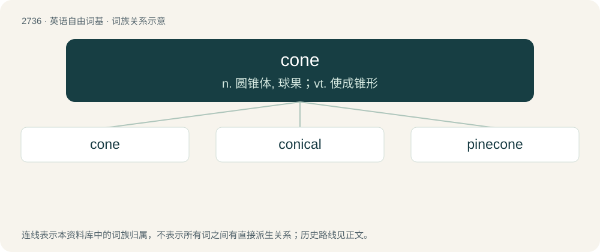

# 2837 · cone — n. 圆锥体, 球果；vt. 使成锥形

[总目录](../00_总目录_按常用程度.md)

**类型**：英语自由词基　｜　**来源语言**：见词源记录

## 核心含义与来源

- 核心含义：n. 圆锥体, 球果；vt. 使成锥形
- 英文含义：A surface of revolution formed by rotating a segment of a line around another line that intersects the first line.
- 词形：cone

**来源记录 1**（名词；A surface of revolution formed by rotating a segment of a line around another line that intersects the first line.）

From Middle English cone (“corner, angle”) and conoun (“cone”), from Medieval Latin cōnus, cōnon (“cone, wedge, peak”), from Ancient Greek κῶνος (kônos, “cone, spinning top, pine cone”). Reinforced by Middle French cone, from the same Graeco-Latin source.

## 词族图

## 单词速览（常用到不常用）

| 单词 | 音标 | 释义 |
|---|---|---|
| [cone](#w-1) | 英 /ˈkəʊn/；美 /ˈkoʊn/ | n. 圆锥体, 球果；vt. 使成锥形 |
| [conical](#w-2) | 英 /ˈkɒn.ɪ.kəl/；美 /ˈkɑ.nɪ.kəl/ | a. 圆锥形的, 圆锥的；\[计\] 圆锥的 |
| [pinecone](#w-3) | 美 /ˈpaɪnˌkoʊn/ | n. 松球, 松果 |

## 逐词详解

### 1. cone

**词性**：名词　｜　**音标**：英 /ˈkəʊn/；美 /ˈkoʊn/

**中文释义**：n. 圆锥体, 球果；vt. 使成锥形

**英文义项**：A surface of revolution formed by rotating a segment of a line around another line that intersects the first line. / A solid of revolution formed by rotating a triangle around one of its altitudes.

**词源与演化**：

From Middle English cone (“corner, angle”) and conoun (“cone”), from Medieval Latin cōnus, cōnon (“cone, wedge, peak”), from Ancient Greek κῶνος (kônos, “cone, spinning top, pine cone”). Reinforced by Middle French cone, from the same Graeco-Latin source.

**用法示例／搭配（非完整句）**：

> A cone is an object (the apex) and a natural transformation from a constant functor (whose image is the apex of the cone and its identity morphism) to a diagram functor. Its components are projections from the apex to the objects of the diagram and it has a “naturality triangle” for each morphism in the diagram. (A “naturality triangle” is just a naturality square which is degenerate at its apex side.)

该用例对应义项：An object V together with an arrow going from V to each object of a diagram such that for any arrow A in the diagram, the pair of arrows from V which subtend A also commute with it. (Then V can be said to be the cone’s vertex and the diagram which the cone subtends can be said to be its base.)

### 2. conical

**词性**：形容词　｜　**音标**：英 /ˈkɒn.ɪ.kəl/；美 /ˈkɑ.nɪ.kəl/

**中文释义**：a. 圆锥形的, 圆锥的；\[计\] 圆锥的

**英文义项**：Of or relating to a cone or cones. / Shaped like a cone.

**构词拆分**：conic + -al + cone + -ic + -al

**词源与演化**：

From conic + -al.

**例句**：

> I'm afraid you'll need more than a conical hat to be a real wizard.

### 3. pinecone

**词性**：名词　｜　**音标**：美 /ˈpaɪnˌkoʊn/

**中文释义**：n. 松球, 松果

**英文义项**：A conical seed-bearing structure produced on a pine tree. / The seed-bearing structure of any conifer, such as fir, spruce, cedar, etc.

**构词拆分**：pine + cone

**词源与演化**：

From pine + cone.

**例句**：

> Tom was wearing an apron with the image of a pinecone on it.
