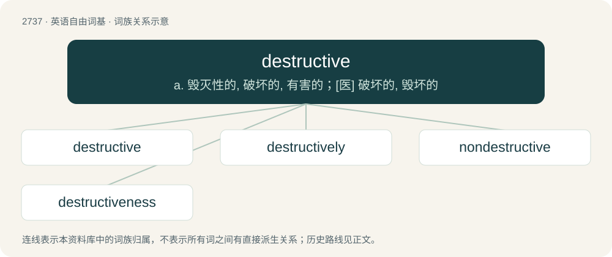

# 2838 · destructive — a. 毁灭性的, 破坏的, 有害的；\[医\] 破坏的, 毁坏的

[总目录](../00_总目录_按常用程度.md)

**类型**：英语自由词基　｜　**来源语言**：见词源记录

## 核心含义与来源

- 核心含义：a. 毁灭性的, 破坏的, 有害的；\[医\] 破坏的, 毁坏的
- 英文含义：Causing destruction; damaging.
- 词形：destructive

**来源记录 1**（形容词；Causing destruction; damaging.）

From Middle English destructyve, from Middle French destructif, from Latin dēstrūctīvus, from past participle of dēstruere (“to tear down, destroy”) + -īvus.

## 词族图

## 单词速览（常用到不常用）

| 单词 | 音标 | 释义 |
|---|---|---|
| [destructive](#w-1) | 英 /dɪˈstɹʌktɪv/ | a. 毁灭性的, 破坏的, 有害的；\[医\] 破坏的, 毁坏的 |
| [destructively](#w-2) |  | adv. 破坏地；狼狈地 |
| [nondestructive](#w-3) | /.nɒndisˈtrʌktiv/ | a. 非破坏性的；\[法\] 无破坏性的, 无害的 |
| [destructiveness](#w-4) | /dɪˈstrʌktɪvnəs/ | 破坏性 |

## 逐词详解

### 1. destructive

**词性**：形容词　｜　**音标**：英 /dɪˈstɹʌktɪv/

**中文释义**：a. 毁灭性的, 破坏的, 有害的；\[医\] 破坏的, 毁坏的

**英文义项**：Causing destruction; damaging. / Causing breakdown or disassembly.

**词源与演化**：

From Middle English destructyve, from Middle French destructif, from Latin dēstrūctīvus, from past participle of dēstruere (“to tear down, destroy”) + -īvus.

**例句**：

> Catabolism is a destructive metabolism that involves the breakdown of molecules and release of energy.

该用例对应义项：Causing breakdown or disassembly.

### 2. destructively

**词性**：副词

**中文释义**：adv. 破坏地；狼狈地

**英文义项**：in a destructive manner: in a way that causes destruction

**构词拆分**：destructive + -ly

**词源与演化**：

From destructive + -ly.

**例句**：

> He is destructively aggressive.

该用例对应义项：in a destructive manner

### 3. nondestructive

**词性**：形容词　｜　**音标**：/.nɒndisˈtrʌktiv/

**中文释义**：a. 非破坏性的；\[法\] 无破坏性的, 无害的

**英文义项**：That does not result in destruction or damage.

**构词拆分**：From non- + destructive.

**词源与演化**：

From non- + destructive.

### 4. destructiveness

**词性**：名词　｜　**音标**：/dɪˈstrʌktɪvnəs/

**中文释义**：破坏性

**英文义项**：The state or quality of being destructive.

**构词拆分**：destructive + -ness

**词源与演化**：

From destructive + -ness.
