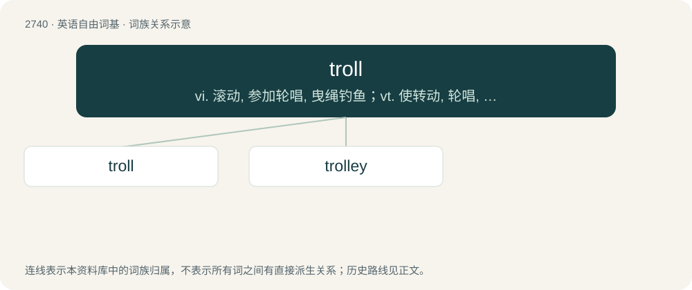

# 2839 · troll — vi. 滚动, 参加轮唱, 曳绳钓鱼；vt. 使转动, 轮唱, 高唱, 用曳绳钓(鱼)；n. 转动, 轮唱, 钓绳

[总目录](../00_总目录_按常用程度.md)

**类型**：英语自由词基　｜　**来源语言**：见词源记录

## 核心含义与来源

- 核心含义：vi. 滚动, 参加轮唱, 曳绳钓鱼；vt. 使转动, 轮唱, 高唱, 用曳绳钓(鱼)；n. 转动, 轮唱, 钓绳
- 英文含义：a giant supernatural being, especially a grotesque humanoid creature living in caves or hills or under bridges.
- 词形：troll

**多个词源／构词路径**：同一拼写可能有不同来源；以下按词性和含义分别列出。

**来源记录 1**（名词；a giant supernatural being, especially a grotesque humanoid creature living in caves or hills or under bridges.）

Partly: \* from Middle English trol (“demon (?); sorcerer (?)”) \[and other forms\], from Old Norse trǫll (“conjurer, mage; witch”), from Proto-Germanic \*truzlą (“supernatural being; demon, fiend; giant; monster”), probably from \*trudaną (“to step on; to tread”) + \*-ilą (suffix forming agent nouns); and \* borrowed from Norwegian Bokmål troll, Swedish troll, or Danish trold, from Old Norse trǫll (see above). Doublet of droll and trow. Cognates \* Danish fortrylle (“to bewitch”), trylle (“to conjure”) \* Icelandic tröll \* Middle High German trol, crewtrolle (“spook, wraith; ogre, monster”) \* Norwegian fortrylle (“to bewitch”), trylle (“to conjure”) \* Swedish trolla (“to conjure”)

**来源记录 2**（动词；To move (something, especially a round object) by, or as if by, rolling; to bowl, to roll, to trundle.）

The verb is derived from Middle English trollen (“to go about, wander; to move (something) to and fro, rock; to roll; to turn”) \[and other forms\], of uncertain origin; perhaps in part from Old French troller (“to run here and there; to walk aimlessly, ramble, stroll; (hunting) to wander about looking for game”) (modern French troller); further etymology uncertain, yet probably from or related to Middle High German trollen (“to stroll, walk with short strides”) (modern German trollen (“to move slowly, trundle; to push off, toddle off”)), ultimately from Proto-Germanic \*truzlōną (“to lumber”), which is probably related to \*trudaną (“to step on, tread”) (see further at etymology 1). Doublet of trull. Verb etymology 2, verb sense 4.2.2 (“to fish using a line and bait or lures trailed behind a boat”) is possibly influenced by trail and/or trawl. The noun is probably derived from the verb. Noun etymology 2, noun sense 4 (“person who makes or posts inflammatory or insincere statements in an attempt to lure others into combative argument”) is possibly influenced by troll (etymology 1). Cognates \* Middle Low German drullen (“to stroll”) (Low German trullen (“to troll”))

## 词族图

## 单词速览（常用到不常用）

| 单词 | 音标 | 释义 |
|---|---|---|
| [troll](#w-1) | 英 /tɹɒl/；美 /tɹɑl/ | vi. 滚动, 参加轮唱, 曳绳钓鱼；vt. 使转动, 轮唱, 高唱, 用曳绳钓(鱼)；n. 转动, 轮唱, 钓绳 |
| [trolley](#w-2) | /ˈtrɒli/ | n. 电车, 手推车, 台车；vt. 用手推车运；vi. 乘电车 |

## 逐词详解

### 1. troll

**词性**：名词　｜　**音标**：英 /tɹɒl/；美 /tɹɑl/

**中文释义**：vi. 滚动, 参加轮唱, 曳绳钓鱼；vt. 使转动, 轮唱, 高唱, 用曳绳钓(鱼)；n. 转动, 轮唱, 钓绳

**英文义项**：a giant supernatural being, especially a grotesque humanoid creature living in caves or hills or under bridges. / An ugly or unpleasant person.

**词源与演化**：

Partly: \* from Middle English trol (“demon (?); sorcerer (?)”) \[and other forms\], from Old Norse trǫll (“conjurer, mage; witch”), from Proto-Germanic \*truzlą (“supernatural being; demon, fiend; giant; monster”), probably from \*trudaną (“to step on; to tread”) + \*-ilą (suffix forming agent nouns); and \* borrowed from Norwegian Bokmål troll, Swedish troll, or Danish trold, from Old Norse trǫll (see above). Doublet of droll and trow. Cognates \* Danish fortrylle (“to bewitch”), trylle (“to conjure”) \* Icelandic tröll \* Middle High German trol, crewtrolle (“spook, wraith; ogre, monster”) \* Norwegian fortrylle (“to bewitch”), trylle (“to conjure”) \* Swedish trolla (“to conjure”)

**例句**：

> Miroslav reported the troll's ongoing harassment to the authorities, seeking their intervention.

### 2. trolley

**词性**：名词　｜　**音标**：/ˈtrɒli/

**中文释义**：n. 电车, 手推车, 台车；vt. 用手推车运；vi. 乘电车

**英文义项**：A trolley pole; a single-pole device for collecting electrical current from an overhead electrical line, normally for a tram/streetcar or a trolleybus. / A streetcar or light train.

**构词拆分**：troll (“to trundle, roll”) + -ey (diminutive ending)

**词源与演化**：

Early 19th century (1823) meaning "cart", of dialectal origin (Suffolk), probably from troll (“to trundle, roll”) + -ey (diminutive ending).

**例句**：

> Tom put a bag of grated cheese into his shopping trolley.
