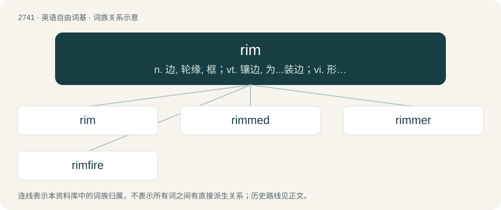

# 2841 · rim — n. 边, 轮缘, 框；vt. 镶边, 为...装边；vi. 形成边缘

[总目录](../00_总目录_按常用程度.md)

**类型**：英语自由词基　｜　**来源语言**：见词源记录

## 核心含义与来源

- 核心含义：n. 边, 轮缘, 框；vt. 镶边, 为...装边；vi. 形成边缘
- 英文含义：An edge around something, especially when circular.
- 词形：rim

**多个词源／构词路径**：同一拼写可能有不同来源；以下按词性和含义分别列出。

**来源记录 1**（名词；An edge around something, especially when circular.）

From Middle English rim, rym, rime, from Old English rima (“rim, edge, border, bank, coast”), from Proto-Germanic \*rimô, \*rembô (“edge, border”), possibly from Proto-Indo-European \*rem-, \*remə- (“to rest, support, be based”). Cognate with Saterland Frisian Rim (“plank, wooden cross, trellis”), Old Saxon rimi (“edge; border; trim”), Icelandic rimi (“a strip of land”).

**来源记录 2**（动词；To lick the anus of a partner as a sexual act; to perform anilingus.）

From a variation of ream.

**来源记录 3**（名词；A membrane.）

From Middle English rim, rym, ryme, reme, from Old English rēoma (“membrane, ligament”), from Proto-West Germanic \*reumō.

**来源记录 4**（名词；A step of a ladder; a rung.）

Unknown.

## 词族图

## 单词速览（常用到不常用）

| 单词 | 音标 | 释义 |
|---|---|---|
| [rim](#w-1) | 英 /ɹɪm/ | n. 边, 轮缘, 框；vt. 镶边, 为...装边；vi. 形成边缘 |
| [rimmed](#w-2) | /rimd/ | a. 有...边缘的 |
| [rimmer](#w-3) |  | 【英文】An implement for cutting, trimming, or ornamenting the rim of anything, as the edges of pies, etc. |
| [rimfire](#w-4) | /ˈrim,faiə/ | a. (子弹)边缘发火的,(火器)发射边缘发火弹的 ；n. 边缘发火弹 |

## 逐词详解

### 1. rim

**词性**：动词　｜　**音标**：英 /ɹɪm/

**中文释义**：n. 边, 轮缘, 框；vt. 镶边, 为...装边；vi. 形成边缘

**英文义项**：To form a rim on. / To follow the contours, possibly creating a circuit.

**词源与演化**：

From Middle English rim, rym, rime, from Old English rima (“rim, edge, border, bank, coast”), from Proto-Germanic \*rimô, \*rembô (“edge, border”), possibly from Proto-Indo-European \*rem-, \*remə- (“to rest, support, be based”). Cognate with Saterland Frisian Rim (“plank, wooden cross, trellis”), Old Saxon rimi (“edge; border; trim”), Icelandic rimi (“a strip of land”).

**例句**：

> A walking path rims the island.

该用例对应义项：To follow the contours, possibly creating a circuit.

### 2. rimmed

**词性**：形容词　｜　**音标**：/rimd/

**中文释义**：a. 有...边缘的

**英文义项**：Having a rim.

**构词拆分**：rim + -ed

**词源与演化**：

From rim + -ed.

**例句**：

> Do you wear rimmed or rimless glasses?

该用例对应义项：having a rim or a rim of a specified kind

### 3. rimmer

**词性**：名词

**英文义项**：An implement for cutting, trimming, or ornamenting the rim of anything, as the edges of pies, etc. / A mixture of confections, spices, and/or salt applied to the rim of a beverage glass or mug.

**构词拆分**：rim + -er

**词源与演化**：

From rim + -er.

### 4. rimfire

**词性**：名词　｜　**音标**：/ˈrim,faiə/

**中文释义**：a. (子弹)边缘发火的,(火器)发射边缘发火弹的 ；n. 边缘发火弹

**英文义项**：A type of firearm cartridge where the primer is in the back rim, rather than a central primer cap. They are cheap to produce but cannot be reloaded with powder.

**构词拆分**：rim + fire

**词源与演化**：

From rim + fire.

**例句**：

> However, this prohibition does not apply if you use an air rifle, air pistol, or .22-caliber rimfire firearm for the control of listed birds.
