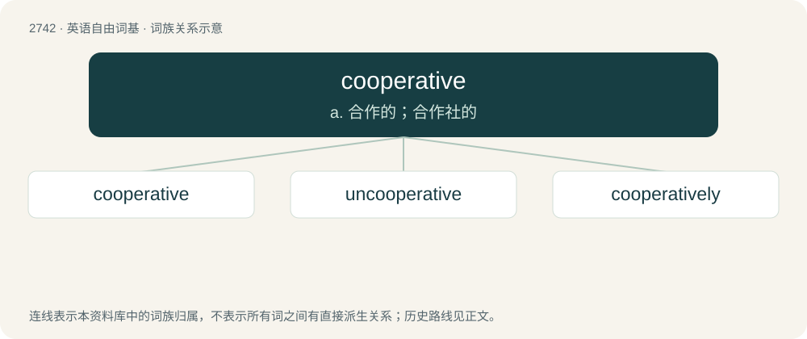

# 2842 · cooperative — a. 合作的；合作社的

[总目录](../00_总目录_按常用程度.md)

**类型**：英语自由词基　｜　**来源语言**：见词源记录

## 核心含义与来源

- 核心含义：a. 合作的；合作社的
- 英文含义：Ready to work with another person or in a team; ready to cooperate.
- 词形：cooperative

**来源记录 1**（形容词；Ready to work with another person or in a team; ready to cooperate.）

From co- + operative.

## 词族图

## 单词速览（常用到不常用）

| 单词 | 音标 | 释义 |
|---|---|---|
| [cooperative](#w-1) | 美 /kuˈɑp.ɹətɪv/ | a. 合作的；合作社的 |
| [uncooperative](#w-2) | /ˈʌnkəuˈɔpərətiv/ | a. 不合作的, 不配合的, 执拗的 |
| [cooperatively](#w-3) | /kəuˈɔpəreitivli/ | adv. 合作地 |

## 逐词详解

### 1. cooperative

**词性**：形容词　｜　**音标**：美 /kuˈɑp.ɹətɪv/

**中文释义**：a. 合作的；合作社的

**英文义项**：Ready to work with another person or in a team; ready to cooperate. / Involving cooperation between individuals or parties.

**构词拆分**：co- + operative

**词源与演化**：

From co- + operative.

**例句**：

> The patient was rarely cooperative, and tended to refuse treatment.

该用例对应义项：Ready to work with another person or in a team; ready to cooperate.

### 2. uncooperative

**词性**：形容词　｜　**音标**：/ˈʌnkəuˈɔpərətiv/

**中文释义**：a. 不合作的, 不配合的, 执拗的

**英文义项**：Not cooperative.

**构词拆分**：un- + cooperative

**词源与演化**：

From un- + cooperative.

**例句**：

> When Yanni was questioned, he was very uncooperative.

### 3. cooperatively

**词性**：副词　｜　**音标**：/kəuˈɔpəreitivli/

**中文释义**：adv. 合作地

**英文义项**：In a cooperative manner; working with others on a task as part of a team.

**构词拆分**：cooperative + -ly

**词源与演化**：

From cooperative + -ly.

**例句**：

> These children are working cooperatively to create their ideal town of the future with input from artificial intelligence.
