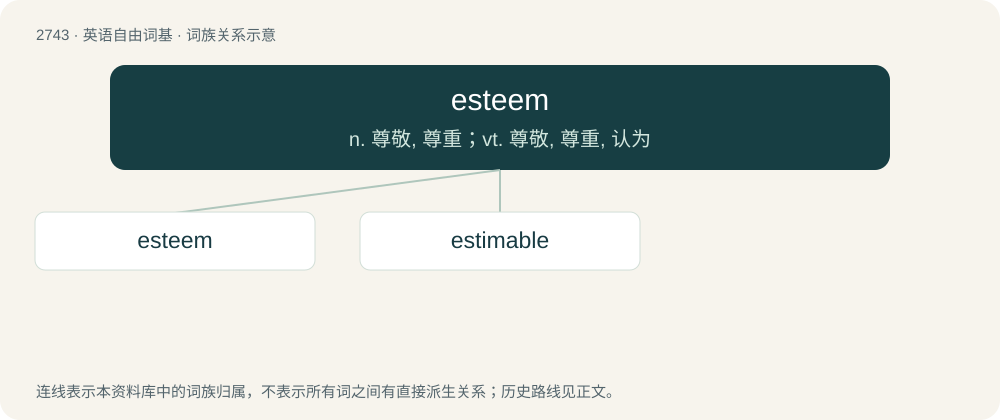

# 2843 · esteem — n. 尊敬, 尊重；vt. 尊敬, 尊重, 认为

[总目录](../00_总目录_按常用程度.md)

**类型**：英语自由词基　｜　**来源语言**：见词源记录

## 核心含义与来源

- 核心含义：n. 尊敬, 尊重；vt. 尊敬, 尊重, 认为
- 英文含义：Assessment, estimation, or regard; especially; favourable estimation or regard.
- 词形：esteem

**来源记录 1**（名词；Assessment, estimation, or regard; especially; favourable estimation or regard.）

First at end of 16th century; borrowed from Middle French estimer, borrowed from Latin aestimō. See estimate and aim, an older word, partly a doublet.

## 词族图

## 单词速览（常用到不常用）

| 单词 | 音标 | 释义 |
|---|---|---|
| [esteem](#w-1) | /ɪˈstiːm/ | n. 尊敬, 尊重；vt. 尊敬, 尊重, 认为 |
| [estimable](#w-2) | /ˈɛstɪməbəl/ | a. 可尊敬的, 可估计的 |

## 逐词详解

### 1. esteem

**词性**：名词　｜　**音标**：/ɪˈstiːm/

**中文释义**：n. 尊敬, 尊重；vt. 尊敬, 尊重, 认为

**英文义项**：Assessment, estimation, or regard; especially; favourable estimation or regard.

**词源与演化**：

First at end of 16th century; borrowed from Middle French estimer, borrowed from Latin aestimō. See estimate and aim, an older word, partly a doublet.

**例句**：

> We hold her in high esteem.

该用例对应义项：Assessment, estimation, or regard; especially; favourable estimation or regard.

### 2. estimable

**词性**：形容词　｜　**音标**：/ˈɛstɪməbəl/

**中文释义**：a. 可尊敬的, 可估计的

**英文义项**：Worthy of esteem; admirable. / Capable of being estimated; estimatable.

**构词拆分**：esteem + -able；estimate + -able

**词源与演化**：

From Middle English estimable, estymable, from Old French estimable, from Latin aestimābilis. Equivalent to esteem + -able and estimate + -able.
