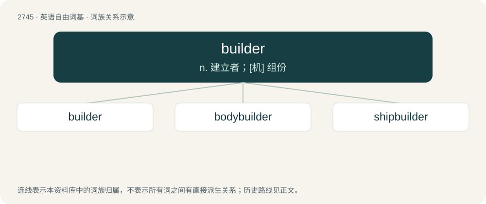

# 2846 · builder — n. 建立者；\[机\] 组份

[总目录](../00_总目录_按常用程度.md)

**类型**：英语自由词基　｜　**来源语言**：见词源记录

## 核心含义与来源

- 核心含义：n. 建立者；\[机\] 组份
- 英文含义：One who builds or constructs things.
- 词形：builder

**来源记录 1**（名词；One who builds or constructs things.）

From Middle English byldere, buyldere, from bylden + -er. By surface analysis, build + -er. Compare Old English bylda, bytla (“hammerer, builder”).

## 词族图

## 单词速览（常用到不常用）

| 单词 | 音标 | 释义 |
|---|---|---|
| [builder](#w-1) | 英 /ˈbɪl.də/；美 /ˈbɪl.dəɹ/ | n. 建立者；\[机\] 组份 |
| [bodybuilder](#w-2) | 英 /ˈbɒ.diˌbɪl.də/；美 /ˈbɑ.diˌbɪl.dəɹ/ | n. 健美运动者；锻炼肌肉者 |
| [shipbuilder](#w-3) | /ˈʃipbildə/ | n. 造船专家, 造船工程师 |

## 逐词详解

### 1. builder

**词性**：名词　｜　**音标**：英 /ˈbɪl.də/；美 /ˈbɪl.dəɹ/

**中文释义**：n. 建立者；\[机\] 组份

**英文义项**：One who builds or constructs things. / Master artisan, who receives his instructions from the architect, and employs workers.

**词源与演化**：

From Middle English byldere, buyldere, from bylden + -er. By surface analysis, build + -er. Compare Old English bylda, bytla (“hammerer, builder”).

**例句**：

> Mr Brown contracted with the builder for a new house.

### 2. bodybuilder

**词性**：名词　｜　**音标**：英 /ˈbɒ.diˌbɪl.də/；美 /ˈbɑ.diˌbɪl.dəɹ/

**中文释义**：n. 健美运动者；锻炼肌肉者

**英文义项**：A person who uses diet and exercise to build an aesthetically muscular physique, in order to compete in bodybuilding.

**构词拆分**：body + builder

**词源与演化**：

From body + builder.

**例句**：

> It was obvious that the muscle-bound bodybuilder had been taking steroids.

### 3. shipbuilder

**词性**：名词　｜　**音标**：/ˈʃipbildə/

**中文释义**：n. 造船专家, 造船工程师

**英文义项**：A person who builds vessels such as ships and boats. / A firm that specializes in building ships.

**构词拆分**：ship + builder

**词源与演化**：

From ship + builder.
