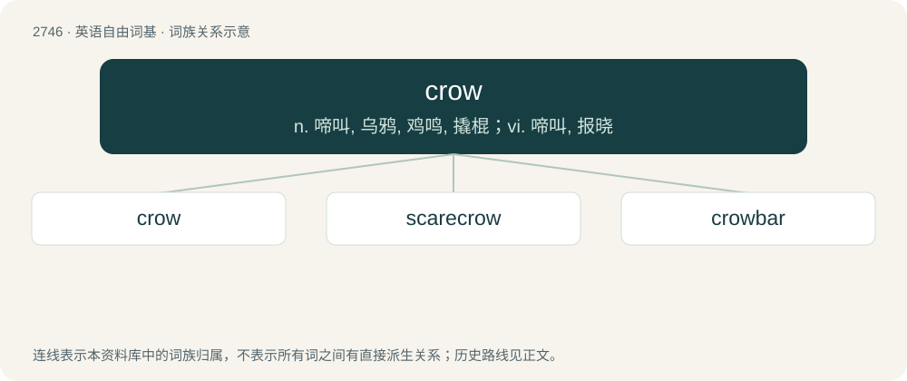

# 2847 · crow — n. 啼叫, 乌鸦, 鸡鸣, 撬棍；vi. 啼叫, 报晓

[总目录](../00_总目录_按常用程度.md)

**类型**：英语自由词基　｜　**来源语言**：见词源记录

## 核心含义与来源

- 核心含义：n. 啼叫, 乌鸦, 鸡鸣, 撬棍；vi. 啼叫, 报晓
- 英文含义：A bird, usually black, of the genus Corvus, having a strong conical beak, with projecting bristles; it has a harsh, croaking call.
- 词形：crow

**多个词源／构词路径**：同一拼写可能有不同来源；以下按词性和含义分别列出。

**来源记录 1**（名词；A bird, usually black, of the genus Corvus, having a strong conical beak, with projecting bristles; it has a harsh, croaking call.）

From Middle English crowe, from Old English crāwe, from Proto-West Germanic \*krāā, from Proto-Germanic \*krēǭ (compare West Frisian krie, Dutch kraai, German Krähe), from \*krēaną (“to crow”). See below. The verb is a back-formation from crowbar.

**来源记录 2**（动词；To make the shrill sound characteristic of a rooster; to make a sound in this manner, either in gaiety, joy, pleasure, or defiance.）

The verb is from Middle English crowen, from Old English crāwan (past tense crēow, past participle crāwen), from Proto-West Germanic \*krāan, from Proto-Germanic \*krēaną, from imitative Proto-Indo-European \*gerH- (“to cry hoarsely”). The noun is from Middle English crowe, from the verb. Compare Dutch kraaien, German krähen, Lithuanian gróti, Russian гра́ять (grájatʹ)). Related to croak.

## 词族图

## 单词速览（常用到不常用）

| 单词 | 音标 | 释义 |
|---|---|---|
| [crow](#w-1) | 英 /kɹəʊ/；美 /kɹoʊ/ | n. 啼叫, 乌鸦, 鸡鸣, 撬棍；vi. 啼叫, 报晓 |
| [scarecrow](#w-2) | 英 /ˈskɛəkɹəʊ/；美 /ˈskɛɚˌkɹoʊ/ | n. 稻草人, 衣衫褴褛的人 |
| [crowbar](#w-3) | 美 /ˈkɹoʊˌbɑɹ/ | n. 铁挺, 起货钩, 撬棍, 铁撬；\[计\] 短路器 |

## 逐词详解

### 1. crow

**词性**：动词　｜　**音标**：英 /kɹəʊ/；美 /kɹoʊ/

**中文释义**：n. 啼叫, 乌鸦, 鸡鸣, 撬棍；vi. 啼叫, 报晓

**英文义项**：To use a crowbar, wedge, or other implement to attempt to open a surface by leveraging force on the opposite end of the tool to pry off the connection between the two surfaces.

**词源与演化**：

From Middle English crowe, from Old English crāwe, from Proto-West Germanic \*krāā, from Proto-Germanic \*krēǭ (compare West Frisian krie, Dutch kraai, German Krähe), from \*krēaną (“to crow”). See below. The verb is a back-formation from crowbar.

**例句**：

> If you wanna get inside, you're gonna have to crow open that door.

该用例对应义项：To use a crowbar, wedge, or other implement to attempt to open a surface by leveraging force on the opposite end of the tool to pry off the connection between the two surfaces.

### 2. scarecrow

**词性**：名词　｜　**音标**：英 /ˈskɛəkɹəʊ/；美 /ˈskɛɚˌkɹoʊ/

**中文释义**：n. 稻草人, 衣衫褴褛的人

**英文义项**：An effigy, typically made of straw and dressed in old clothes, fixed to a pole in a field to deter birds from eating crops or seeds planted there. / A person or animal regarded as resembling a scarecrow (sense 1) in some way; especially, a tall, thin, awkward person; or a person wearing ragged and tattered clothes.

**构词拆分**：scare (“to frighten, startle, terrify”) + crow (“bird of the genus Corvus”)

**词源与演化**：

The noun is derived from scare (“to frighten, startle, terrify”) + crow (“bird of the genus Corvus”). The word displaced other terms such as bogle (now dialectal, dated), sewel or shewel, and shoy-hoy (perhaps imitative of the cry of crows). The verb is derived from the noun.

**例句**：

> I cannot scare the birds away. I am not a scarecrow.

### 3. crowbar

**词性**：动词　｜　**音标**：美 /ˈkɹoʊˌbɑɹ/

**中文释义**：n. 铁挺, 起货钩, 撬棍, 铁撬；\[计\] 短路器

**英文义项**：To force to move, usually with a crowbar; to prise.

**构词拆分**：crow + bar；crow (“crow (bird)" also "metal lever, crowbar”) + bar

**词源与演化**：

From crow (“crow (bird)" also "metal lever, crowbar”) + bar, probably because the forked end looks like a crow's foot.

**例句**：

> Tom used a crowbar to pry open the lid of the crate.
