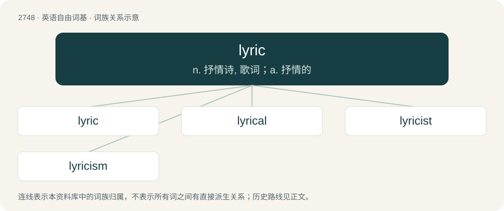

# 2849 · lyric — n. 抒情诗, 歌词；a. 抒情的

[总目录](../00_总目录_按常用程度.md)

**类型**：英语自由词基　｜　**来源语言**：见词源记录

## 核心含义与来源

- 核心含义：n. 抒情诗, 歌词；a. 抒情的
- 英文含义：Of, or relating to a type of poetry (such as a sonnet or ode) that expresses subjective thoughts and feelings, often in a songlike style.
- 词形：lyric

**来源记录 1**（形容词；Of, or relating to a type of poetry (such as a sonnet or ode) that expresses subjective thoughts and feelings, often in a songlike style.）

From French lyrique, or its source, Latin lyricus, from Ancient Greek λυρικός (lurikós), from λύρα (lúra, “lyre”). Its English equivalent would be lyre + -ic. The original Greek sense of "lyric poetry"—"poetry accompanied by the lyre" i.e. "words set to music"—eventually led to its use as "lyrics", first attested in Stainer and Barrett's 1876 Dictionary of Musical Terms. Stainer and Barrett used the word as a singular substantive: "Lyric, poetry or blank verse intended to be set to music and sung". By the 1930s, the present use of the plurale tantum "lyrics" had begun; it has been standard since the 1950s for many writers. The singular form "lyric" is still used to mean the complete words to a song by authorities such as Alec Wilder, Robert Gottlieb, and Stephen Sondheim. However, the singular form is also commonly used to refer to a specific line (or phrase) within a song's lyrics.

## 词族图

## 单词速览（常用到不常用）

| 单词 | 音标 | 释义 |
|---|---|---|
| [lyric](#w-1) | 英 /ˈlɪɹɪk/ | n. 抒情诗, 歌词；a. 抒情的 |
| [lyrical](#w-2) | /ˈlɪɹɪkəl/ | a. 抒情诗调的, 有抒情味的, 感情丰富的 |
| [lyricist](#w-3) | /ˈlɪɹ.ɪsɪst/ | n. 抒情诗人, 歌曲作者 |
| [lyricism](#w-4) | /ˈlirisizm/ | n. 抒情风格, 抒情诗体, 抒情方式抒情 |

## 逐词详解

### 1. lyric

**词性**：名词　｜　**音标**：英 /ˈlɪɹɪk/

**中文释义**：n. 抒情诗, 歌词；a. 抒情的

**英文义项**：A lyric poem. / The words of a song or other vocal music.

**构词拆分**：lyre + -ic

**词源与演化**：

From French lyrique, or its source, Latin lyricus, from Ancient Greek λυρικός (lurikós), from λύρα (lúra, “lyre”). Its English equivalent would be lyre + -ic. The original Greek sense of "lyric poetry"—"poetry accompanied by the lyre" i.e. "words set to music"—eventually led to its use as "lyrics", first attested in Stainer and Barrett's 1876 Dictionary of Musical Terms. Stainer and Barrett used the word as a singular substantive: "Lyric, poetry or blank verse intended to be set to music and sung". By the 1930s, the present use of the plurale tantum "lyrics" had begun; it has been standard since the 1950s for many writers. The singular form "lyric" is still used to mean the complete words to a song by authorities such as Alec Wilder, Robert Gottlieb, and Stephen Sondheim. However, the singular form is also commonly used to refer to a specific line (or phrase) within a song's lyrics.

**例句**：

> The lyrics were written by the composer.

该用例对应义项：The words of a song or other vocal music.

### 2. lyrical

**词性**：形容词　｜　**音标**：/ˈlɪɹɪkəl/

**中文释义**：a. 抒情诗调的, 有抒情味的, 感情丰富的

**英文义项**：Appropriate for or suggestive of singing. / Expressive of emotion.

**构词拆分**：From lyric + -al.

**词源与演化**：

From lyric + -al.

**用法示例／搭配（非完整句）**：

> lyrical content

该用例对应义项：Of or pertaining to the lyrics of a song

### 3. lyricist

**词性**：名词　｜　**音标**：/ˈlɪɹ.ɪsɪst/

**中文释义**：n. 抒情诗人, 歌曲作者

**英文义项**：A person who writes the lyrics of a song.

**构词拆分**：lyric + -ist

**词源与演化**：

From lyric + -ist.

**例句**：

> Pindar, the greatest lyricist of the Greeks, wrote about athletic contests; athletes were his heroes.

### 4. lyricism

**词性**：名词　｜　**音标**：/ˈlirisizm/

**中文释义**：n. 抒情风格, 抒情诗体, 抒情方式抒情

**英文义项**：Great enthusiasm. / The emotional style of lyric poetry.

**构词拆分**：lyric + -ism

**词源与演化**：

From lyric + -ism.
