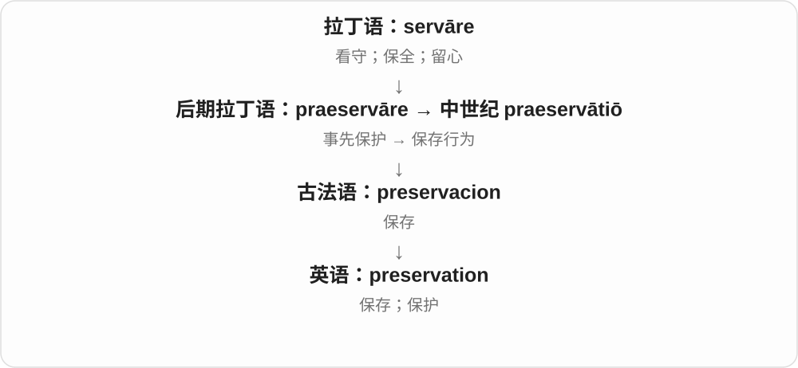

# 2849 · preservation — 保存这一过程，加前项说明采用低温方式

[逐词精讲目录](../00_逐词精讲目录.md) · [总目录](../00_总目录_按常用程度.md)

## 核心词根与来源

一般保存可用于食品、文物、自然环境；前加 cryo-，则常进入生物材料低温保存领域。

**PRESERVATION：让东西保存下来，cryo- 指明冷的手段**

preservation → cryopreservation。

- **保存及低温保存**：preservation · cryopreservation

## 词形与演化规律

preserve → preservation；cryo- 寒冷 + preservation → cryopreservation。

## 单词速览（按词族由简到繁）

同一基础词的相关扩展放在一起，先读基础形式，再读扩展；各组之间优先读常用的。具体词源关系见各词讲解。

| 单词 | 音标 | 核心意思 |
|---|---|---|
| [preservation](#w-1) | 英 /ˌprezəˈveɪʃən/；美 /ˌprezərˈveɪʃən/ | 保存；保护；维持原状 |
| [cryopreservation](#w-2) | 英 /ˌkraɪəʊprezəˈveɪʃən/；美 /ˌkraɪoʊprezərˈveɪʃən/ | 低温保存、冷冻保存 |

## 逐词讲解

### 1. preservation — 保存；保护；维持原状

**音标**：英 /ˌprezəˈveɪʃən/；美 /ˌprezərˈveɪʃən/

**先抓住这个画面**

把东西长期留好，不让时间、环境或使用把它毁掉的过程。

**怎么拆**

古法语 preservacion 来自中世纪拉丁语 praeservātiō；现代对应 preserve + -ation。

**怎么变成今天的意思**

可以讨论档案、建筑、食物或自然环境的保存。词义偏持续留存，不只一次临时防护。

**常见搭配与例句**

food preservation；the preservation of records；historic preservation。

> Low humidity helps with the preservation of old documents.

较低湿度有助于保存旧文献。

> The group supports the preservation of historic buildings.

这个团体支持保护历史建筑。

**别混淆**

preservation 强调留存；restoration 是修复到某种较早状态。保存可能需要修复，但两词不完全相同。

### 2. cryopreservation — 低温保存、冷冻保存

**音标**：英 /ˌkraɪəʊprezəˈveɪʃən/；美 /ˌkraɪoʊprezərˈveɪʃən/

**先抓住这个画面**

把细胞、组织等放在很低温度下保存，留待以后使用，就是 cryopreservation。cryo- 告诉你采用冷的方式，后半仍是保存。

**怎么拆**

cryo- 接希腊 kryos 冰冷、寒霜 + preservation 保存；现代生命科学组合词。

**怎么变成今天的意思**

**preserve 保存、保护 → preservation**  
保存行为、保护状态

↓

**希腊 kryos 寒冷 → cryo- + preservation**  
用低温来保存生物材料

cell cryopreservation 细胞冷冻保存，cryopreservation methods 低温保存方法，cryopreservation of tissue 组织低温保存。

**常见搭配与例句**

cell cryopreservation；cryopreservation methods。

> The laboratory studies cryopreservation of cells.

实验室研究细胞的低温保存。

> The samples were labelled before cryopreservation.

样品在冷冻保存前贴上了标签。

**别混淆**

cryopreservation 是具体低温保存过程名；一般 preservation 还可用其他方法，范围更广。

## 这一组要分清什么

cryopreservation 是一种具体方式，一般 preservation 范围更广。

## 串起来练习

The course discusses preservation methods, including cryopreservation.

课程讨论保存方法，包括低温保存。
