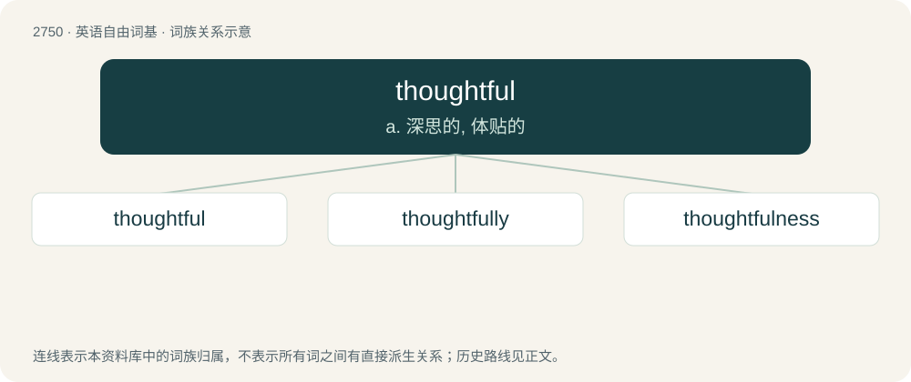

# 2852 · thoughtful — a. 深思的, 体贴的

[总目录](../00_总目录_按常用程度.md)

**类型**：英语自由词基　｜　**来源语言**：见词源记录

## 核心含义与来源

- 核心含义：a. 深思的, 体贴的
- 英文含义：Demonstrating thought or careful consideration.
- 词形：thoughtful

**来源记录 1**（形容词；Demonstrating thought or careful consideration.）

From Middle English thoȝtful, thohtful, equivalent to thought + -ful. Compare Dutch gedachtenvol, Swedish tankfull.

## 词族图

## 单词速览（常用到不常用）

| 单词 | 音标 | 释义 |
|---|---|---|
| [thoughtful](#w-1) | 英 /ˈθɔːtfəl/；/ˈfoːtfəl/ | a. 深思的, 体贴的 |
| [thoughtfully](#w-2) | 英 /ˈθɔːtfʊli/；美 /ˈθɔtfəli/ | adv. 沉思地；体贴地, 亲切地 |
| [thoughtfulness](#w-3) | 英 /ˈθɔːt.f(ə)l.nəs/；美 /ˈθɔt.f(ə)l.nəs/ | n. 体贴；思虑 |

## 逐词详解

### 1. thoughtful

**词性**：形容词　｜　**音标**：英 /ˈθɔːtfəl/；/ˈfoːtfəl/

**中文释义**：a. 深思的, 体贴的

**英文义项**：Demonstrating thought or careful consideration. / Demonstrating kindness or consideration for others.

**构词拆分**：thought + -ful

**词源与演化**：

From Middle English thoȝtful, thohtful, equivalent to thought + -ful. Compare Dutch gedachtenvol, Swedish tankfull.

**例句**：

> Preparing dinner is a thoughtful gesture for a new mother.

该用例对应义项：Demonstrating kindness or consideration for others.

### 2. thoughtfully

**词性**：副词　｜　**音标**：英 /ˈθɔːtfʊli/；美 /ˈθɔtfəli/

**中文释义**：adv. 沉思地；体贴地, 亲切地

**英文义项**：In a thoughtful or pensive manner. / In a way that shows kindness or consideration for others.

**构词拆分**：thoughtful + -ly

**词源与演化**：

From thoughtful + -ly.

**例句**：

> He stared thoughtfully out the window.

该用例对应义项：in a thoughtful manner

### 3. thoughtfulness

**词性**：名词　｜　**音标**：英 /ˈθɔːt.f(ə)l.nəs/；美 /ˈθɔt.f(ə)l.nəs/

**中文释义**：n. 体贴；思虑

**英文义项**：Thoughtful and considerate attention. / Careful deliberation before action.

**构词拆分**：thoughtful + -ness

**词源与演化**：

From thoughtful + -ness.
