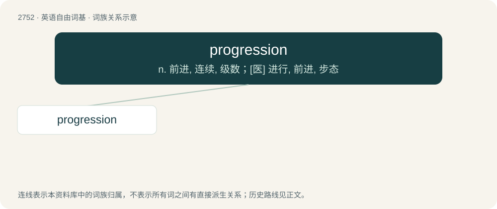

# 2858 · progression — n. 前进, 连续, 级数；\[医\] 进行, 前进, 步态

[总目录](../00_总目录_按常用程度.md)

**类型**：英语自由词基　｜　**来源语言**：见词源记录

## 核心含义与来源

- 核心含义：n. 前进, 连续, 级数；\[医\] 进行, 前进, 步态
- 英文含义：The act of moving from one thing to another.
- 词形：progression

**来源记录 1**（名词；The act of moving from one thing to another.）

From Middle English progressioun, from Old French progression and its etymon Latin prōgressiō. By surface analysis, progress + -ion.

## 词族图

## 单词速览（常用到不常用）

| 单词 | 音标 | 释义 |
|---|---|---|
| [progression](#w-1) | 英 /pɹəˈɡɹɛʃn̩/；美 /pɹəˈɡɹɛʃən/ | n. 前进, 连续, 级数；\[医\] 进行, 前进, 步态 |

## 逐词详解

### 1. progression

**词性**：名词　｜　**音标**：英 /pɹəˈɡɹɛʃn̩/；美 /pɹəˈɡɹɛʃən/

**中文释义**：n. 前进, 连续, 级数；\[医\] 进行, 前进, 步态

**英文义项**：The act of moving from one thing to another. / The act of moving forward or proceeding in a course; motion onward.

**词源与演化**：

From Middle English progressioun, from Old French progression and its etymon Latin prōgressiō. By surface analysis, progress + -ion.

**用法示例／搭配（非完整句）**：

> Make a natural progression from player to coach

该用例对应义项：The act of moving from one thing to another.
