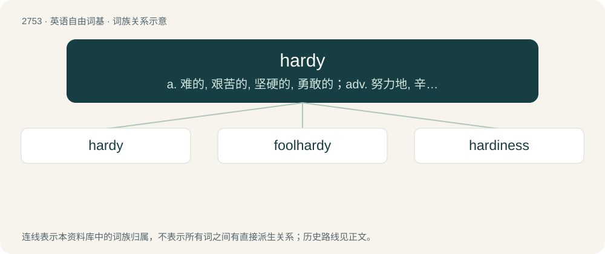

# 2860 · hardy — a. 难的, 艰苦的, 坚硬的, 勇敢的；adv. 努力地, 辛苦地, 坚硬地

[总目录](../00_总目录_按常用程度.md)

**类型**：英语自由词基　｜　**来源语言**：见词源记录

## 核心含义与来源

- 核心含义：a. 难的, 艰苦的, 坚硬的, 勇敢的；adv. 努力地, 辛苦地, 坚硬地
- 英文含义：Having rugged physical strength; inured to fatigue or hardships.
- 词形：hardy

**来源记录 1**（形容词；Having rugged physical strength; inured to fatigue or hardships.）

From Middle English hardy, hardi, from Old French hardi (“hardy, daring, stout, bold”). Old French hardi is usually regarded as the past participle of hardir ("to harden, be bold, make bold"; compare Occitan ardir, Italian ardire), from Frankish \*hardijan; but it may also have come directly from Frankish \*hardi, a secondary form of Frankish \*hard (compare Old High German harti, herti, secondary forms of Old High German hart (“hard”)); or even yet from Frankish \*hardig (compare Middle Low German herdich (“persevering”), Old Danish hærdig, Norwegian herdig, Swedish härdig (“vigorous, courageous”)). Cognate with hard. May have at some point also been surface analysed as hard + -y.

## 词族图

## 单词速览（常用到不常用）

| 单词 | 音标 | 释义 |
|---|---|---|
| [hardy](#w-1) | 英 /ˈhɑːdi/；美 /ˈhɑɹdi/ | a. 难的, 艰苦的, 坚硬的, 勇敢的；adv. 努力地, 辛苦地, 坚硬地 |
| [foolhardy](#w-2) | 英 /ˈfuːlhɑːdi/；美 /ˈfulˌhɑɹdi/ | a. 愚勇的, 有勇无谋的 |
| [hardiness](#w-3) | /ˈhɑːdinis/ | n. 强壮, 胆子, 勇气, 耐寒(性), 耐劳(性) |

## 逐词详解

### 1. hardy

**词性**：形容词　｜　**音标**：英 /ˈhɑːdi/；美 /ˈhɑɹdi/

**中文释义**：a. 难的, 艰苦的, 坚硬的, 勇敢的；adv. 努力地, 辛苦地, 坚硬地

**英文义项**：Having rugged physical strength; inured to fatigue or hardships. / Able to survive adverse growing conditions, especially frost.

**词源与演化**：

From Middle English hardy, hardi, from Old French hardi (“hardy, daring, stout, bold”). Old French hardi is usually regarded as the past participle of hardir ("to harden, be bold, make bold"; compare Occitan ardir, Italian ardire), from Frankish \*hardijan; but it may also have come directly from Frankish \*hardi, a secondary form of Frankish \*hard (compare Old High German harti, herti, secondary forms of Old High German hart (“hard”)); or even yet from Frankish \*hardig (compare Middle Low German herdich (“persevering”), Old Danish hærdig, Norwegian herdig, Swedish härdig (“vigorous, courageous”)). Cognate with hard. May have at some point also been surface analysed as hard + -y.

**例句**：

> A hardy plant is one that can withstand the extremes of climate, such as frost.

该用例对应义项：Able to survive adverse growing conditions, especially frost.

### 2. foolhardy

**词性**：形容词　｜　**音标**：英 /ˈfuːlhɑːdi/；美 /ˈfulˌhɑɹdi/

**中文释义**：a. 愚勇的, 有勇无谋的

**英文义项**：Marked by unthinking recklessness with disregard for danger; boldly rash; hotheaded.

**构词拆分**：fool + hardy

**词源与演化**：

From Middle English folehardy, foolhardi, folherdi, from Old French fol hardi (“foolishly bold”), from Old French fol (“foolish, silly; insane, mad”) (from Latin follis (“bellows; purse, sack; inflated ball; belly, paunch”), ultimately from Proto-Indo-European \*bʰelǵʰ- (“to swell”)) + Old French hardi (“durable, hardy, tough”) (past tense of hardir (“to harden”), from the unattested Frankish \*hartjan, from Proto-Germanic \*harduz (“hard; brave”)), equivalent to fool + hardy. Compare fool-bold, fool-large, etc.

**例句**：

> Foolhardy enough to try to seize the gun from the hijacker.

该用例对应义项：marked by defiant disregard for danger or consequences

### 3. hardiness

**词性**：名词　｜　**音标**：/ˈhɑːdinis/

**中文释义**：n. 强壮, 胆子, 勇气, 耐寒(性), 耐劳(性)

**英文义项**：The quality of being able to withstand fatigue and hardship; (of a plant) the quality of being resistant to cold or other environmental conditions.

**构词拆分**：hardy + -ness

**词源与演化**：

From Middle English hardynesse; equivalent to hardy + -ness.

**例句**：

> Kale is known for its winter-hardiness.

该用例对应义项：The quality of being able to withstand fatigue and hardship; (of a plant) the quality of being resistant to cold or other environmental conditions.
