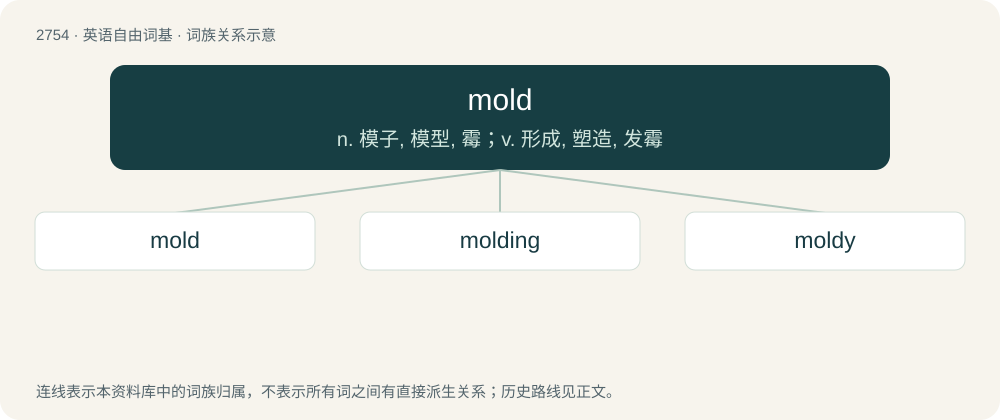

# 2861 · mold — n. 模子, 模型, 霉；v. 形成, 塑造, 发霉

[总目录](../00_总目录_按常用程度.md)

**类型**：英语自由词基　｜　**来源语言**：见词源记录

## 核心含义与来源

- 核心含义：n. 模子, 模型, 霉；v. 形成, 塑造, 发霉
- 英文含义：A hollow form or matrix for shaping a fluid or plastic substance.
- 词形：mold

**多个词源／构词路径**：同一拼写可能有不同来源；以下按词性和含义分别列出。

**来源记录 1**（名词；A hollow form or matrix for shaping a fluid or plastic substance.）

From Middle English molde (“mold, cast”), from Old French modle, mole, from Latin modulus, from Latin modus. Doublet of module, modulus, and model.

**来源记录 2**（名词；A natural substance in the form of a furry or woolly growth of tiny fungi that appears when organic material lies for a long time exposed to (usually warm and moist) air.）

From Middle English mowlde, noun use and alteration of mowled, past participle of mowlen, moulen (“to grow moldy”), from Old Norse mygla (compare dialectal Danish mugle), from Proto-Germanic \*muglōną, diminutive and denominative of \*mukiz 'soft substance' (compare Old Norse myki, mykr (“cow dung”)), from Proto-Indo-European \*mewk- (“slick, soft”). More at muck and meek.

**来源记录 3**（名词；Loose friable soil, rich in humus and fit for planting.）

From Middle English molde, from Old English molde, from Proto-Germanic \*muldō (“dirt, soil”) (compare Old Frisian molde, Middle Dutch moude, Dutch moude, obsolete German Molte, Norwegian Bokmål mold, and Gothic 𐌼𐌿𐌻𐌳𐌰 (mulda)), from Proto-Indo-European \*ml̥h₂-téh₂ (compare Ashkun mič, Kamkata-viri muři, mřey, mřëi, Prasuni mire, Waigali muk, all meaning "clay").

## 词族图

## 单词速览（常用到不常用）

| 单词 | 音标 | 释义 |
|---|---|---|
| [mold](#w-1) | 英 /məʊld/；美 /moʊld/ | n. 模子, 模型, 霉；v. 形成, 塑造, 发霉 |
| [molding](#w-2) | 英 /ˈməʊl.dɪŋ/；美 /ˈmoʊl.dɪŋ/ | n. 模制, 铸造物, 模制件, 浇铸；\[化\] 模塑; 模压 |
| [moldy](#w-3) | /ˈmoʊldi/ | a. 发霉的, 腐臭的 |

## 逐词详解

### 1. mold

**词性**：名词　｜　**音标**：英 /məʊld/；美 /moʊld/

**中文释义**：n. 模子, 模型, 霉；v. 形成, 塑造, 发霉

**英文义项**：A hollow form or matrix for shaping a fluid or plastic substance. / A frame or model around or on which something is formed or shaped.

**词源与演化**：

From Middle English molde (“mold, cast”), from Old French modle, mole, from Latin modulus, from Latin modus. Doublet of module, modulus, and model.

**例句**：

> His method of scientific investigation broke the mold and led to a new discovery.

该用例对应义项：A fixed or restrictive pattern or form.

### 2. molding

**词性**：名词　｜　**音标**：英 /ˈməʊl.dɪŋ/；美 /ˈmoʊl.dɪŋ/

**中文释义**：n. 模制, 铸造物, 模制件, 浇铸；\[化\] 模塑; 模压

**英文义项**：The act or process of shaping in or on a mold, or of making molds; the art or occupation of a molder. / Anything cast in a mold, or which appears to be so, as grooved or ornamental bars of wood or metal.

**构词拆分**：mold + -ing

**词源与演化**：

From Middle English moldynge; equivalent to mold + -ing.

**例句**：

> Instead of using standard injection molding to make products, the Carbon 3-D company uses light and oxygen to shape objects.

### 3. moldy

**词性**：形容词　｜　**音标**：/ˈmoʊldi/

**中文释义**：a. 发霉的, 腐臭的

**英文义项**：Covered with mold. / Stale or musty.

**构词拆分**：mold + -y

**词源与演化**：

From mold + -y.

**例句**：

> A moldy (or musty) odor.

该用例对应义项：covered with or smelling of mold
