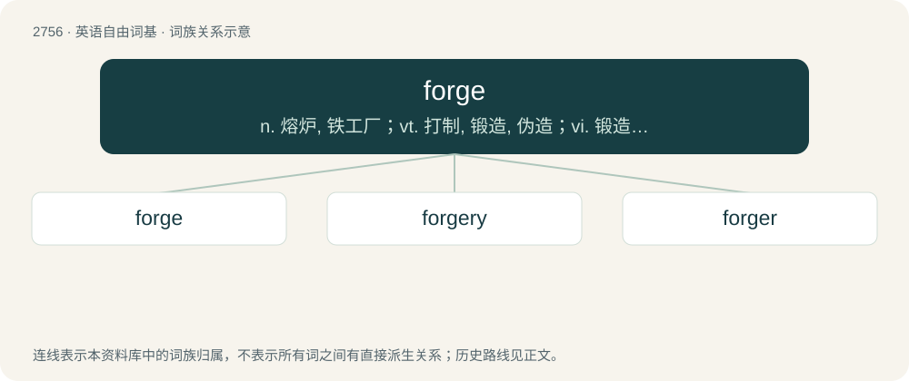

# 2862 · forge — n. 熔炉, 铁工厂；vt. 打制, 锻造, 伪造；vi. 锻造, 伪造

[总目录](../00_总目录_按常用程度.md)

**类型**：英语自由词基　｜　**来源语言**：见词源记录

## 核心含义与来源

- 核心含义：n. 熔炉, 铁工厂；vt. 打制, 锻造, 伪造；vi. 锻造, 伪造
- 英文含义：A furnace or hearth where metals are heated prior to hammering them into shape.
- 词形：forge

**多个词源／构词路径**：同一拼写可能有不同来源；以下按词性和含义分别列出。

**来源记录 1**（名词；A furnace or hearth where metals are heated prior to hammering them into shape.）

From Middle English forge, from Old French forge, early Old French faverge, from Latin fabrica (“workshop”), from faber (“workman in hard materials, smith”) (genitive fabri). Cognate with Franco-Provençal favèrge. Doublet of fabric and fabrica. Partially displaced English smithy. \* Computing sense perhaps derived from the early SourceForge service, launched in 1999.

**来源记录 2**（动词；To shape a metal by heating and hammering.）

From Middle English forgen, from Anglo-Norman forger and Old French forgier, from Latin fabrico (“to frame, construct, build”). Doublet of fabricate.

**来源记录 3**（动词；To move forward slowly (originally as a ship); to advance gradually but steadily, especially in the face of resistance or difficulty.）

Make way, move ahead, most likely an alteration of force, but perhaps from forge (n.), via notion of steady hammering at something. Originally nautical, in reference to vessels.

## 词族图

## 单词速览（常用到不常用）

| 单词 | 音标 | 释义 |
|---|---|---|
| [forge](#w-1) | 英 /fɔːd͡ʒ/；美 /fɔɹd͡ʒ/ | n. 熔炉, 铁工厂；vt. 打制, 锻造, 伪造；vi. 锻造, 伪造 |
| [forgery](#w-2) | 英 /ˈfɔː.dʒəɹ.ɪ/；美 /ˈfɔːɹ.d͡ʒəɹ.ɪ/ | n. 伪造, 伪造罪, 伪造物；\[经\] 伪造签字, 伪造品 |
| [forger](#w-3) | /ˈfɒːdʒə/ | n. 铁匠, 伪造者, 赝造者；\[法\] 伪造者, 伪造犯 |

## 逐词详解

### 1. forge

**词性**：名词　｜　**音标**：英 /fɔːd͡ʒ/；美 /fɔɹd͡ʒ/

**中文释义**：n. 熔炉, 铁工厂；vt. 打制, 锻造, 伪造；vi. 锻造, 伪造

**英文义项**：A furnace or hearth where metals are heated prior to hammering them into shape. / A workshop in which metals are shaped by heating and hammering them.

**词源与演化**：

From Middle English forge, from Old French forge, early Old French faverge, from Latin fabrica (“workshop”), from faber (“workman in hard materials, smith”) (genitive fabri). Cognate with Franco-Provençal favèrge. Doublet of fabric and fabrica. Partially displaced English smithy. \* Computing sense perhaps derived from the early SourceForge service, launched in 1999.

**例句**：

> The snow was piling up, but we decided to forge ahead anyway.

### 2. forgery

**词性**：名词　｜　**音标**：英 /ˈfɔː.dʒəɹ.ɪ/；美 /ˈfɔːɹ.d͡ʒəɹ.ɪ/

**中文释义**：n. 伪造, 伪造罪, 伪造物；\[经\] 伪造签字, 伪造品

**英文义项**：The act of forging metal into shape. / The act of forging, fabricating, or producing falsely; especially the crime of fraudulently making or altering a writing or signature purporting to be made by another, the false making or material alteration of or addition to a written instrument for the purpose of deceit and fraud.

**构词拆分**：forge + -ery

**词源与演化**：

Recorded since 1574; from forge + -ery, from Middle English forgen, via Anglo-Norman forger, from Old French forgier, from Latin fabricārī (“to frame, construct, fabricate”), itself from fabrica (“workshop; construction”), from faber (“workman, smith”). (fake): Compare typologically Russian кова́рный (kovárnyj), кова́рство (kovárstvo), ко́зни (kózni) (akin to кова́ть (kovátʹ), ку́зница (kúznica)).

**用法示例／搭配（非完整句）**：

> the forgery of horseshoes

该用例对应义项：The act of forging metal into shape.

### 3. forger

**词性**：名词　｜　**音标**：/ˈfɒːdʒə/

**中文释义**：n. 铁匠, 伪造者, 赝造者；\[法\] 伪造者, 伪造犯

**英文义项**：A person who creates forgeries, falsifies documents with intent to defraud, e.g. to create a false will or illicit copies of currency; counterfeiter. / A person who forges metals.

**构词拆分**：forge + -er

**词源与演化**：

From Middle English forger, forgere, from Old French forgiere; equivalent to forge + -er.

**例句**：

> The sudden outflow of counterfeit notes from the bank alerted investigators to an expert forger on the inside.
