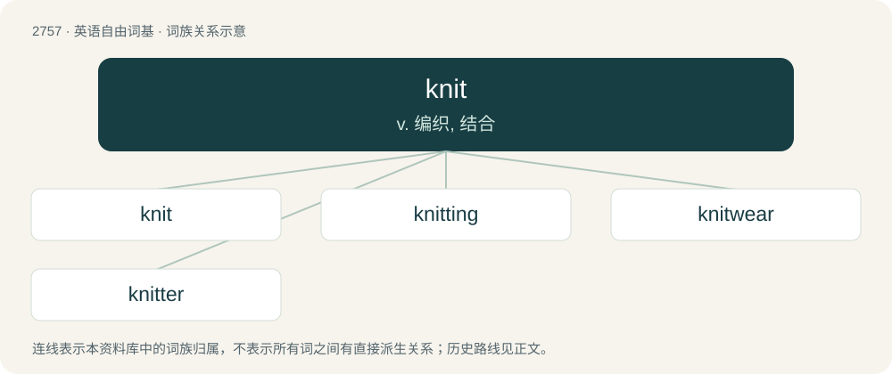

# 2863 · knit — v. 编织, 结合

[总目录](../00_总目录_按常用程度.md)

**类型**：英语自由词基　｜　**来源语言**：见词源记录

## 核心含义与来源

- 核心含义：v. 编织, 结合
- 英文含义：To turn thread or yarn into a piece of fabric by forming loops that are pulled through each other. This can be done by hand with needles or by machine.
- 词形：knit

**来源记录 1**（动词；To turn thread or yarn into a piece of fabric by forming loops that are pulled through each other. This can be done by hand with needles or by machine.）

Inherited from Middle English knytten, from Old English cnyttan, from Proto-West Germanic \*knuttijan, from Proto-Germanic \*knuttijaną, from \*knuttô + \*-janą. Cognate with Low German knütten and Old Norse knýta (whence Danish knytte, Norwegian Nynorsk knyta). More at knot.

## 词族图

## 单词速览（常用到不常用）

| 单词 | 音标 | 释义 |
|---|---|---|
| [knit](#w-1) | 英 /nɪt/ | v. 编织, 结合 |
| [knitting](#w-2) | /ˈnɪtɪŋ/ | n. 编结, 针织法, 针织, 编结法, 编结物, 针织品；\[医\] 骨愈合 |
| [knitwear](#w-3) | /ˈnit,weə/ | n. 针织品 |
| [knitter](#w-4) | 美 /ˈnɪtɚ/ | n. 编结者, 编织工人, 编织机, 针织机；\[化\] 编织机 |

## 逐词详解

### 1. knit

**词性**：动词　｜　**音标**：英 /nɪt/

**中文释义**：v. 编织, 结合

**英文义项**：To turn thread or yarn into a piece of fabric by forming loops that are pulled through each other. This can be done by hand with needles or by machine. / To create a stitch by pulling the working yarn through an existing stitch from back to front.

**词源与演化**：

Inherited from Middle English knytten, from Old English cnyttan, from Proto-West Germanic \*knuttijan, from Proto-Germanic \*knuttijaną, from \*knuttô + \*-janą. Cognate with Low German knütten and Old Norse knýta (whence Danish knytte, Norwegian Nynorsk knyta). More at knot.

**例句**：

> The first generation knitted to order; the second still knits for its own use; the next leaves knitting to industrial manufacturers.

该用例对应义项：To turn thread or yarn into a piece of fabric by forming loops that are pulled through each other. This can be done by hand with needles or by machine.

### 2. knitting

**词性**：名词　｜　**音标**：/ˈnɪtɪŋ/

**中文释义**：n. 编结, 针织法, 针织, 编结法, 编结物, 针织品；\[医\] 骨愈合

**英文义项**：The action of the verb to knit; the process of producing knitted material. / Material that has been, or is being knitted.

**构词拆分**：knit + -ing

**词源与演化**：

From Middle English knyttynge; equivalent to knit + -ing.

**例句**：

> She put down her knitting and went to answer the phone.

该用例对应义项：Material that has been, or is being knitted.

### 3. knitwear

**词性**：名词　｜　**音标**：/ˈnit,weə/

**中文释义**：n. 针织品

**英文义项**：knitted garments

**构词拆分**：knit + -wear

**词源与演化**：

From knit + -wear.

**例句**：

> Fashion company Betabrand saw that knitwear was a hot style in sneakers and wanted to quickly jump on the trend.

### 4. knitter

**词性**：名词　｜　**音标**：美 /ˈnɪtɚ/

**中文释义**：n. 编结者, 编织工人, 编织机, 针织机；\[化\] 编织机

**英文义项**：A person or a machine that knits.

**构词拆分**：knit + -er

**词源与演化**：

From Middle English knytter, knettere, equivalent to knit + -er.
