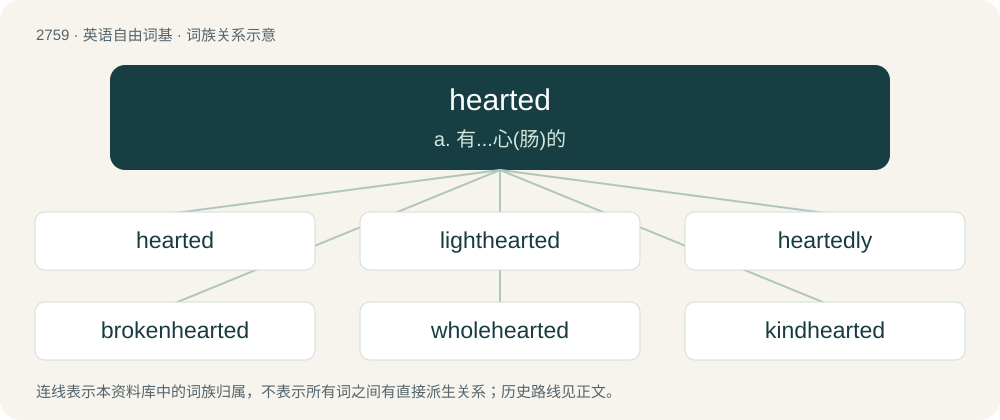

# 2864 · hearted — a. 有...心(肠)的

[总目录](../00_总目录_按常用程度.md)

**类型**：英语自由词基　｜　**来源语言**：见词源记录

## 核心含义与来源

- 核心含义：a. 有...心(肠)的
- 英文含义：Having a specified kind or number of heart.
- 词形：hearted

**来源记录 1**（形容词；Having a specified kind or number of heart.）

From Middle English herted, hertid; equivalent to heart + -ed.

## 词族图

## 单词速览（常用到不常用）

| 单词 | 音标 | 释义 |
|---|---|---|
| [hearted](#w-1) | 英 /ˈhɑːtɪd/；美 /ˈhɑɹtɪd/ | a. 有...心(肠)的 |
| [lighthearted](#w-2) | /ˈlaitˈhɑːtid/ | a. 快乐的, 心情愉快的；无忧无虑的 |
| [heartedly](#w-3) | /ˈhɑːɹ.təd.li/ | 放在心上的, 铭记在心的 |
| [brokenhearted](#w-4) | /ˈbrəukənˈhɑːtid/ | a. 没有精神的, 灰心的, 心碎的 |
| [wholehearted](#w-5) | 英 /ˌhəʊlˈhɑː(ɹ)t.əd/ | a. 一心一意的, 诚恳的 |
| [kindhearted](#w-6) | /ˈkaindˈhɑːtid/ | a. 亲切的, 好心肠的, 仁慈的 |
| [heartedness](#w-7) | /ˈhɑːɹ.təd.nəs/ | n. hearted（放在心上的, 铭记在心的）的变形 |

## 逐词详解

### 1. hearted

**词性**：形容词　｜　**音标**：英 /ˈhɑːtɪd/；美 /ˈhɑɹtɪd/

**中文释义**：a. 有...心(肠)的

**英文义项**：Having a specified kind or number of heart. / Seated or fixed in the heart.

**构词拆分**：heart + -ed

**词源与演化**：

From Middle English herted, hertid; equivalent to heart + -ed.

**用法示例／搭配（非完整句）**：

> a hard-hearted woman

该用例对应义项：Having a specified kind or number of heart.

### 2. lighthearted

**词性**：形容词　｜　**音标**：/ˈlaitˈhɑːtid/

**中文释义**：a. 快乐的, 心情愉快的；无忧无虑的

**英文义项**：Joyful, glad, taking pleasure in being alive; not depressed or sad. / Enjoyably lacking of seriousness, not grave.

**构词拆分**：light + hearted

**词源与演化**：

From Middle English lyght hertyd, liȝt-hertid, from light (adjective) + herted, hertid (“having a disposition”, adjective) (equivalent to light + hearted), from the noun herte. See more at light, heart, -ed.

**例句**：

> His lighthearted banjo performance was appreciated because it relieved the tension in tight situations.

该用例对应义项：Enjoyably lacking of seriousness, not grave.

### 3. heartedly

**词性**：副词　｜　**音标**：/ˈhɑːɹ.təd.li/

**中文释义**：放在心上的, 铭记在心的

**英文义项**：In a hearted manner.

**构词拆分**：hearted + -ly

**词源与演化**：

From hearted + -ly.

### 4. brokenhearted

**词性**：形容词　｜　**音标**：/ˈbrəukənˈhɑːtid/

**中文释义**：a. 没有精神的, 灰心的, 心碎的

**英文义项**：Grieved and disappointed, especially by the loss of a beloved person or thing, such as the end of a romantic relationship.

**构词拆分**：broken + hearted

**词源与演化**：

From broken + hearted.

### 5. wholehearted

**词性**：形容词　｜　**音标**：英 /ˌhəʊlˈhɑː(ɹ)t.əd/

**中文释义**：a. 一心一意的, 诚恳的

**英文义项**：Showing enthusiastic and unconditional commitment; having no reservations.

**构词拆分**：whole + hearted

**词源与演化**：

From whole + hearted. First appears before 1628 in the publications of John Preston, a clergyman in the Church of England.

**例句**：

> Gave wholehearted support to her candidacy.

该用例对应义项：with unconditional and enthusiastic devotion

### 6. kindhearted

**词性**：形容词　｜　**音标**：/ˈkaindˈhɑːtid/

**中文释义**：a. 亲切的, 好心肠的, 仁慈的

**英文义项**：Having an innately kind disposition or character.

**构词拆分**：kind + hearted

**词源与演化**：

From kind + hearted.

**例句**：

> A generous and kindhearted teacher.

该用例对应义项：having or proceeding from an innately kind disposition

### 7. heartedness

**词性**：名词　｜　**音标**：/ˈhɑːɹ.təd.nəs/

**中文释义**：n. hearted（放在心上的, 铭记在心的）的变形

**英文义项**：The state or quality of being hearted. / The result or product of being hearted.

**构词拆分**：hearted + -ness

**词源与演化**：

From hearted + -ness.

**例句**：

> Do not profit from the good heartedness of others.
