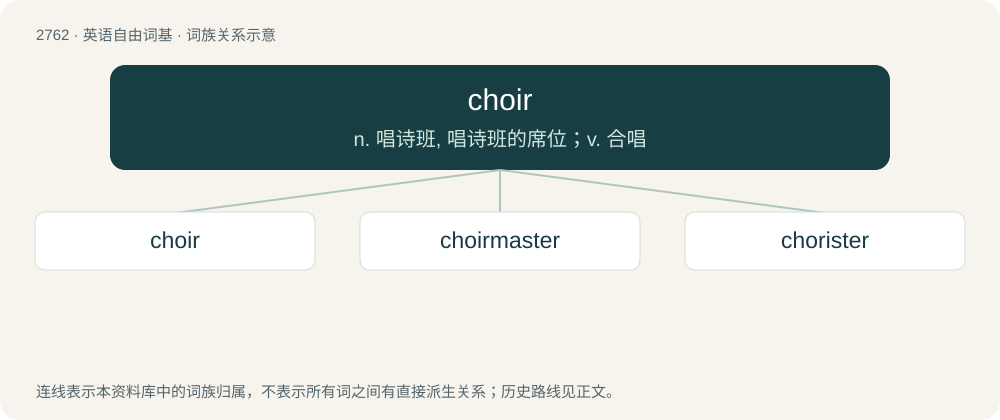

# 2866 · choir — n. 唱诗班, 唱诗班的席位；v. 合唱

[总目录](../00_总目录_按常用程度.md)

**类型**：英语自由词基　｜　**来源语言**：见词源记录

## 核心含义与来源

- 核心含义：n. 唱诗班, 唱诗班的席位；v. 合唱
- 英文含义：A group of people who sing together; a company of people who are trained to sing together.
- 词形：choir

**来源记录 1**（名词；A group of people who sing together; a company of people who are trained to sing together.）

From Middle English quer, quere, from Old French quer, from Latin chorus, from Ancient Greek χορός (khorós, “company of dancers or singers”). Modern spelling influenced by chorus and French chœur. Doublet of quire, chorus, and hora. Displaced native Old English hād.

## 词族图

## 单词速览（常用到不常用）

| 单词 | 音标 | 释义 |
|---|---|---|
| [choir](#w-1) | 英 /kwaɪə(ɹ)/；美 /kwaɪɚ/ | n. 唱诗班, 唱诗班的席位；v. 合唱 |
| [choirmaster](#w-2) | /ˈkwaiəmɑːstə/ | n. 唱诗班指挥 |
| [chorister](#w-3) | 英 /ˈkɒɹɪstə(ɹ)/；美 /ˈkɔɹɪstɚ/ | n. 唱诗班男童歌手, 唱诗队领队 |

## 逐词详解

### 1. choir

**词性**：名词　｜　**音标**：英 /kwaɪə(ɹ)/；美 /kwaɪɚ/

**中文释义**：n. 唱诗班, 唱诗班的席位；v. 合唱

**英文义项**：A group of people who sing together; a company of people who are trained to sing together. / One quarter of a cruciform church, or the architectural area of a church, generally used by the choir; often near the apse.

**词源与演化**：

From Middle English quer, quere, from Old French quer, from Latin chorus, from Ancient Greek χορός (khorós, “company of dancers or singers”). Modern spelling influenced by chorus and French chœur. Doublet of quire, chorus, and hora. Displaced native Old English hād.

**例句**：

> Seraphim, Cherubim, and Thrones are three of the choirs of angels.

该用例对应义项：One of the nine ranks or orders of angels.

### 2. choirmaster

**词性**：名词　｜　**音标**：/ˈkwaiəmɑːstə/

**中文释义**：n. 唱诗班指挥

**英文义项**：The musical director of a choir, who conducts performances and supervises rehearsal.

**构词拆分**：choir + master

**词源与演化**：

From choir + master, a calque of German Chormeister. Piecewise doublet of chorusmaster.

### 3. chorister

**词性**：名词　｜　**音标**：英 /ˈkɒɹɪstə(ɹ)/；美 /ˈkɔɹɪstɚ/

**中文释义**：n. 唱诗班男童歌手, 唱诗队领队

**英文义项**：A singer in a choir; especially a child in a church or cathedral choir. / A director or leader of a choral group.

**构词拆分**：choir + -ster

**词源与演化**：

Derived from late Middle English queristre, from an Anglo-Norman variant of Old French cueriste, from cuer (see Middle French cuer). Equivalent to choir + -ster.

**例句**：

> Jane was the chorister of her congregation's choir, and that occupied much of her time on the weekends.

该用例对应义项：A director or leader of a choral group.
