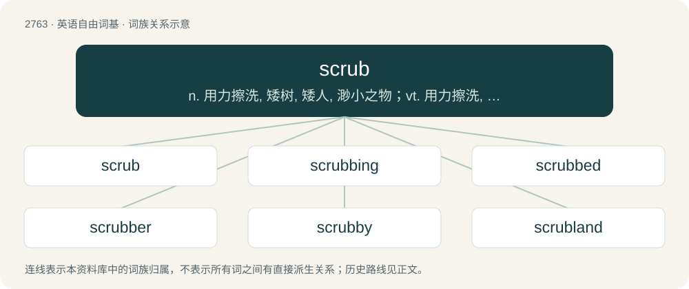

# 2867 · scrub — n. 用力擦洗, 矮树, 矮人, 渺小之物；vt. 用力擦洗, 擦掉, 摩擦；vi. 擦洗干净, 进行手臂消毒

[总目录](../00_总目录_按常用程度.md)

**类型**：英语自由词基　｜　**来源语言**：见词源记录

## 核心含义与来源

- 核心含义：n. 用力擦洗, 矮树, 矮人, 渺小之物；vt. 用力擦洗, 擦掉, 摩擦；vi. 擦洗干净, 进行手臂消毒
- 英文含义：A thicket or jungle, often specified by the name of the prevailing plant.
- 词形：scrub

**多个词源／构词路径**：同一拼写可能有不同来源；以下按词性和含义分别列出。

**来源记录 1**（名词；A thicket or jungle, often specified by the name of the prevailing plant.）

Late Middle English shrobbe in the sense of "stunted tree," a variant of shrub, from Old English scrybb. Doublet of shrub.

**来源记录 2**（动词；To rub hard; to wash with rubbing; usually, to rub with a wet brush, sponge or with something coarse or rough, for the purpose of cleaning or brightening.）

From Middle English scrobben (“groom a horse with a currycomb”); from Middle Dutch schrobben (“clean by scrubbing”).

## 词族图

## 单词速览（常用到不常用）

| 单词 | 音标 | 释义 |
|---|---|---|
| [scrub](#w-1) | /skɹʌb/ | n. 用力擦洗, 矮树, 矮人, 渺小之物；vt. 用力擦洗, 擦掉, 摩擦；vi. 擦洗干净, 进行手臂消毒 |
| [scrubbing](#w-2) |  | \[化\] 洗涤 |
| [scrubbed](#w-3) | /skˈrʌbd/ | v. 用力擦洗, 刷洗( scrub的过去式和过去分词 ); 取消（原有安排）; 对…不予考虑, 取消 |
| [scrubber](#w-4) | 英 /ˈskɹʌbə/；美 /ˈskɹʌbɚ/ | \[化\] 涤气器; 洗涤器; 洗涤塔; 擦洗粉；\[医\] 洗涤器, 洗氧器, 清洁工 |
| [scrubby](#w-5) | /ˈskɹʌbi/ | a. 个子矮的, 矮小的, 灌木丛生的, 多短硬毛的 |
| [scrubland](#w-6) | /ˈskrʌblænd/ | n. 灌木丛林地 |

## 逐词详解

### 1. scrub

**词性**：名词　｜　**音标**：/skɹʌb/

**中文释义**：n. 用力擦洗, 矮树, 矮人, 渺小之物；vt. 用力擦洗, 擦掉, 摩擦；vi. 擦洗干净, 进行手臂消毒

**英文义项**：A thicket or jungle, often specified by the name of the prevailing plant. / Vegetation judged to be of inferior quality or of little use to humans, though sometimes thick and impenetrable, growing in poor soil or in sand; also, brush.

**词源与演化**：

Late Middle English shrobbe in the sense of "stunted tree," a variant of shrub, from Old English scrybb. Doublet of shrub.

**例句**：

> Wow, she really scored 0? What a scrub!

该用例对应义项：One who is incompetent or unable to complete easy tasks.

### 2. scrubbing

**词性**：名词

**中文释义**：\[化\] 洗涤

**英文义项**：An act of scrubbing. / An act of cleaning in which something is scrubbed.

**构词拆分**：From scrub + -ing.

**词源与演化**：

From scrub + -ing.

**例句**：

> Avoid using excessive force when scrubbing the stovetop; it can cause damage.

### 3. scrubbed

**词性**：形容词　｜　**音标**：/skˈrʌbd/

**中文释义**：v. 用力擦洗, 刷洗( scrub的过去式和过去分词 ); 取消（原有安排）; 对…不予考虑, 取消

**英文义项**：Dwarfed or stunted; scrubby. / Having been scrubbed; having received a scrubbing.

**构词拆分**：From scrub + -ed.

**词源与演化**：

From scrub + -ed.

**例句**：

> He looked better than usual, reasonably scrubbed, but he still needed a better wardrobe.

该用例对应义项：Synonym of scrubbed up (Cleaned up; dressed up; having been made smart).

### 4. scrubber

**词性**：名词　｜　**音标**：英 /ˈskɹʌbə/；美 /ˈskɹʌbɚ/

**中文释义**：\[化\] 涤气器; 洗涤器; 洗涤塔; 擦洗粉；\[医\] 洗涤器, 洗氧器, 清洁工

**英文义项**：A person or appliance that cleans floors or similar by scrubbing. / A soft and flexible handheld polymer-fiber implement for scrubbing tasks.

**构词拆分**：From scrub + -er.

**词源与演化**：

From scrub + -er.

**例句**：

> Use a gentle scrubber or sponge to clean utensils, avoiding abrasive materials.

### 5. scrubby

**词性**：形容词　｜　**音标**：/ˈskɹʌbi/

**中文释义**：a. 个子矮的, 矮小的, 灌木丛生的, 多短硬毛的

**英文义项**：Covered with or consisting of scrub. / Inferior in size or quality.

**构词拆分**：From scrub + -y.

**词源与演化**：

From scrub + -y.

**用法示例／搭配（非完整句）**：

> a scrubby landscape

该用例对应义项：Covered with or consisting of scrub.

### 6. scrubland

**词性**：名词　｜　**音标**：/ˈskrʌblænd/

**中文释义**：n. 灌木丛林地

**英文义项**：A plant community characterized by scrub vegetation, consisting of low shrubs, mixed with grasses, herbs, and geophytes.

**构词拆分**：scrub + land

**词源与演化**：

From scrub + land.

**例句**：

> The scrubland I'd be crossing looked desolate, but at least it wasn't a desert.

该用例对应义项：A plant community characterized by scrub vegetation, consisting of low shrubs, mixed with grasses, herbs, and geophytes.
