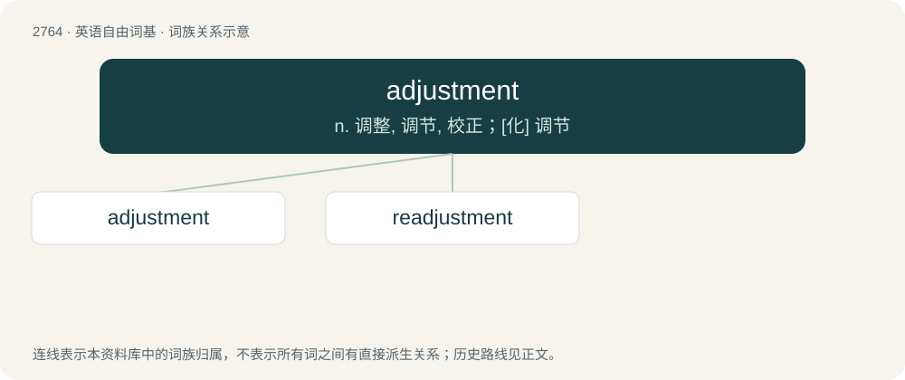

# 2868 · adjustment — n. 调整, 调节, 校正；\[化\] 调节

[总目录](../00_总目录_按常用程度.md)

**类型**：英语自由词基　｜　**来源语言**：见词源记录

## 核心含义与来源

- 核心含义：n. 调整, 调节, 校正；\[化\] 调节
- 英文含义：The action of adjusting something.
- 词形：adjustment

**来源记录 1**（名词；The action of adjusting something.）

From French ajustement, or else adjust + -ment.

## 词族图

## 单词速览（常用到不常用）

| 单词 | 音标 | 释义 |
|---|---|---|
| [adjustment](#w-1) | 英 /əˈd͡ʒʌst.mənt/ | n. 调整, 调节, 校正；\[化\] 调节 |
| [readjustment](#w-2) | /riːəˈdʒʌstmənt/ | n. 再整理, (使)重新进入正常状态/正常位置, 再调整, (使)重新适应；\[化\] 重调; 重新调整 |

## 逐词详解

### 1. adjustment

**词性**：名词　｜　**音标**：英 /əˈd͡ʒʌst.mənt/

**中文释义**：n. 调整, 调节, 校正；\[化\] 调节

**英文义项**：The action of adjusting something. / The result of adjusting something; a small change; a minor correction; a modification or alteration.

**构词拆分**：adjust + -ment

**词源与演化**：

From French ajustement, or else adjust + -ment.

**例句**：

> The credit card company made an adjustment to my account to waive the late fee.

该用例对应义项：The settling or balancing of a financial account.

### 2. readjustment

**词性**：名词　｜　**音标**：/riːəˈdʒʌstmənt/

**中文释义**：n. 再整理, (使)重新进入正常状态/正常位置, 再调整, (使)重新适应；\[化\] 重调; 重新调整

**英文义项**：A second or subsequent adjustment.

**构词拆分**：re- + adjustment

**词源与演化**：

From re- + adjustment.
