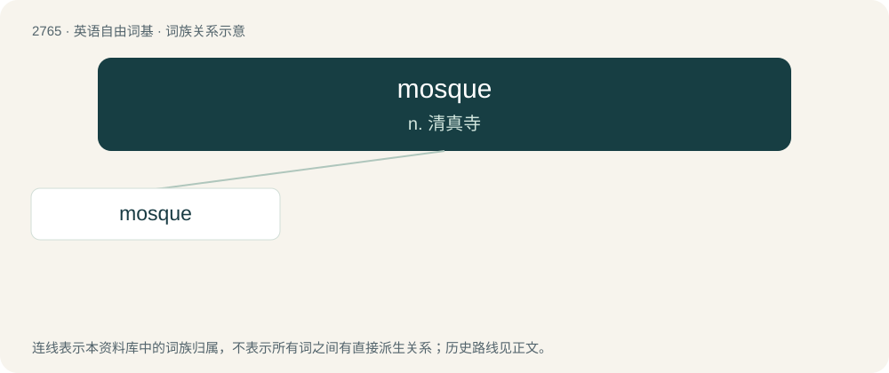

# 2869 · mosque — n. 清真寺

[总目录](../00_总目录_按常用程度.md)

**类型**：英语自由词基　｜　**来源语言**：见词源记录

## 核心含义与来源

- 核心含义：n. 清真寺
- 英文含义：A place of worship for Muslims, often having at least one minaret; a masjid.
- 词形：mosque

**来源记录 1**（名词；A place of worship for Muslims, often having at least one minaret; a masjid.）

From Middle French mosquée, from Italian moschea, ultimately from Arabic مَسْجِد (masjid, literally “place of prostration”). Doublet of masjid.

## 词族图

## 单词速览（常用到不常用）

| 单词 | 音标 | 释义 |
|---|---|---|
| [mosque](#w-1) | 英 /mɒsk/；美 /mɑsk/ | n. 清真寺 |

## 逐词详解

### 1. mosque

**词性**：名词　｜　**音标**：英 /mɒsk/；美 /mɑsk/

**中文释义**：n. 清真寺

**英文义项**：A place of worship for Muslims, often having at least one minaret; a masjid.

**词源与演化**：

From Middle French mosquée, from Italian moschea, ultimately from Arabic مَسْجِد (masjid, literally “place of prostration”). Doublet of masjid.

**例句**：

> There's a mosque near where I live.

该用例对应义项：A place of worship for Muslims, often having at least one minaret; a masjid.
