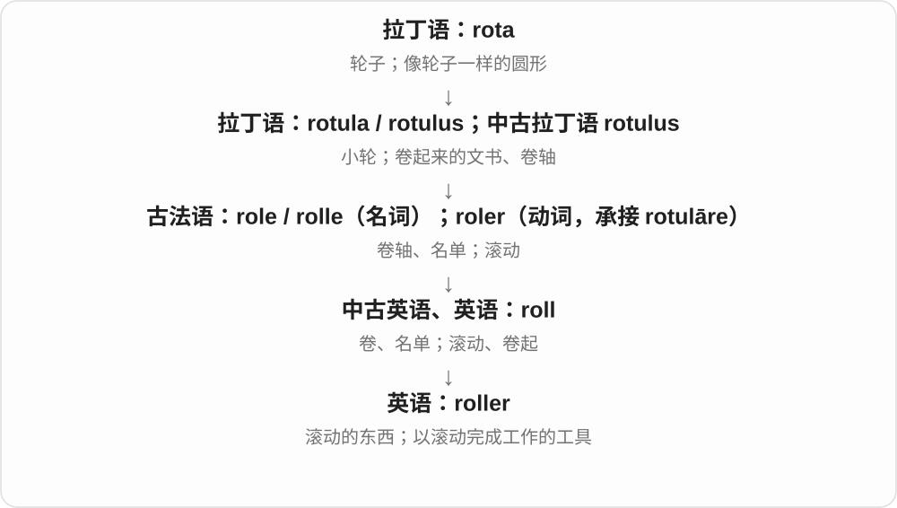

# 2870 · roller — 滚动动作的器具名，复合词再指定部件与用途

[逐词精讲目录](../00_逐词精讲目录.md) · [总目录](../00_总目录_按常用程度.md)

## 核心词根与来源

滚筒可以压、涂或支撑，走珠笔靠小球滚动带墨，压路机靠重滚筒压平。-er 常是工具，不必是一个滚来滚去的人。

**ROLLER：什么在滚、靠滚做什么，前后项给出答案**

roller → rollerball、steamroller。

- **滚动工具与复合用途**：roller · rollerball · steamroller

## 词形与演化规律

roll + -er → roller；roller + ball；steam + roller 的历史机械名称。

## 单词速览（按词族由简到繁）

同一基础词的相关扩展放在一起，先读基础形式，再读扩展；各组之间优先读常用的。具体词源关系见各词讲解。

| 单词 | 音标 | 核心意思 |
|---|---|---|
| [roller](#w-1) | 英 /ˈrəʊlə/；美 /ˈroʊlər/ | 滚轮；滚筒；滚刷；卷发筒 |
| [rollerball](#w-3) | 英 /ˈrəʊləbɔːl/；美 /ˈroʊlərbɔːl/ | 水性走珠笔、滚珠笔；轨迹球 |
| [steamroller](#w-2) | 英 /ˈstiːmrəʊlə/；美 /ˈstiːmroʊlər/ | 压路机；势不可挡的力量；强行压过、推行 |

## 逐词讲解

### 1. roller — 滚轮；滚筒；滚刷；卷发筒

**音标**：英 /ˈrəʊlə/；美 /ˈroʊlər/

**先抓住这个画面**

roller 是用滚动来完成工作的东西：圆筒滚过墙面涂漆，滚过地面压平，或让纸张顺着机器前进。

**怎么拆**

roll + -er，中古英语已有 rollere 形式。

**怎么变成今天的意思**

意思很依赖对象。paint roller 是滚刷；hair rollers 是卷发筒；机器里的 rollers 是滚筒或滚轮。

**常见搭配与例句**

a paint roller；hair rollers；a conveyor roller。

> Use a roller to paint the large wall.

用滚刷给这面大墙刷漆。

> The paper passes between two rubber rollers.

纸张从两个橡胶滚筒之间通过。

**别混淆**

wheel 多强调轮子支撑移动；roller 常强调圆筒或滚轮与表面接触、压过或带动物料。

### 2. rollerball — 水性走珠笔、滚珠笔；轨迹球

**音标**：英 /ˈrəʊləbɔːl/；美 /ˈroʊlərbɔːl/

**先抓住这个画面**

笔尖小圆珠边滚边把墨带到纸上，roller + ball 直接给出滚动小球的画面。常用笔名特别指水性液体等墨水的这类笔。

**怎么拆**

roller 滚动部件 + ball 球，现代复合词；电脑输入设备中也可指供滚动定位的轨迹球。

**怎么变成今天的意思**

**roll 滚动 → roller**  
滚动者、滚筒或滚动器具

↓

**roller + ball → rollerball**  
用滚动圆珠供墨的笔；也有轨迹球设备义

a rollerball pen 走珠笔，rollerball ink 水性等走珠墨水。

**常见搭配与例句**

a rollerball pen；a rollerball refill。

> She signed the card with a rollerball pen.

她用走珠笔在卡片上签了名。

> The shop sells rollerball refills.

店里出售走珠笔替芯。

**别混淆**

rollerball 与普通 ballpoint 都用圆珠，但常见命名按墨水类型区分；具体产品结构、配方仍看实际型号。

### 3. steamroller — 压路机；势不可挡的力量；强行压过、推行

**音标**：英 /ˈstiːmrəʊlə/；美 /ˈstiːmroʊlər/

**先抓住这个画面**

大滚筒把路面压平，借到会议和政治里，就是不理会阻力，硬把意见、方案压过去。

**怎么拆**

steam 蒸汽 + roller 滚压装置，早期机器由蒸汽驱动；现代口语可泛称其他动力压路机，名字保留旧动力。

**怎么变成今天的意思**

**古英语 stēam 等 → 中古英语 steem → steam**  
热气、蒸气、气味等旧用法

↓

**水蒸气及动力扩展**  
蒸食物、熨烫；蒸汽机、蒸汽船

↓

**steam + roller → steamroller**  
原先蒸汽驱动的滚压设备

↓

**机器力量的比喻**  
压过反对、强行推进

a steamroller on the road 路上压路机，steamroller opposition 压过反对意见，steamroller a proposal through 强行推动提案通过。

**常见搭配与例句**

a steamroller；steamroller opposition；steamroller something through。

> A steamroller flattened the new road surface.

压路机压平了新路面。

> The chair tried to steamroller the proposal through the meeting.

主持人试图在会上强行推动提案通过。

**别混淆**

steamroller 可名词也可动词；steamroller a decision 强行推过，不是说决定真的被碾碎成废案。

## 这一组要分清什么

rollerball 常按笔的供墨类型命名；steamroller 的现代日常用法不保证机器仍用蒸汽。

## 串起来练习

The rollerball’s tiny ball rolls, while a steamroller uses a much larger roller.

走珠笔的小球在滚，压路机则使用大得多的滚筒。
