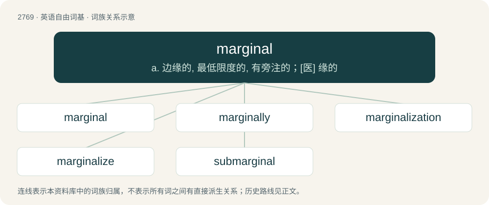

# 2871 · marginal — a. 边缘的, 最低限度的, 有旁注的；\[医\] 缘的

[总目录](../00_总目录_按常用程度.md)

**类型**：英语自由词基　｜　**来源语言**：见词源记录

## 核心含义与来源

- 核心含义：a. 边缘的, 最低限度的, 有旁注的；\[医\] 缘的
- 英文含义：Of, relating to, or located at or near a margin or edge; also figurative usages of location and margin (edge).
- 词形：marginal

**来源记录 1**（形容词；Of, relating to, or located at or near a margin or edge; also figurative usages of location and margin (edge).）

Learned borrowing from Medieval Latin marginālis, equivalent to margin + -al.

## 词族图

## 单词速览（常用到不常用）

| 单词 | 音标 | 释义 |
|---|---|---|
| [marginal](#w-1) | 英 /ˈmɑː.d͡ʒɪ.nəl/；美 /ˈmɑɹ.d͡ʒɪ.nəl/ | a. 边缘的, 最低限度的, 有旁注的；\[医\] 缘的 |
| [marginally](#w-2) | 英 /ˈmɑːd͡ʒɪnəli/；美 /ˈmɑɹd͡ʒɪnəli/ | adv. 记在页边, 有旁注, 边缘, 边沿地区, 边际, 限界, 勉强够格, 无关紧要, 少量 |
| [marginalization](#w-3) | /ˌmɑː(ɹ)dʒɪnəlaɪˈzeɪʃən/ | \[医\]边缘化 |
| [marginalize](#w-4) | 英 /ˈmɑːdʒɪnəlaɪz/；美 /ˈmɑɹdʒɪnəlaɪz/ | vt.使处于社会边缘,使脱离社会发展进程, 忽视,排斥 |
| [submarginal](#w-5) | /sʌbˈmɑːdʒinl/ | a. 靠近边缘的, 界限以下的, 标准以下的；\[医\] 缘下的 |

## 逐词详解

### 1. marginal

**词性**：形容词　｜　**音标**：英 /ˈmɑː.d͡ʒɪ.nəl/；美 /ˈmɑɹ.d͡ʒɪ.nəl/

**中文释义**：a. 边缘的, 最低限度的, 有旁注的；\[医\] 缘的

**英文义项**：Of, relating to, or located at or near a margin or edge; also figurative usages of location and margin (edge). / Written in the margin of a book.

**构词拆分**：margin + -al

**词源与演化**：

Learned borrowing from Medieval Latin marginālis, equivalent to margin + -al.

**例句**：

> In recent years there has been an increase in violence against marginal groups.

该用例对应义项：Of, relating to, or located at or near a margin or edge; also figurative usages of location and margin (edge).

### 2. marginally

**词性**：副词　｜　**音标**：英 /ˈmɑːd͡ʒɪnəli/；美 /ˈmɑɹd͡ʒɪnəli/

**中文释义**：adv. 记在页边, 有旁注, 边缘, 边沿地区, 边际, 限界, 勉强够格, 无关紧要, 少量

**英文义项**：In a marginal manner, or to a marginal extent; barely sufficiently; slightly. / In the margin of a book.

**构词拆分**：marginal + -ly

**词源与演化**：

From marginal + -ly.

**例句**：

> The food at this restaurant was only marginally better despite the price.

### 3. marginalization

**词性**：名词　｜　**音标**：/ˌmɑː(ɹ)dʒɪnəlaɪˈzeɪʃən/

**中文释义**：\[医\]边缘化

**英文义项**：The act of marginalizing.

**构词拆分**：marginal + -ization

**词源与演化**：

From marginal + -ization.

**例句**：

> This policy will lead to the marginalization of millions of people.

### 4. marginalize

**词性**：动词　｜　**音标**：英 /ˈmɑːdʒɪnəlaɪz/；美 /ˈmɑɹdʒɪnəlaɪz/

**中文释义**：vt.使处于社会边缘,使脱离社会发展进程, 忽视,排斥

**英文义项**：To relegate (something, especially a topic or a group of people) to the margins or to a lower limit; to exclude socially or otherwise. / To find a marginal distribution of a joint probability distribution.

**构词拆分**：marginal + -ize

**词源与演化**：

From marginal + -ize.

**例句**：

> We must not marginalize the poor in our society.

该用例对应义项：relegate to a lower or outer edge, as of specific groups of people

### 5. submarginal

**词性**：形容词　｜　**音标**：/sʌbˈmɑːdʒinl/

**中文释义**：a. 靠近边缘的, 界限以下的, 标准以下的；\[医\] 缘下的

**英文义项**：Less than, or worse than, marginal. Not meeting even the minimum standard of quality. / Below a margin.

**构词拆分**：sub- + marginal

**词源与演化**：

From sub- + marginal.
