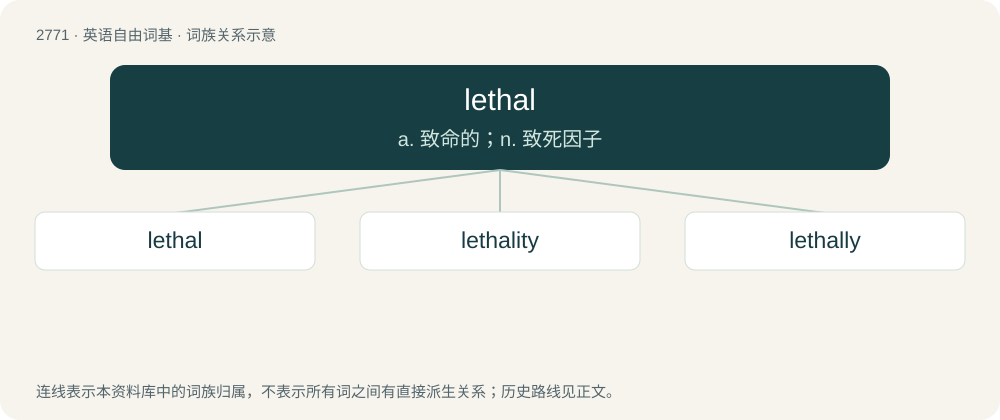

# 2872 · lethal — a. 致命的；n. 致死因子

[总目录](../00_总目录_按常用程度.md)

**类型**：英语自由词基　｜　**来源语言**：见词源记录

## 核心含义与来源

- 核心含义：a. 致命的；n. 致死因子
- 英文含义：Of, pertaining to, or causing death; deadly; mortal; fatal.
- 词形：lethal

**多个词源／构词路径**：同一拼写可能有不同来源；以下按词性和含义分别列出。

**来源记录 1**（形容词；Of, pertaining to, or causing death; deadly; mortal; fatal.）

Learned borrowing from Latin lētālis (“deadly, mortal, fatal”), improperly written lēthālis, from lētum (“death”), improperly written as lēthum, from a supposed connection with Ancient Greek λήθη (lḗthē, “oblivion, forgetfulness”).

**来源记录 2**（名词；One of the higher alcohols of the paraffine series obtained from spermaceti as a white crystalline solid.）

Abbreviation of “lauric acid ethereal salt”, so called because it occurs in the ethereal salt of lauric acid.

## 词族图

## 单词速览（常用到不常用）

| 单词 | 音标 | 释义 |
|---|---|---|
| [lethal](#w-1) | /ˈliː.θəl/ | a. 致命的；n. 致死因子 |
| [lethality](#w-2) | /liˈθælɪti/ | n. 致死性；\[医\] 致死率 |
| [lethally](#w-3) | /ˈliːθəli/ | adv. 致命地; 危害地; 极具威胁地 |

## 逐词详解

### 1. lethal

**词性**：形容词　｜　**音标**：/ˈliː.θəl/

**中文释义**：a. 致命的；n. 致死因子

**英文义项**：Of, pertaining to, or causing death; deadly; mortal; fatal.

**词源与演化**：

Learned borrowing from Latin lētālis (“deadly, mortal, fatal”), improperly written lēthālis, from lētum (“death”), improperly written as lēthum, from a supposed connection with Ancient Greek λήθη (lḗthē, “oblivion, forgetfulness”).

**例句**：

> A giraffe's powerful legs are a lethal weapon that could kill a lion.

### 2. lethality

**词性**：名词　｜　**音标**：/liˈθælɪti/

**中文释义**：n. 致死性；\[医\] 致死率

**英文义项**：The fact of something being lethal; the ability of something to kill. / The degree of lethal (mortal) danger that something (usually a disease or a weapon) presents; the magnitude of its power to kill organisms exposed to it; this property is indirectly measured by any of various proxy rates, including mortality rate, case fatality rate, or infection fatality rate (for diseases) or kill rate (for weapons, pesticides, or parasites).

**构词拆分**：lethal + -ity

**词源与演化**：

From lethal + -ity.

### 3. lethally

**词性**：副词　｜　**音标**：/ˈliːθəli/

**中文释义**：adv. 致命地; 危害地; 极具威胁地

**英文义项**：In a lethal manner, in manner which is or will be fatal.

**构词拆分**：lethal + -ly

**词源与演化**：

From lethal + -ly.

**例句**：

> He was lethally poisoned by the cobra and died a day later of it.

该用例对应义项：In a lethal manner, in manner which is or will be fatal.
