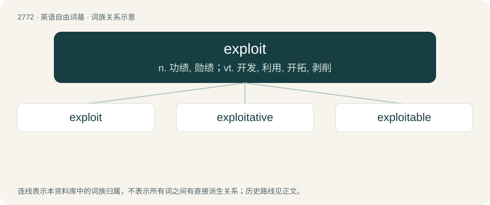

# 2873 · exploit — n. 功绩, 勋绩；vt. 开发, 利用, 开拓, 剥削

[总目录](../00_总目录_按常用程度.md)

**类型**：英语自由词基　｜　**来源语言**：见词源记录

## 核心含义与来源

- 核心含义：n. 功绩, 勋绩；vt. 开发, 利用, 开拓, 剥削
- 英文含义：A heroic or extraordinary deed.
- 词形：exploit

**来源记录 1**（名词；A heroic or extraordinary deed.）

From Old French esploit (noun), esploitier (verb).

## 词族图

## 单词速览（常用到不常用）

| 单词 | 音标 | 释义 |
|---|---|---|
| [exploit](#w-1) | /ˈɛksplɔɪt/ | n. 功绩, 勋绩；vt. 开发, 利用, 开拓, 剥削 |
| [exploitative](#w-2) | 美 /ɛkˈsplɔɪtətɪv/；/ɪkˈsplɔɪtətɪv/ | a. 开发的, 剥削的, (糟蹋地)利用的 |
| [exploitable](#w-3) | /iksˈplɔitəbl/ | a. 可开发的, 可剥削的, 可利用的 |

## 逐词详解

### 1. exploit

**词性**：名词　｜　**音标**：/ˈɛksplɔɪt/

**中文释义**：n. 功绩, 勋绩；vt. 开发, 利用, 开拓, 剥削

**英文义项**：A heroic or extraordinary deed. / An achievement.

**词源与演化**：

From Old French esploit (noun), esploitier (verb).

**例句**：

> The first trek to the summit of Mount Everest was a stunning exploit.

该用例对应义项：An achievement.

### 2. exploitative

**词性**：形容词　｜　**音标**：美 /ɛkˈsplɔɪtətɪv/；/ɪkˈsplɔɪtətɪv/

**中文释义**：a. 开发的, 剥削的, (糟蹋地)利用的

**英文义项**：In the nature of exploitation; acting to exploit someone or something / Of or relating to exploitation.

**构词拆分**：exploit + -ative

**词源与演化**：

From exploit + -ative. Compare exploitive.

**例句**：

> We are protesting the company's exploitative policies.

该用例对应义项：In the nature of exploitation; acting to exploit someone or something

### 3. exploitable

**词性**：形容词　｜　**音标**：/iksˈplɔitəbl/

**中文释义**：a. 可开发的, 可剥削的, 可利用的

**英文义项**：Able to be exploited, especially commercially. / Easily fooled; credulous.

**构词拆分**：exploit + -able

**词源与演化**：

From Old French exploitable or exploit + -able.
