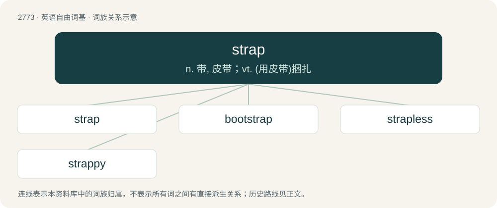

# 2874 · strap — n. 带, 皮带；vt. (用皮带)捆扎

[总目录](../00_总目录_按常用程度.md)

**类型**：英语自由词基　｜　**来源语言**：见词源记录

## 核心含义与来源

- 核心含义：n. 带, 皮带；vt. (用皮带)捆扎
- 英文含义：A long, narrow, pliable strip of leather, cloth, or the like.
- 词形：strap

**来源记录 1**（名词；A long, narrow, pliable strip of leather, cloth, or the like.）

From a variant of earlier strope (“loop on a harness”), from Middle English strope, stroppe, from Late Old English strop, stropp (“a band, thong, strap; oar-thong”) and Old French estrope (“strap, loop on a harness”), both from Latin stroppus, struppus (“strap”), from Ancient Greek στρόφος (stróphos, “rope”) (compare strophe), from στρέφω (stréphō, “to twist”), ultimately from Proto-Indo-European \*strebʰ- (compare Proto-West Germanic \*stroppōn (“to twist, writhe”)). Cognate with Scots strap, strop (“strap, band, thong”), Dutch strop (“noose, strop, loop”), Low German Strop (“strap”), German Struppe, Strüppe, Strippe (“string, cord”), Danish strop (“strap”), Swedish stropp (“strap, loop”).

## 词族图

## 单词速览（常用到不常用）

| 单词 | 音标 | 释义 |
|---|---|---|
| [strap](#w-1) | 英 /stɹæp/ | n. 带, 皮带；vt. (用皮带)捆扎 |
| [bootstrap](#w-2) | /ˈbuːtˌstɹæp/ | n. 解靴带；\[计\] 引导程序, 引导自举 |
| [strapless](#w-3) | /ˈstrapləs/ | a. 无带的, 无背带的 |
| [strappy](#w-4) | 英 /ˈstɹapi/ | a. (鞋类或衣服)有襻的,有带子的 |

## 逐词详解

### 1. strap

**词性**：动词　｜　**音标**：英 /stɹæp/

**中文释义**：n. 带, 皮带；vt. (用皮带)捆扎

**英文义项**：To beat or chastise with a strap; to whip, to lash. / To fasten or bind with a strap.

**词源与演化**：

From a variant of earlier strope (“loop on a harness”), from Middle English strope, stroppe, from Late Old English strop, stropp (“a band, thong, strap; oar-thong”) and Old French estrope (“strap, loop on a harness”), both from Latin stroppus, struppus (“strap”), from Ancient Greek στρόφος (stróphos, “rope”) (compare strophe), from στρέφω (stréphō, “to twist”), ultimately from Proto-Indo-European \*strebʰ- (compare Proto-West Germanic \*stroppōn (“to twist, writhe”)). Cognate with Scots strap, strop (“strap, band, thong”), Dutch strop (“noose, strop, loop”), Low German Strop (“strap”), German Struppe, Strüppe, Strippe (“string, cord”), Danish strop (“strap”), Swedish stropp (“strap, loop”).

**用法示例／搭配（非完整句）**：

> to strap a razor

该用例对应义项：To sharpen by rubbing on a strap; to strop.

### 2. bootstrap

**词性**：名词　｜　**音标**：/ˈbuːtˌstɹæp/

**中文释义**：n. 解靴带；\[计\] 引导程序, 引导自举

**英文义项**：A loop (leather or other material) sewn at the side or top rear of a boot to help in pulling the boot on. / A means of advancing oneself or accomplishing something without aid.

**构词拆分**：boot + strap

**词源与演化**：

From boot + strap. The sense "pull up (without aid)" comes from the phrase pull oneself up by one's bootstraps.

**例句**：

> He used his business experience as a bootstrap to win voters.

该用例对应义项：A means of advancing oneself or accomplishing something without aid.

### 3. strapless

**词性**：形容词　｜　**音标**：/ˈstrapləs/

**中文释义**：a. 无带的, 无背带的

**英文义项**：Without a strap or straps; usually describing women's clothing without shoulder straps.

**构词拆分**：strap + -less

**词源与演化**：

From strap + -less. The noun sense is by analogy of strap-on.

**例句**：

> A strapless evening gown.

该用例对应义项：having no straps

### 4. strappy

**词性**：形容词　｜　**音标**：英 /ˈstɹapi/

**中文释义**：a. (鞋类或衣服)有襻的,有带子的

**英文义项**：Of or characterized by straps.

**构词拆分**：From strap + -y.

**词源与演化**：

From strap + -y.
