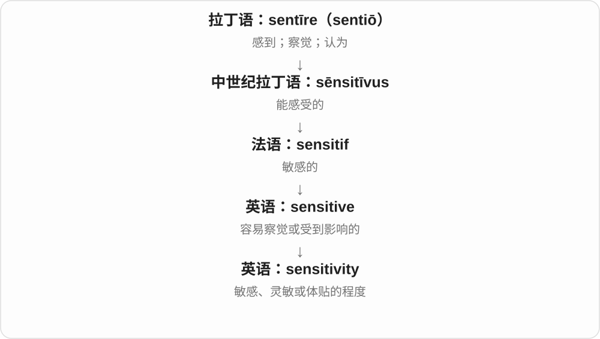
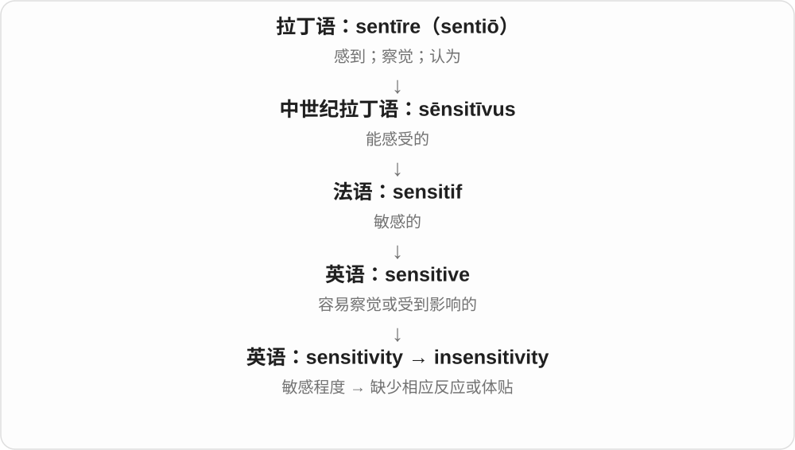

# 2875 · sensitivity — 敏感；灵敏；敏感度

[逐词精讲目录](../00_逐词精讲目录.md) · [总目录](../00_总目录_按常用程度.md)

## 核心词根与来源

sensitivity 由 sensitive 的相关名词形式构成，远接感知一支。hypersensitivity 表示过度或超常敏感，insensitivity 表示不敏感，也可说缺乏体贴。

**SENSITIVITY：对刺激、变化或感受能多快作出反应**

传感器察觉小变化，人也能察觉别人的感受。

- **反应程度**：sensitivity · hypersensitivity
- **缺少反应或体贴**：insensitivity

## 词形与演化规律

sensitivity to；hyper- 过度，in- 否定。医学、测量和人际用法各有尺度，不共享一个万能数值。

## 单词速览（按词族由简到繁）

同一基础词的相关扩展放在一起，先读基础形式，再读扩展；各组之间优先读常用的。具体词源关系见各词讲解。

| 单词 | 音标 | 核心意思 |
|---|---|---|
| [sensitivity](#w-1) | /ˌsensəˈtɪvəti/ | 敏感程度；灵敏度；体贴 |
| [hypersensitivity](#w-2) | 英 /ˌhaɪpəsensəˈtɪvəti/；美 /ˌhaɪpərsensəˈtɪvəti/ | 过度敏感；超敏反应 |
| [insensitivity](#w-3) | /ɪnˌsensəˈtɪvəti/ | 不体贴；不敏感；对某因素缺少反应 |

## 逐词讲解

### 1. sensitivity — 敏感程度；灵敏度；体贴

**音标**：/ˌsensəˈtɪvəti/

**先抓住这个画面**

把“多小的变化就会有反应”当成一个可讨论的程度，这就是 sensitivity；对人也可谈体察他人感受的能力。

**怎么拆**

sensitive + -ity，变成性质名词，重音随词尾变化。

**怎么变成今天的意思**

可以评价传感器，也可以评价谈话方式。高 sensitivity 不自动等于总体性能或性格更好，要看讨论的是哪种反应。

**常见搭配与例句**

light sensitivity；sensor sensitivity；show sensitivity；cultural sensitivity。

> The technician adjusted the sensitivity of the sensor.

技术人员调整了传感器的灵敏度。

> The situation needs to be handled with sensitivity.

这种情况需要体贴、谨慎地处理。

**别混淆**

sensibility 常偏感受和审美能力；sensitivity 也常是可测的灵敏度或对刺激的反应程度。

### 2. hypersensitivity — 过度敏感；超敏反应

**音标**：英 /ˌhaɪpəsensəˈtɪvəti/；美 /ˌhaɪpərsensəˈtɪvəti/

**先抓住这个画面**

像感应器的灵敏度开得太大，一点刺激就引起明显反应。

**怎么拆**

hyper- 过度 + sensitivity 敏感性；现代也可与 hypersensitive + -ity 对应理解。

**怎么变成今天的意思**

**希腊 hyper**  
在上；越过；过量

↓

**英语 hyper-**  
超过通常范围；超出

↓

**hyper- + sensitivity → hypersensitivity**  
超出通常程度的敏感或反应

hypersensitivity to criticism 是对批评过度敏感；医学中的 drug hypersensitivity 指对药物的超敏反应。这两种场景共享“反应过强”的直觉，但心理感受与免疫机制不是同一回事。

**常见搭配与例句**

hypersensitivity to something；drug hypersensitivity；a hypersensitivity reaction。

> His hypersensitivity to criticism made teamwork difficult.

他对批评过度敏感，让团队合作变得困难。

> The paper reviews drug hypersensitivity reactions.

论文综述了药物超敏反应。

**别混淆**

sensitivity 是敏感性，hypersensitivity 强调过度或异常。不能把免疫学的超敏反应简单说成人太玻璃心。

### 3. insensitivity — 不体贴；不敏感；对某因素缺少反应

**音标**：/ɪnˌsensəˈtɪvəti/

**先抓住这个画面**

把没有接住别人的感受、或没有对刺激作反应的状态单独拿出来谈。

**怎么拆**

in-（不）+ sensitivity，也可从 insensitive 对应的名词形式理解。

**怎么变成今天的意思**

人际场景常批评漠视；技术场景只说明反应较弱。其好坏不能脱离后面的 to 什么。

**常见搭配与例句**

insensitivity to others；show insensitivity；insensitivity to noise。

> She was upset by his insensitivity to her concerns.

他不顾她的忧虑，让她很难过。

> The design’s insensitivity to electrical noise is useful.

这种设计不易受电噪声影响，这一点很有用。

**别混淆**

indifference 是不关心；insensitivity 是不易察觉或不顾及。有时人想帮忙，却因缺少体察而表现出 insensitivity。

## 这一组要分清什么

sensitivity 和 specificity 在检测中有不同技术定义，不能只用日常敏感解释全部统计性质。

## 串起来练习

The engineer tested the sensor’s sensitivity to small temperature changes.

工程师测试了传感器对微小温度变化的灵敏度。
