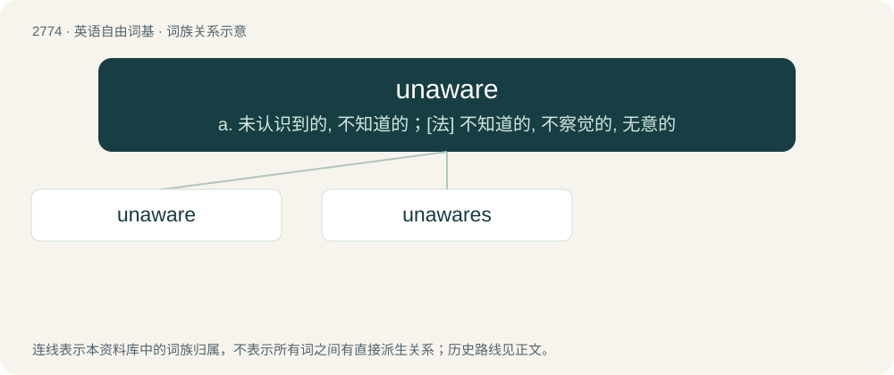

# 2875 · unaware — a. 未认识到的, 不知道的；\[法\] 不知道的, 不察觉的, 无意的

[总目录](../00_总目录_按常用程度.md)

**类型**：英语自由词基　｜　**来源语言**：见词源记录

## 核心含义与来源

- 核心含义：a. 未认识到的, 不知道的；\[法\] 不知道的, 不察觉的, 无意的
- 英文含义：Not aware or informed; lacking knowledge; unmindful.
- 词形：unaware

**来源记录 1**（形容词；Not aware or informed; lacking knowledge; unmindful.）

From un- + aware.

## 词族图

## 单词速览（常用到不常用）

| 单词 | 音标 | 释义 |
|---|---|---|
| [unaware](#w-1) | 英 /ˌʌnəˈwɛə/；美 /ˌʌnəˈwɛɚ/ | a. 未认识到的, 不知道的；\[法\] 不知道的, 不察觉的, 无意的 |
| [unawares](#w-2) | /ˌʌnəˈwɛə(ɹ)z/ | adv. 出其不意地, 没想到, 不料, 不知不觉地 |

## 逐词详解

### 1. unaware

**词性**：形容词　｜　**音标**：英 /ˌʌnəˈwɛə/；美 /ˌʌnəˈwɛɚ/

**中文释义**：a. 未认识到的, 不知道的；\[法\] 不知道的, 不察觉的, 无意的

**英文义项**：Not aware or informed; lacking knowledge; unmindful. / Not noticing; paying no heed.

**构词拆分**：un- + aware

**词源与演化**：

From un- + aware.

**例句**：

> Luckily, she was unaware that I'd spent the last five years in prison.

该用例对应义项：Not aware or informed; lacking knowledge; unmindful.

### 2. unawares

**词性**：副词　｜　**音标**：/ˌʌnəˈwɛə(ɹ)z/

**中文释义**：adv. 出其不意地, 没想到, 不料, 不知不觉地

**英文义项**：Unexpectedly or by surprise. / Inadvertently.

**构词拆分**：unaware + -s (adverbial suffix)

**词源与演化**：

From unaware + -s (adverbial suffix). Attested earlier than unaware.

**例句**：

> Your question catches/takes me unawares, I don't know the answer right now...

该用例对应义项：Unexpectedly or by surprise.
