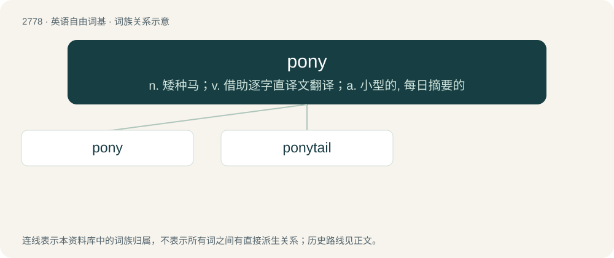

# 2881 · pony — n. 矮种马；v. 借助逐字直译文翻译；a. 小型的, 每日摘要的

[总目录](../00_总目录_按常用程度.md)

**类型**：英语自由词基　｜　**来源语言**：见词源记录

## 核心含义与来源

- 核心含义：n. 矮种马；v. 借助逐字直译文翻译；a. 小型的, 每日摘要的
- 英文含义：A small horse; specifically, any of several small breeds of horse under 14.2 hands at the withers.
- 词形：pony

**多个词源／构词路径**：同一拼写可能有不同来源；以下按词性和含义分别列出。

**来源记录 1**（名词；A small horse; specifically, any of several small breeds of horse under 14.2 hands at the withers.）

From Scots powny, apparently from Middle French poulenet (“little foal”), ultimately from Late Latin pullanus (“young of an animal”), from pullus. First attested in 1659. Doublet of foal and pullus. Sense “small serving of alcohol” from 19th century, both for small sizes generally and for a quarter pint specifically, from the small size.

**来源记录 2**（形容词；Synonym of crap: of little worth.）

Clipping of pony and trap, rhyming with crap.

## 词族图

## 单词速览（常用到不常用）

| 单词 | 音标 | 释义 |
|---|---|---|
| [pony](#w-1) | 英 /ˈpəʊni/；美 /ˈpoʊni/ | n. 矮种马；v. 借助逐字直译文翻译；a. 小型的, 每日摘要的 |
| [ponytail](#w-2) | 美 /ˈpoʊniˌteɪl/ | n. 马尾辫 |

## 逐词详解

### 1. pony

**词性**：名词　｜　**音标**：英 /ˈpəʊni/；美 /ˈpoʊni/

**中文释义**：n. 矮种马；v. 借助逐字直译文翻译；a. 小型的, 每日摘要的

**英文义项**：A small horse; specifically, any of several small breeds of horse under 14.2 hands at the withers. / A horse of any size.

**词源与演化**：

From Scots powny, apparently from Middle French poulenet (“little foal”), ultimately from Late Latin pullanus (“young of an animal”), from pullus. First attested in 1659. Doublet of foal and pullus. Sense “small serving of alcohol” from 19th century, both for small sizes generally and for a quarter pint specifically, from the small size.

**例句**：

> Benedito's little sister wants to ride the pony at the petting zoo.

### 2. ponytail

**词性**：名词　｜　**音标**：美 /ˈpoʊniˌteɪl/

**中文释义**：n. 马尾辫

**英文义项**：A hairstyle where the hair is pulled back and tied into a single "tail" which hangs down behind the head.

**构词拆分**：pony + tail

**词源与演化**：

From pony + tail.

**例句**：

> I used a ribbon to tie my hair into a ponytail.
