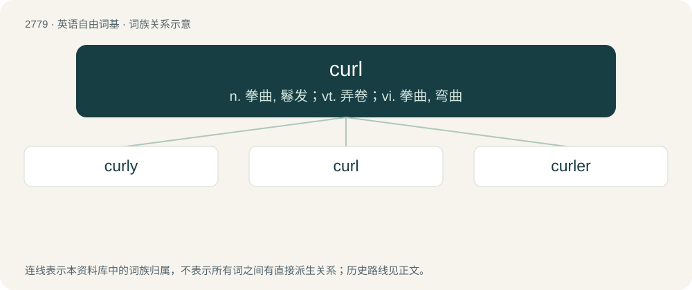

# 2883 · curl — n. 拳曲, 鬈发；vt. 弄卷；vi. 拳曲, 弯曲

[总目录](../00_总目录_按常用程度.md)

**类型**：英语自由词基　｜　**来源语言**：见词源记录

## 核心含义与来源

- 核心含义：n. 拳曲, 鬈发；vt. 弄卷；vi. 拳曲, 弯曲
- 英文含义：A curving piece or lock of hair; a ringlet.
- 词形：curl

**来源记录 1**（名词；A curving piece or lock of hair; a ringlet.）

From metathesis of Middle English crulle (“curled, curly”), of uncertain origin but probably from an unrecorded Old English word or from Middle Dutch crul, crulle (“curl”), ultimately from Proto-Germanic \*kruzlǭ (“bent or crooked object, curl”), connected to \*krūsą (“curl”), of unknown origin. Cognate with Saterland Frisian Krulle (“curl, lock”), West Frisian krul (“curl”), Dutch krul (“curl”), German Low German Krull (“curl”), dialectal German Krolle (“curl”), Danish krølle (“curl”), Norwegian Bokmål krøll (“curl”). Related also to Saterland Frisian Kruus (“curl”), German kraus (“frizzy, crumpled, curly”), Danish krus (“curl”), Swedish krusa (“to crimp, curl”). Compare also Gothic 𐌺𐍂𐌹𐌿𐍃𐍄𐌰𐌽 (kriustan, “to grind, crush, gnash”).

## 词族图

## 单词速览（常用到不常用）

| 单词 | 音标 | 释义 |
|---|---|---|
| [curly](#w-1) | 英 /ˈkɜːli/；美 /ˈkɝli/ | a. 拳曲的, 卷毛的, 弯曲的 |
| [curl](#w-2) | 英 /kɜːl/；美 /kɜɹl/ | n. 拳曲, 鬈发；vt. 弄卷；vi. 拳曲, 弯曲 |
| [curler](#w-3) | /ˈkɜː(ɹ)lə(ɹ)/ | n. 卷发的人, 卷发夹子 |

## 逐词详解

### 1. curly

**词性**：形容词　｜　**音标**：英 /ˈkɜːli/；美 /ˈkɝli/

**中文释义**：a. 拳曲的, 卷毛的, 弯曲的

**英文义项**：Having curls. / Curling in a direction, as opposed to straight (quotation marks or apostrophes)

**构词拆分**：curl + -y

**词源与演化**：

From curl + -y.

**例句**：

> They envied her naturally curly hair.

该用例对应义项：(of hair) having curls or waves

### 2. curl

**词性**：名词　｜　**音标**：英 /kɜːl/；美 /kɜɹl/

**中文释义**：n. 拳曲, 鬈发；vt. 弄卷；vi. 拳曲, 弯曲

**英文义项**：A curving piece or lock of hair; a ringlet. / A curved stroke or shape.

**词源与演化**：

From metathesis of Middle English crulle (“curled, curly”), of uncertain origin but probably from an unrecorded Old English word or from Middle Dutch crul, crulle (“curl”), ultimately from Proto-Germanic \*kruzlǭ (“bent or crooked object, curl”), connected to \*krūsą (“curl”), of unknown origin. Cognate with Saterland Frisian Krulle (“curl, lock”), West Frisian krul (“curl”), Dutch krul (“curl”), German Low German Krull (“curl”), dialectal German Krolle (“curl”), Danish krølle (“curl”), Norwegian Bokmål krøll (“curl”). Related also to Saterland Frisian Kruus (“curl”), German kraus (“frizzy, crumpled, curly”), Danish krus (“curl”), Swedish krusa (“to crimp, curl”). Compare also Gothic 𐌺𐍂𐌹𐌿𐍃𐍄𐌰𐌽 (kriustan, “to grind, crush, gnash”).

**例句**：

> The one-piece back is of a medium curl.

该用例对应义项：The contrasting light and dark figure seen in wood used for stringed instrument making; the flame.

### 3. curler

**词性**：名词　｜　**音标**：/ˈkɜː(ɹ)lə(ɹ)/

**中文释义**：n. 卷发的人, 卷发夹子

**英文义项**：One of a set of small cylindrical tubes used to curl hair. / A sportsman who plays curling.

**构词拆分**：curl + -er

**词源与演化**：

From curl + -er.

**例句**：

> The captain sent a curler into the top corner of the net.

该用例对应义项：A pass or a shot of the ball which swerves.
