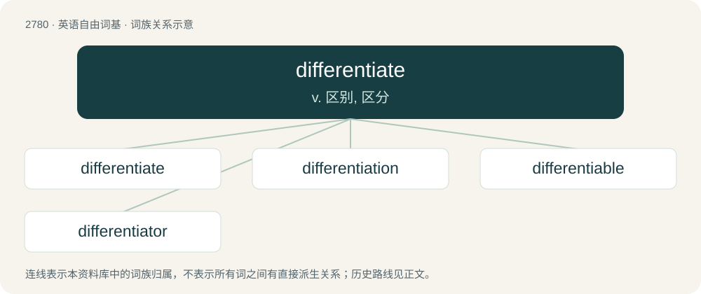

# 2884 · differentiate — v. 区别, 区分

[总目录](../00_总目录_按常用程度.md)

**类型**：英语自由词基　｜　**来源语言**：见词源记录

## 核心含义与来源

- 核心含义：v. 区别, 区分
- 英文含义：To modify so as to create a difference or distinction.
- 词形：differentiate

**来源记录 1**（动词；To modify so as to create a difference or distinction.）

From New Latin differentiātus, perfect passive participle of differentiō (see -ate (verb-forming suffix) and -ate (noun-forming suffix)), from Latin differentia (“difference”); see difference.

## 词族图

## 单词速览（常用到不常用）

| 单词 | 音标 | 释义 |
|---|---|---|
| [differentiate](#w-1) | 英 /dɪf.əˈɹɛn.ʃi.eɪt/；美 /ˌdɪf.əˈɹɛn.ʃi.eɪt/ | v. 区别, 区分 |
| [differentiation](#w-2) | 英 /dɪf.əˌɹɛn.ʃiˈeɪ.ʃən/；美 /ˌdɪf.əˌɹɛn.ʃiˈeɪ.ʃən/ | n. 区别, 分化, 变异；\[医\] 鉴别, 区别, 分化\[作用\], 微分法 |
| [differentiable](#w-3) | 英 /ˌdɪf.ə(ɹ)ˈɛn.ʃə.bəl/ | \[计\] 可微的 |
| [differentiator](#w-4) | 英 /dɪf.əˈɹɛn.ʃi.eɪ.tə/；美 /ˌdɪf.əˈɹɛn.ʃi.eɪ.tɚ/ | \[计\] 微分电路; 微分器 |

## 逐词详解

### 1. differentiate

**词性**：动词　｜　**音标**：英 /dɪf.əˈɹɛn.ʃi.eɪt/；美 /ˌdɪf.əˈɹɛn.ʃi.eɪt/

**中文释义**：v. 区别, 区分

**英文义项**：To modify so as to create a difference or distinction. / To show or be the difference or distinction between things.

**词源与演化**：

From New Latin differentiātus, perfect passive participle of differentiō (see -ate (verb-forming suffix) and -ate (noun-forming suffix)), from Latin differentia (“difference”); see difference.

**例句**：

> How do you differentiate a fake smile from a genuine one?

该用例对应义项：To recognize as different or distinct.

### 2. differentiation

**词性**：名词　｜　**音标**：英 /dɪf.əˌɹɛn.ʃiˈeɪ.ʃən/；美 /ˌdɪf.əˌɹɛn.ʃiˈeɪ.ʃən/

**中文释义**：n. 区别, 分化, 变异；\[医\] 鉴别, 区别, 分化\[作用\], 微分法

**英文义项**：The act of treating one thing as distinct from another, or of creating such a distinction; of separating a class of things into categories; of describing a thing by illustrating how it is different from something else. / The process of developing distinct components.

**构词拆分**：differentiate + -ion；different + -iate；differ + -ent

**词源与演化**：

From differentiate + -ion, from different + -iate, from differ + -ent, from Middle English differen, from Old French differer, from Latin differō (“carry apart, put off, defer; differ”), from dis- (“apart”) + ferō (“carry, bear”); cognate with Ancient Greek διαφέρω (diaphérō, “to differ”).

**例句**：

> Cell differentiation in the developing embryo.

该用例对应义项：(biology) the structural adaptation of some body part for a particular function

### 3. differentiable

**词性**：形容词　｜　**音标**：英 /ˌdɪf.ə(ɹ)ˈɛn.ʃə.bəl/

**中文释义**：\[计\] 可微的

**英文义项**：Having a derivative, said of a function whose domain and codomain are manifolds. / able to be differentiated; distinguishable, as for example by differing appearance or measurable characteristics.

**构词拆分**：differentiate + -able

**词源与演化**：

From differentiate + -able.

**例句**：

> A function that is differentiable everywhere is continuous.

### 4. differentiator

**词性**：名词　｜　**音标**：英 /dɪf.əˈɹɛn.ʃi.eɪ.tə/；美 /ˌdɪf.əˈɹɛn.ʃi.eɪ.tɚ/

**中文释义**：\[计\] 微分电路; 微分器

**英文义项**：Anything that differentiates, or causes differentiation (in any sense); a distinguishing feature.

**构词拆分**：differentiate + -or

**词源与演化**：

From differentiate + -or.
