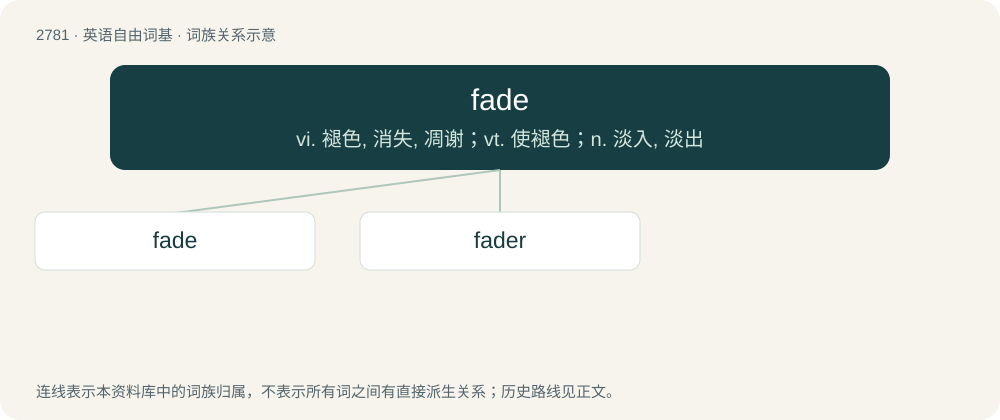

# 2885 · fade — vi. 褪色, 消失, 凋谢；vt. 使褪色；n. 淡入, 淡出

[总目录](../00_总目录_按常用程度.md)

**类型**：英语自由词基　｜　**来源语言**：见词源记录

## 核心含义与来源

- 核心含义：vi. 褪色, 消失, 凋谢；vt. 使褪色；n. 淡入, 淡出
- 英文含义：A golf shot that curves intentionally to the player's right (if they are right-handed) or to the left (if left-handed).
- 词形：fade

**来源记录 1**（名词；A golf shot that curves intentionally to the player's right (if they are right-handed) or to the left (if left-handed).）

From Middle English fade, vad, vade (“faded, pale, withered, weak”), from Middle Dutch vade (“weak, faint, limp”), from Old French fade (“weak, witless”), of obscure origin. Probably from Vulgar Latin \*fatidus, from Latin fatuus (“insipid”).

## 词族图

## 单词速览（常用到不常用）

| 单词 | 音标 | 释义 |
|---|---|---|
| [fade](#w-1) | 英 /feɪd/ | vi. 褪色, 消失, 凋谢；vt. 使褪色；n. 淡入, 淡出 |
| [fader](#w-2) | /ˈfeɪdə/ | n. 音量控制器, 增益调节器, 混频电位器；\[电\] 化音器 |

## 逐词详解

### 1. fade

**词性**：动词　｜　**音标**：英 /feɪd/

**中文释义**：vi. 褪色, 消失, 凋谢；vt. 使褪色；n. 淡入, 淡出

**英文义项**：To hit the ball with the shot called a fade. / To grow weak; to lose strength; to decay; to perish gradually; to wither, as a plant.

**词源与演化**：

From Middle English fade, vad, vade (“faded, pale, withered, weak”), from Middle Dutch vade (“weak, faint, limp”), from Old French fade (“weak, witless”), of obscure origin. Probably from Vulgar Latin \*fatidus, from Latin fatuus (“insipid”).

**例句**：

> The scene begins to fade.

该用例对应义项：become less clearly visible or distinguishable; disappear gradually or seemingly

### 2. fader

**词性**：名词　｜　**音标**：/ˈfeɪdə/

**中文释义**：n. 音量控制器, 增益调节器, 混频电位器；\[电\] 化音器

**英文义项**：A device used to raise and lower sound volume. / A program or algorithm for fading out colors.

**构词拆分**：fade + -er

**词源与演化**：

From fade (verb) + -er.
