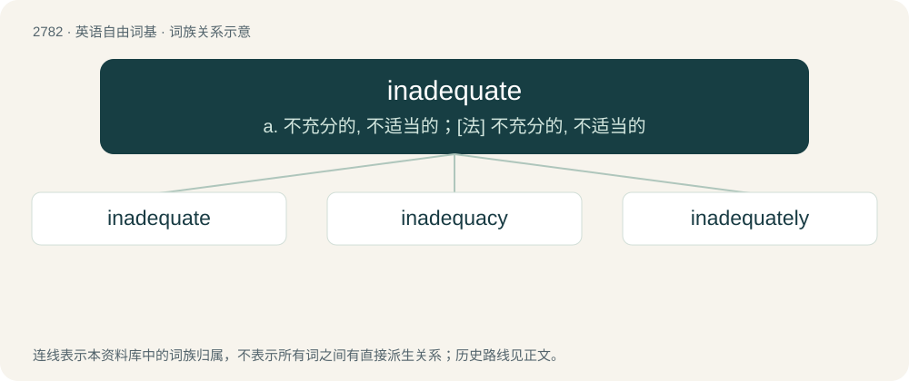

# 2886 · inadequate — a. 不充分的, 不适当的；\[法\] 不充分的, 不适当的

[总目录](../00_总目录_按常用程度.md)

**类型**：英语自由词基　｜　**来源语言**：见词源记录

## 核心含义与来源

- 核心含义：a. 不充分的, 不适当的；\[法\] 不充分的, 不适当的
- 英文含义：Not adequate; lacking in quality or quantity required; insufficient for a purpose.
- 词形：inadequate

**来源记录 1**（形容词；Not adequate; lacking in quality or quantity required; insufficient for a purpose.）

From in- + adequate.

## 词族图

## 单词速览（常用到不常用）

| 单词 | 音标 | 释义 |
|---|---|---|
| [inadequate](#w-1) | /ɪnˈædəkwɪt/ | a. 不充分的, 不适当的；\[法\] 不充分的, 不适当的 |
| [inadequacy](#w-2) | /ɪˈnædɪkwəsi/ | n. 不适当, 不足之处, 不充分；\[医\] 机能不全, 闭锁不全, 关闭不全 |
| [inadequately](#w-3) |  | adv. 不适当地；不够好地 |

## 逐词详解

### 1. inadequate

**词性**：形容词　｜　**音标**：/ɪnˈædəkwɪt/

**中文释义**：a. 不充分的, 不适当的；\[法\] 不充分的, 不适当的

**英文义项**：Not adequate; lacking in quality or quantity required; insufficient for a purpose.

**构词拆分**：in- + adequate

**词源与演化**：

From in- + adequate.

**用法示例／搭配（非完整句）**：

> inadequate representation

该用例对应义项：Not adequate; lacking in quality or quantity required; insufficient for a purpose.

### 2. inadequacy

**词性**：名词　｜　**音标**：/ɪˈnædɪkwəsi/

**中文释义**：n. 不适当, 不足之处, 不充分；\[医\] 机能不全, 闭锁不全, 关闭不全

**英文义项**：The state of being inadequate. / A shortage of required material.

**构词拆分**：inadequate + -cy；in- + adequacy

**词源与演化**：

From inadequate + -cy or in- + adequacy.

**例句**：

> The report exposed the inadequacy of existing regulations.

该用例对应义项：The state of being inadequate.

### 3. inadequately

**词性**：副词

**中文释义**：adv. 不适当地；不够好地

**英文义项**：In an inadequate manner.

**构词拆分**：inadequate + -ly

**词源与演化**：

From inadequate + -ly.

**例句**：

> The temporary camps were inadequately equipped.

该用例对应义项：in an inadequate manner or to an inadequate degree
