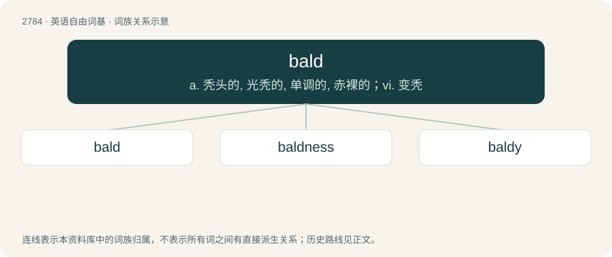

# 2888 · bald — a. 秃头的, 光秃的, 单调的, 赤裸的；vi. 变秃

[总目录](../00_总目录_按常用程度.md)

**类型**：英语自由词基　｜　**来源语言**：见词源记录

## 核心含义与来源

- 核心含义：a. 秃头的, 光秃的, 单调的, 赤裸的；vi. 变秃
- 英文含义：Having little or no hair, fur, or feathers.
- 词形：bald

**来源记录 1**（形容词；Having little or no hair, fur, or feathers.）

From Middle English balled, ballid, bald (“bald”), of uncertain origin. Probably formed from Middle English bal, balle (“ball, round object, knoll, head”). Compare Old Danish bældet (“bald”). An alternate etymology relates it to Old English bǣl (“fire, flame; funeral pyre”), from Proto-Germanic \*bēlą. Compare Albanian balë (“white spot on the forehead”) and ballë (“forehead”).

## 词族图

## 单词速览（常用到不常用）

| 单词 | 音标 | 释义 |
|---|---|---|
| [bald](#w-1) | 英 /bɔːld/；/bɔld/ | a. 秃头的, 光秃的, 单调的, 赤裸的；vi. 变秃 |
| [baldness](#w-2) | /ˈbɒːldnis/ | n. 光秃, 率直, 枯燥；\[医\] 秃\[发\], 脱发 |
| [baldy](#w-3) | 英 /ˈbɔːl.di/；美 /ˈbɔl.di/ | n. 秃子；n. (Baldy)人名；(法)巴尔迪；a. 秃的；秃顶的 |

## 逐词详解

### 1. bald

**词性**：形容词　｜　**音标**：英 /bɔːld/；/bɔld/

**中文释义**：a. 秃头的, 光秃的, 单调的, 赤裸的；vi. 变秃

**英文义项**：Having little or no hair, fur, or feathers. / Having little or no hair on the head, or having a large area of bare scalp on top of the head.

**词源与演化**：

From Middle English balled, ballid, bald (“bald”), of uncertain origin. Probably formed from Middle English bal, balle (“ball, round object, knoll, head”). Compare Old Danish bældet (“bald”). An alternate etymology relates it to Old English bǣl (“fire, flame; funeral pyre”), from Proto-Germanic \*bēlą. Compare Albanian balë (“white spot on the forehead”) and ballë (“forehead”).

**例句**：

> The bald cypress is a tree that loses its leaves in winter.

该用例对应义项：Lacking any covering.

### 2. baldness

**词性**：名词　｜　**音标**：/ˈbɒːldnis/

**中文释义**：n. 光秃, 率直, 枯燥；\[医\] 秃\[发\], 脱发

**英文义项**：The condition or state of being (or becoming) bald.

**构词拆分**：bald + -ness

**词源与演化**：

From Middle English ballednesse, equivalent to bald + -ness.

**例句**：

> My baldness was the result of radiotherapy.

该用例对应义项：The condition or state of being (or becoming) bald.

### 3. baldy

**词性**：名词　｜　**音标**：英 /ˈbɔːl.di/；美 /ˈbɔl.di/

**中文释义**：n. 秃子；n. (Baldy)人名；(法)巴尔迪；a. 秃的；秃顶的

**英文义项**：Someone who is bald.

**构词拆分**：bald + -y

**词源与演化**：

From bald + -y (nominalizing suffix).

**例句**：

> His elaborate comb over doesn't conceal the fact that he's a baldy.
