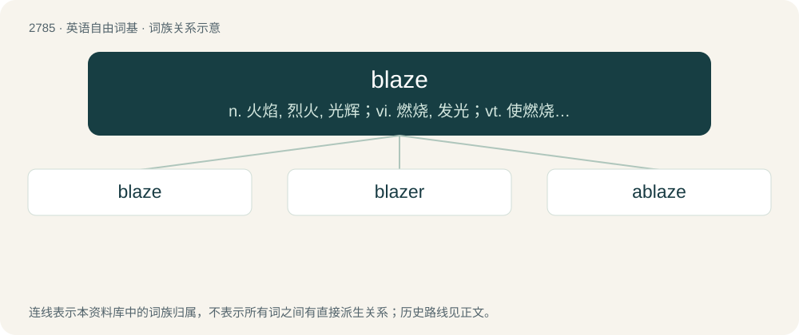

# 2889 · blaze — n. 火焰, 烈火, 光辉；vi. 燃烧, 发光；vt. 使燃烧, 宣布, 在树皮上刻痕

[总目录](../00_总目录_按常用程度.md)

**类型**：英语自由词基　｜　**来源语言**：见词源记录

## 核心含义与来源

- 核心含义：n. 火焰, 烈火, 光辉；vi. 燃烧, 发光；vt. 使燃烧, 宣布, 在树皮上刻痕
- 英文含义：A fire, especially a fast-burning fire producing a lot of flames and light.
- 词形：blaze

**多个词源／构词路径**：同一拼写可能有不同来源；以下按词性和含义分别列出。

**来源记录 1**（名词；A fire, especially a fast-burning fire producing a lot of flames and light.）

From Middle English blase, from Old English blæse, blase (“firebrand, torch, lamp, flame”), from Proto-West Germanic \*blasā, from Proto-Germanic \*blasǭ (“torch”), from Proto-Indo-European \*bʰel- (“to shine, be white”). Cognate with Low German blas (“burning candle, torch, fire”), Middle High German blas (“candle, torch, flame”).

**来源记录 2**（动词；To be on fire, especially producing bright flames.）

From Middle English blasen, from Middle English blase (“torch”). See above.

**来源记录 3**（名词；The white or lighter-coloured markings on a horse's face.）

\] A 1639 borrowing, perhaps from Dutch bles or Middle Low German blesse, bles, ultimately from Proto-West Germanic \*blasī, from Proto-Germanic \*blasį̄, from \*blasaz (“white, pale (of animals)”) + \*-į̄ (forming nouns), from Proto-Indo-European \*bʰel- (“shiny, white”). Cognate with German Blesse, Swedish bläs. The verb is from the noun.

**来源记录 4**（动词；To blow, as from a trumpet.）

From Middle English blasen (“to blow”), from Old English \*blǣsan, from Proto-West Germanic \*blāsan, from Proto-Germanic \*blēsaną (“to blow”). Related to English blast.

## 词族图

## 单词速览（常用到不常用）

| 单词 | 音标 | 释义 |
|---|---|---|
| [blaze](#w-1) | /bleɪz/ | n. 火焰, 烈火, 光辉；vi. 燃烧, 发光；vt. 使燃烧, 宣布, 在树皮上刻痕 |
| [blazer](#w-2) | 英 /ˈbleɪzə/；美 /ˈbleɪzəɹ/ | n. 燃烧体, 颜色鲜明的上装, 宣布者 |
| [ablaze](#w-3) | 美 /əˈbleɪz/ | a. 着火的, 闪亮的, 激昂的；adv. 着火, 闪耀 |

## 逐词详解

### 1. blaze

**词性**：名词　｜　**音标**：/bleɪz/

**中文释义**：n. 火焰, 烈火, 光辉；vi. 燃烧, 发光；vt. 使燃烧, 宣布, 在树皮上刻痕

**英文义项**：A fire, especially a fast-burning fire producing a lot of flames and light. / Intense, direct light accompanied with heat.

**词源与演化**：

From Middle English blase, from Old English blæse, blase (“firebrand, torch, lamp, flame”), from Proto-West Germanic \*blasā, from Proto-Germanic \*blasǭ (“torch”), from Proto-Indo-European \*bʰel- (“to shine, be white”). Cognate with Low German blas (“burning candle, torch, fire”), Middle High German blas (“candle, torch, flame”).

**例句**：

> They sought shelter from the blaze of the sun.

该用例对应义项：Intense, direct light accompanied with heat.

### 2. blazer

**词性**：名词　｜　**音标**：英 /ˈbleɪzə/；美 /ˈbleɪzəɹ/

**中文释义**：n. 燃烧体, 颜色鲜明的上装, 宣布者

**英文义项**：A very bright or hot day. / A dish used to cook directly over the coals of a brazier, or the flame of a chafing dish lamp.

**构词拆分**：blaze + -er

**词源与演化**：

From blaze (“to reflect or send forth a bright light; (figurative) to be conspicuous; etc.”, verb) + -er (suffix forming agent nouns). Blaze is derived from blaze (“fire”, noun), from Middle English blase (“a flame, blaze; a firebrand, torch; a bright light”), from Old English blæse, blase (“a flame, blaze; a firebrand, torch”) (whence Old English blæsere, blasere (“one who burns, burner, incendiary”, literally “blazer”)), from Proto-West Germanic \*blasā (“a flame, blaze; a firebrand, torch”), from Proto-Germanic \*blasǭ (“a torch”), from Proto-Indo-European \*bʰel- (“to blaze, burn; to be bright, shine; bright flame, fire; shiny; white”).

**用法示例／搭配（非完整句）**：

> a blazer of pathways

该用例对应义项：A person or thing that blazes a trail; a pioneer, a trailblazer.

### 3. ablaze

**词性**：形容词　｜　**音标**：美 /əˈbleɪz/

**中文释义**：a. 着火的, 闪亮的, 激昂的；adv. 着火, 闪耀

**英文义项**：Burning fiercely; in a blaze; on fire. / Radiant with bright light and color.

**构词拆分**：a- + blaze

**词源与演化**：

From a- (“on, in”) + blaze (“flame”).

**例句**：

> Streets ablaze with lighted Christmas trees.

该用例对应义项：lighted with red light as if with flames
