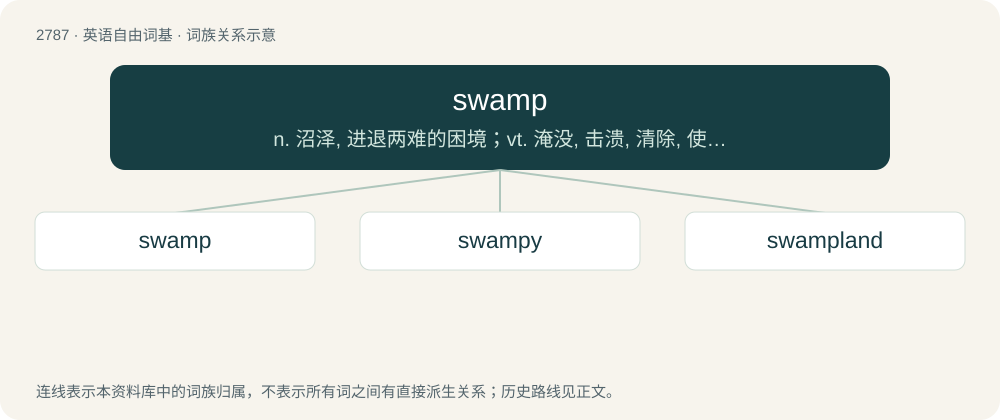

# 2891 · swamp — n. 沼泽, 进退两难的困境；vt. 淹没, 击溃, 清除, 使陷于沼泽；vi. 陷于沼泽, 淹没

[总目录](../00_总目录_按常用程度.md)

**类型**：英语自由词基　｜　**来源语言**：见词源记录

## 核心含义与来源

- 核心含义：n. 沼泽, 进退两难的困境；vt. 淹没, 击溃, 清除, 使陷于沼泽；vi. 陷于沼泽, 淹没
- 英文含义：An area of wet (water-saturated), spongy (soft) land, often with trees, generally a rich ecosystem for certain plants and animals but ill-suited for many agricultural purposes. (A type of wetland. Compare marsh, bog, fen.)
- 词形：swamp

**来源记录 1**（名词；An area of wet (water-saturated), spongy (soft) land, often with trees, generally a rich ecosystem for certain plants and animals but ill-suited for many agricultural purposes. (A type of wetland. Compare marsh, bog, fen.)）

Early attestations (starting in 1624) are from North America, but the term was probably in local use in Britain earlier. The etymology is not entirely certain; it is probably a fusion of Middle English swam (“swamp, muddy pool, bog, marsh”, also “fungus, mushroom”) — from Old English swamm (“mushroom, fungus, sponge”), from Proto-West Germanic \*swamm, from Proto-Germanic \*swambaz, \*swammaz — and Middle English sompe (“marsh, morass”), from either Middle Dutch somp, sump (“marsh, swamp”) or Middle Low German sump (“marsh, swamp”) (from Old Saxon \*sump (“swamp, marsh”)), both from Proto-West Germanic \*sump, from Proto-Germanic \*sumpaz. \*Swambaz, \*swammaz and \*sumpaz are likely related to each other, but it is unclear whether they are of Indo-European origin or are substrate words or wanderworts. The word has alternatively been suggested to be a borrowing from Dutch zwamp (“swamp, marsh, fen”). Other cognates include Middle Low German swamp (“sponge, mushroom”), Dutch zomp (“swamp, lake, marshy place”), German Low German Sump (“swamp, bog, marsh”), German Sumpf (“swamp”), Swedish sump (“swamp”). Related also to Dutch zwam (“fungus, punk, tinder”), German Schwamm (“mushroom, fungus, sponge”), Swedish svamp (“mushroom, fungus, sponge”), Icelandic svampur, sveppur (“fungus”), Gothic 𐍃𐍅𐌿𐌼𐍃𐌻 (swumsl, “a ditch”). Related to sump, swim.

## 词族图

## 单词速览（常用到不常用）

| 单词 | 音标 | 释义 |
|---|---|---|
| [swamp](#w-1) | 英 /ˈswɒmp/；美 /ˈswɑmp/ | n. 沼泽, 进退两难的困境；vt. 淹没, 击溃, 清除, 使陷于沼泽；vi. 陷于沼泽, 淹没 |
| [swampy](#w-2) | /ˈswɒmpi/ | a. 沼泽的, 沼泽多的, 湿地的, 松软的 |
| [swampland](#w-3) | /ˈswɔmplænd, ˈswɔːm-/ | n. 沼泽地 |

## 逐词详解

### 1. swamp

**词性**：动词　｜　**音标**：英 /ˈswɒmp/；美 /ˈswɑmp/

**中文释义**：n. 沼泽, 进退两难的困境；vt. 淹没, 击溃, 清除, 使陷于沼泽；vi. 陷于沼泽, 淹没

**英文义项**：To drench or fill with water. / To overwhelm; to make too busy, or overrun the capacity of.

**词源与演化**：

Early attestations (starting in 1624) are from North America, but the term was probably in local use in Britain earlier. The etymology is not entirely certain; it is probably a fusion of Middle English swam (“swamp, muddy pool, bog, marsh”, also “fungus, mushroom”) — from Old English swamm (“mushroom, fungus, sponge”), from Proto-West Germanic \*swamm, from Proto-Germanic \*swambaz, \*swammaz — and Middle English sompe (“marsh, morass”), from either Middle Dutch somp, sump (“marsh, swamp”) or Middle Low German sump (“marsh, swamp”) (from Old Saxon \*sump (“swamp, marsh”)), both from Proto-West Germanic \*sump, from Proto-Germanic \*sumpaz. \*Swambaz, \*swammaz and \*sumpaz are likely related to each other, but it is unclear whether they are of Indo-European origin or are substrate words or wanderworts. The word has alternatively been suggested to be a borrowing from Dutch zwamp (“swamp, marsh, fen”). Other cognates include Middle Low German swamp (“sponge, mushroom”), Dutch zomp (“swamp, lake, marshy place”), German Low German Sump (“swamp, bog, marsh”), German Sumpf (“swamp”), Swedish sump (“swamp”). Related also to Dutch zwam (“fungus, punk, tinder”), German Schwamm (“mushroom, fungus, sponge”), Swedish svamp (“mushroom, fungus, sponge”), Icelandic svampur, sveppur (“fungus”), Gothic 𐍃𐍅𐌿𐌼𐍃𐌻 (swumsl, “a ditch”). Related to sump, swim.

**例句**：

> I have been swamped with paperwork ever since they started using the new system.

该用例对应义项：To overwhelm; to make too busy, or overrun the capacity of.

### 2. swampy

**词性**：形容词　｜　**音标**：/ˈswɒmpi/

**中文释义**：a. 沼泽的, 沼泽多的, 湿地的, 松软的

**英文义项**：Soggy and marshy; wet like a swamp. / Flowing smoothly with no harsh tones but possibly including muddy tones.

**构词拆分**：swamp + -y

**词源与演化**：

From swamp + -y. Compare Saterland Frisian sumpich (“swampy”), Dutch sompig, zompig (“swampy, soggy”), German sumpfig (“swampy”), Swedish sumpig (“swampy”).

**用法示例／搭配（非完整句）**：

> swampy armpits

该用例对应义项：Soggy and marshy; wet like a swamp.

### 3. swampland

**词性**：名词　｜　**音标**：/ˈswɔmplænd, ˈswɔːm-/

**中文释义**：n. 沼泽地

**英文义项**：Low-lying land that is regularly flooded; especially such land that is drier than a bog or a marsh. / The set of effective low-energy physical theories that are not compatible with quantum gravity.

**构词拆分**：swamp + land

**词源与演化**：

From swamp + land.
