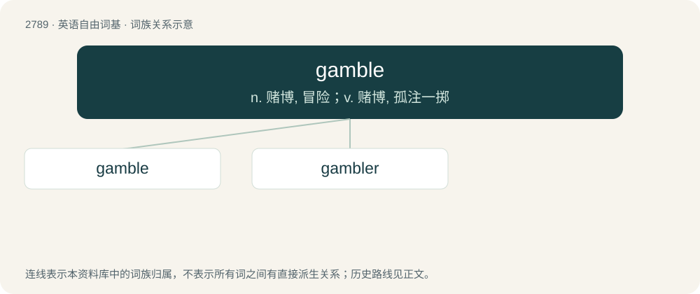

# 2893 · gamble — n. 赌博, 冒险；v. 赌博, 孤注一掷

[总目录](../00_总目录_按常用程度.md)

**类型**：英语自由词基　｜　**来源语言**：见词源记录

## 核心含义与来源

- 核心含义：n. 赌博, 冒险；v. 赌博, 孤注一掷
- 英文含义：A bet or wager.
- 词形：gamble

**来源记录 1**（名词；A bet or wager.）

From earlier gamel, from Middle English \*gamlen, \*gamelen, variant of Middle English gamenen, from Old English gæmnian, gamnian, gamenian (“to joke; play”), related to Old English gamen (“joy; mirth; pleasure; entertainment; pastime; sport; game”), equivalent to game + -le. Compare Old Danish gammel, Middle High German gamel (“pleasure; fun”). More at game.

## 词族图

## 单词速览（常用到不常用）

| 单词 | 音标 | 释义 |
|---|---|---|
| [gamble](#w-1) | 英 /ˈɡæm.bəl/ | n. 赌博, 冒险；v. 赌博, 孤注一掷 |
| [gambler](#w-2) | 美 /ˈɡæmblɚ/ | n. 赌博者, 赌徒；\[法\] 赌徒, 投机商人 |

## 逐词详解

### 1. gamble

**词性**：名词　｜　**音标**：英 /ˈɡæm.bəl/

**中文释义**：n. 赌博, 冒险；v. 赌博, 孤注一掷

**英文义项**：A bet or wager. / A significant risk, undertaken with a potential gain.

**构词拆分**：game + -le

**词源与演化**：

From earlier gamel, from Middle English \*gamlen, \*gamelen, variant of Middle English gamenen, from Old English gæmnian, gamnian, gamenian (“to joke; play”), related to Old English gamen (“joy; mirth; pleasure; entertainment; pastime; sport; game”), equivalent to game + -le. Compare Old Danish gammel, Middle High German gamel (“pleasure; fun”). More at game.

**例句**：

> The sailors had taken many gambles with the sea and always won.

该用例对应义项：A risky venture.

### 2. gambler

**词性**：名词　｜　**音标**：美 /ˈɡæmblɚ/

**中文释义**：n. 赌博者, 赌徒；\[法\] 赌徒, 投机商人

**英文义项**：One who plays at a game of chance, who gambles. / One who takes significant risks.

**构词拆分**：gamble + -er

**词源与演化**：

From gamble + -er.

**例句**：

> My husband is a compulsive gambler. What can I do?
