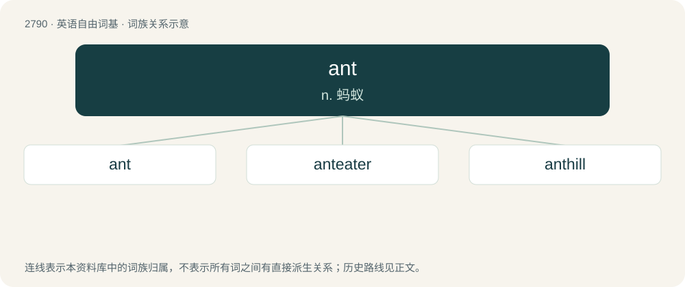

# 2895 · ant — n. 蚂蚁

[总目录](../00_总目录_按常用程度.md)

**类型**：英语自由词基　｜　**来源语言**：见词源记录

## 核心含义与来源

- 核心含义：n. 蚂蚁
- 英文含义：Any of various insects in the family Formicidae in the order Hymenoptera, typically living in large colonies composed almost entirely of flightless females.
- 词形：ant

**来源记录 1**（名词；Any of various insects in the family Formicidae in the order Hymenoptera, typically living in large colonies composed almost entirely of flightless females.）

From Middle English ampte, amte, amete, amote, ante, emete, emot, emotte, empt, empte, from Old English ǣmete, ǣmette, ǣmytte, ǣmætte (“ant”), from Proto-West Germanic \*āmaitijā (“ant”), of uncertain and debated origin (q.v.), but probably from Proto-Germanic \*ē- (“off, away”) + \*maitaną (“to cut”), from Proto-Indo-European \*meh₂y- (“to cut”). See also emmet. Cognates Cognate with Yola emotee, emothee (“ant”), West Frisian eamel, eamelder, eameler (“ant”), Alemannic German Ameisse (“ant”), Bavarian Åmasn, Åmeisn (“ant”), Cimbrian amasa (“ant”), Dutch emt (“ant”), German Ameise, Emse (“ant”), Low German Emk (“ant”), Vilamovian ömys (“ant”), Yiddish אַמייזע (ameyze, “ant”).

## 词族图

## 单词速览（常用到不常用）

| 单词 | 音标 | 释义 |
|---|---|---|
| [ant](#w-1) | 英 /ænt/ | n. 蚂蚁 |
| [anteater](#w-2) | 英 /ˈæntˌiːtə/；美 /ˈæntˌitɚ/ | n. 食蚁动物 |
| [anthill](#w-3) | /ˈænt.hɪl/ | n. 蚁冢, 人群密集的地方 |

## 逐词详解

### 1. ant

**词性**：名词　｜　**音标**：英 /ænt/

**中文释义**：n. 蚂蚁

**英文义项**：Any of various insects in the family Formicidae in the order Hymenoptera, typically living in large colonies composed almost entirely of flightless females. / A Web spider.

**词源与演化**：

From Middle English ampte, amte, amete, amote, ante, emete, emot, emotte, empt, empte, from Old English ǣmete, ǣmette, ǣmytte, ǣmætte (“ant”), from Proto-West Germanic \*āmaitijā (“ant”), of uncertain and debated origin (q.v.), but probably from Proto-Germanic \*ē- (“off, away”) + \*maitaną (“to cut”), from Proto-Indo-European \*meh₂y- (“to cut”). See also emmet. Cognates Cognate with Yola emotee, emothee (“ant”), West Frisian eamel, eamelder, eameler (“ant”), Alemannic German Ameisse (“ant”), Bavarian Åmasn, Åmeisn (“ant”), Cimbrian amasa (“ant”), Dutch emt (“ant”), German Ameise, Emse (“ant”), Low German Emk (“ant”), Vilamovian ömys (“ant”), Yiddish אַמייזע (ameyze, “ant”).

**例句**：

> Sami used a forceps to pick the ant up from its thorax.

### 2. anteater

**词性**：名词　｜　**音标**：英 /ˈæntˌiːtə/；美 /ˈæntˌitɚ/

**中文释义**：n. 食蚁动物

**英文义项**：Any of several animals of South and Central America, in the suborder Vermilingua, which are noted for eating ants and termites which they catch with their long sticky tongues, including giant anteater and lesser anteater (also known as collared anteater). / Any of some other not closely related species that feed with ants, including pangolin (scaly anteater), echidna (spiny anteater), aardvark (African anteater) and numbat (banded anteater).

**构词拆分**：ant + eater

**词源与演化**：

From ant + eater, from their typical diet.

**例句**：

> Pleased to meet you. I am an anteater.

### 3. anthill

**词性**：名词　｜　**音标**：/ˈænt.hɪl/

**中文释义**：n. 蚁冢, 人群密集的地方

**英文义项**：A cone-shaped structure built from sediment and other available materials by ants or white ants (termites), and beneath which the colony nests.

**构词拆分**：ant + hill

**词源与演化**：

From Middle English ametehul, amptehille, from Old English ǣmethyll, equivalent to ant + hill.

**例句**：

> The anthill is full of food collected by the ants.
