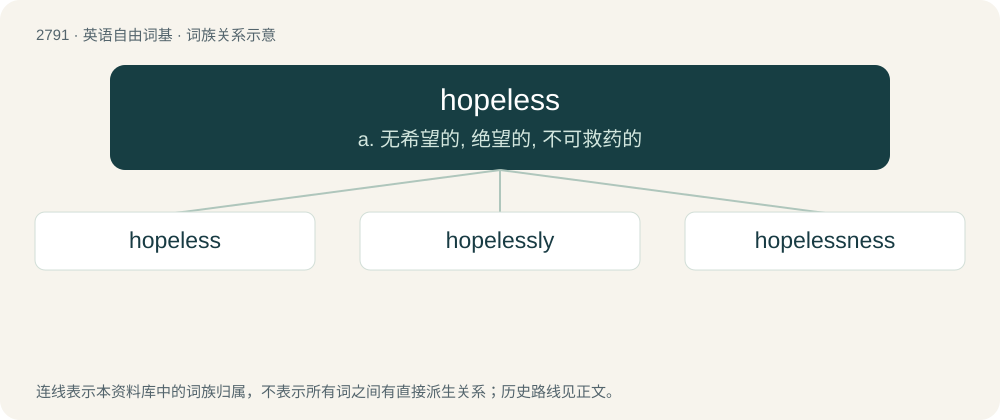

# 2896 · hopeless — a. 无希望的, 绝望的, 不可救药的

[总目录](../00_总目录_按常用程度.md)

**类型**：英语自由词基　｜　**来源语言**：见词源记录

## 核心含义与来源

- 核心含义：a. 无希望的, 绝望的, 不可救药的
- 英文含义：Without hope; despairing; not expecting anything positive.
- 词形：hopeless

**来源记录 1**（形容词；Without hope; despairing; not expecting anything positive.）

From hope + -less. Compare Swedish hopplös.

## 词族图

## 单词速览（常用到不常用）

| 单词 | 音标 | 释义 |
|---|---|---|
| [hopeless](#w-1) | 英 /ˈhəʊplɪs/；美 /ˈhoʊplɪs/ | a. 无希望的, 绝望的, 不可救药的 |
| [hopelessly](#w-2) | 英 /ˈhəʊplɪsli/；美 /ˈhoʊplɪsli/ | adv. 绝望地, 无可奈何地 |
| [hopelessness](#w-3) | /ˈhəʊpləsnəs/ | 绝望 |

## 逐词详解

### 1. hopeless

**词性**：形容词　｜　**音标**：英 /ˈhəʊplɪs/；美 /ˈhoʊplɪs/

**中文释义**：a. 无希望的, 绝望的, 不可救药的

**英文义项**：Without hope; despairing; not expecting anything positive. / Giving no ground of hope; promising nothing desirable; desperate.

**构词拆分**：hope + -less

**词源与演化**：

From hope + -less. Compare Swedish hopplös.

**例句**：

> He's a hopeless writer, but can draw very well.

该用例对应义项：Without talent, not skilled.

### 2. hopelessly

**词性**：副词　｜　**音标**：英 /ˈhəʊplɪsli/；美 /ˈhoʊplɪsli/

**中文释义**：adv. 绝望地, 无可奈何地

**英文义项**：In a manner showing no hope

**构词拆分**：hopeless + -ly

**词源与演化**：

From hopeless + -ly.

**例句**：

> He hung his head hopelessly.

该用例对应义项：without hope; desperate because there seems no possibility of comfort or success

### 3. hopelessness

**词性**：名词　｜　**音标**：/ˈhəʊpləsnəs/

**中文释义**：绝望

**英文义项**：The state of having no hope, being unhopeful. / Lack of potential.

**构词拆分**：hopeless + -ness

**词源与演化**：

From hopeless + -ness.

**例句**：

> He considered the former tooling hopeless, and he reported its hopelessness to his boss right away.

该用例对应义项：Lack of potential.
