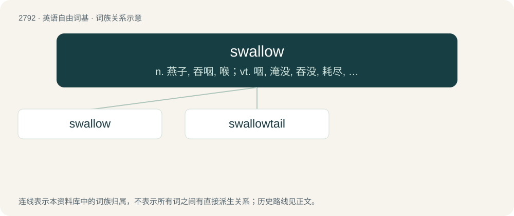

# 2898 · swallow — n. 燕子, 吞咽, 喉；vt. 咽, 淹没, 吞没, 耗尽, 轻信, 忍受, 抑制；vi. 吞下, 咽下

[总目录](../00_总目录_按常用程度.md)

**类型**：英语自由词基　｜　**来源语言**：见词源记录

## 核心含义与来源

- 核心含义：n. 燕子, 吞咽, 喉；vt. 咽, 淹没, 吞没, 耗尽, 轻信, 忍受, 抑制；vi. 吞下, 咽下
- 英文含义：To cause (food, drink etc.) to pass from the mouth into the stomach; to take into the stomach through the throat.
- 词形：swallow

**多个词源／构词路径**：同一拼写可能有不同来源；以下按词性和含义分别列出。

**来源记录 1**（动词；To cause (food, drink etc.) to pass from the mouth into the stomach; to take into the stomach through the throat.）

From Middle English swolwen, from Old English swelgan, from Proto-West Germanic \*swelgan, from Proto-Germanic \*swelganą (“to swallow, revel, devour”), from Proto-Indo-European \*swelk- (“to gulp”). Cognate with Dutch zwelgen (“to revel, carouse, guzzle”), German schwelgen (“to delight, indulge”), Danish svælge (“to swallow”), Norwegian Bokmål svelge (“to swallow”), Norwegian Nynorsk svelgje (“to swallow”), Swedish svälja (“to swallow, gulp”), Faroese svølgja (“to swallow”), Icelandic svelgja (“to swallow”), Old English swillan, swilian (“to swill, wash out, gargle”). See also swill. The noun is from Middle English swolow, swolwe, from Old English swelh, swelg (“gulf, chasm”) and ġeswelge (“gulf, chasm, abyss, whirlpool”), both from Proto-West Germanic \*swelg, \*swalgi, from Proto-Germanic \*swelgaz, \*swalgiz. Cognate with Old English swiliġe (“pit”), Scots swelch, swellie, swallie (“an abyss in the sea, whirpool”), Middle Low German swelch (“whirlpool, eddy”), Dutch zwelg (“gorge, chasm, gullet, throat”), Old Norse svelgr (“whirlpool, current, stream”).

**来源记录 2**（名词；A small, migratory bird of the Hirundinidae family with long, pointed, moon-shaped wings and a forked tail which feeds on the wing by catching insects.）

From Middle English swalwe, swalewe, swalowe, from Old English swealwe, from Proto-West Germanic \*swalwā, from Proto-Germanic \*swalwǭ. Cognate with Norwegian and Danish svale, Dutch zwaluw, German Schwalbe, Swedish svala.

## 词族图

## 单词速览（常用到不常用）

| 单词 | 音标 | 释义 |
|---|---|---|
| [swallow](#w-1) | 英 /ˈswɒl.əʊ/；美 /ˈswɑ.loʊ/ | n. 燕子, 吞咽, 喉；vt. 咽, 淹没, 吞没, 耗尽, 轻信, 忍受, 抑制；vi. 吞下, 咽下 |
| [swallowtail](#w-2) | 英 /ˈswɒl.əʊˌteɪl/ | n. 燕尾, 燕尾服, 燕尾叉形旗子的末端 |

## 逐词详解

### 1. swallow

**词性**：动词　｜　**音标**：英 /ˈswɒl.əʊ/；美 /ˈswɑ.loʊ/

**中文释义**：n. 燕子, 吞咽, 喉；vt. 咽, 淹没, 吞没, 耗尽, 轻信, 忍受, 抑制；vi. 吞下, 咽下

**英文义项**：To cause (food, drink etc.) to pass from the mouth into the stomach; to take into the stomach through the throat. / To take (something) in so that it disappears; to consume, absorb.

**词源与演化**：

From Middle English swolwen, from Old English swelgan, from Proto-West Germanic \*swelgan, from Proto-Germanic \*swelganą (“to swallow, revel, devour”), from Proto-Indo-European \*swelk- (“to gulp”). Cognate with Dutch zwelgen (“to revel, carouse, guzzle”), German schwelgen (“to delight, indulge”), Danish svælge (“to swallow”), Norwegian Bokmål svelge (“to swallow”), Norwegian Nynorsk svelgje (“to swallow”), Swedish svälja (“to swallow, gulp”), Faroese svølgja (“to swallow”), Icelandic svelgja (“to swallow”), Old English swillan, swilian (“to swill, wash out, gargle”). See also swill. The noun is from Middle English swolow, swolwe, from Old English swelh, swelg (“gulf, chasm”) and ġeswelge (“gulf, chasm, abyss, whirlpool”), both from Proto-West Germanic \*swelg, \*swalgi, from Proto-Germanic \*swelgaz, \*swalgiz. Cognate with Old English swiliġe (“pit”), Scots swelch, swellie, swallie (“an abyss in the sea, whirpool”), Middle Low German swelch (“whirlpool, eddy”), Dutch zwelg (“gorge, chasm, gullet, throat”), Old Norse svelgr (“whirlpool, current, stream”).

**例句**：

> My throat was so sore that I was unable to swallow.

该用例对应义项：To take food down into the stomach; to make the muscular contractions of the oesophagus to achieve this, often taken as a sign of nervousness or strong emotion.

### 2. swallowtail

**词性**：名词　｜　**音标**：英 /ˈswɒl.əʊˌteɪl/

**中文释义**：n. 燕尾, 燕尾服, 燕尾叉形旗子的末端

**英文义项**：The forked tail of a swallow. / Anything, such as a burgee, of a similar forked shape.

**构词拆分**：swallow + tail

**词源与演化**：

From swallow + tail.

**例句**：

> Kotaro found a large swallowtail butterfly and chased him about 20 meters inside the grass field.
