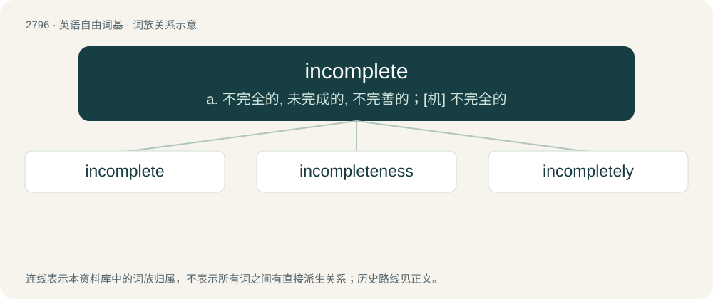

# 2902 · incomplete — a. 不完全的, 未完成的, 不完善的；\[机\] 不完全的

[总目录](../00_总目录_按常用程度.md)

**类型**：英语自由词基　｜　**来源语言**：见词源记录

## 核心含义与来源

- 核心含义：a. 不完全的, 未完成的, 不完善的；\[机\] 不完全的
- 英文含义：Not complete; not finished.
- 词形：incomplete

**来源记录 1**（形容词；Not complete; not finished.）

From Middle English incomplete, incompleet, from Late Latin incomplētus, from in- (“un-; not”) + complētus (“complete”), equivalent to in- (“not”) + complete.

## 词族图

## 单词速览（常用到不常用）

| 单词 | 音标 | 释义 |
|---|---|---|
| [incomplete](#w-1) | /ɪn.kəmˈpliːt/ | a. 不完全的, 未完成的, 不完善的；\[机\] 不完全的 |
| [incompleteness](#w-2) |  | \[计\] 不完全性 |
| [incompletely](#w-3) | /ˌɪn.kəmˈpliːt.li/ | adv. 不完全地 |

## 逐词详解

### 1. incomplete

**词性**：形容词　｜　**音标**：/ɪn.kəmˈpliːt/

**中文释义**：a. 不完全的, 未完成的, 不完善的；\[机\] 不完全的

**英文义项**：Not complete; not finished. / Of a flower, wanting any of the usual floral organs.

**构词拆分**：in- (“not”) + complete

**词源与演化**：

From Middle English incomplete, incompleet, from Late Latin incomplētus, from in- (“un-; not”) + complētus (“complete”), equivalent to in- (“not”) + complete.

**例句**：

> He considers that his life would be incomplete if not for his children.

该用例对应义项：Not complete; not finished.

### 2. incompleteness

**词性**：名词

**中文释义**：\[计\] 不完全性

**英文义项**：The state or condition of being not complete.

**构词拆分**：incomplete + -ness

**词源与演化**：

From incomplete + -ness.

**例句**：

> The study was criticized for incompleteness of data but it stimulated further research.

该用例对应义项：the state of being crude and incomplete and imperfect

### 3. incompletely

**词性**：副词　｜　**音标**：/ˌɪn.kəmˈpliːt.li/

**中文释义**：adv. 不完全地

**英文义项**：In an incomplete manner. / To an incomplete degree.

**构词拆分**：incomplete + -ly

**词源与演化**：

From incomplete + -ly.

**例句**：

> A form filled out incompletely.

该用例对应义项：not to a full degree or extent
