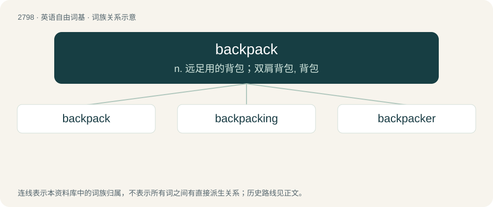

# 2903 · backpack — n. 远足用的背包；双肩背包, 背包

[总目录](../00_总目录_按常用程度.md)

**类型**：英语自由词基　｜　**来源语言**：见词源记录

## 核心含义与来源

- 核心含义：n. 远足用的背包；双肩背包, 背包
- 英文含义：A knapsack, sometimes mounted on a light frame, but always supported by straps, worn on a person’s back for the purpose of carrying things, especially when hiking, or on a student's back when carrying books.
- 词形：backpack

**来源记录 1**（名词；A knapsack, sometimes mounted on a light frame, but always supported by straps, worn on a person’s back for the purpose of carrying things, especially when hiking, or on a student's back when carrying books.）

From back + pack. First attested in 1896.

## 词族图

## 单词速览（常用到不常用）

| 单词 | 音标 | 释义 |
|---|---|---|
| [backpack](#w-1) | /ˈbæk.pæk/ | n. 远足用的背包；双肩背包, 背包 |
| [backpacking](#w-2) | /ˈbæk,pækɪŋ/ | n. 徒步旅行 |
| [backpacker](#w-3) | /ˈbæk.pækə/ | n. 背包旅行者 |

## 逐词详解

### 1. backpack

**词性**：动词　｜　**音标**：/ˈbæk.pæk/

**中文释义**：n. 远足用的背包；双肩背包, 背包

**英文义项**：To hike and camp overnight in backcountry with one's gear carried in a backpack. / To engage in low-cost, generally urban, travel with minimal luggage and frugal accommodation.

**构词拆分**：back + pack

**词源与演化**：

From back + pack. First attested in 1896.

**例句**：

> Astronauts backpack oxygen during spacewalks.

该用例对应义项：To place or carry (an item or items) in a backpack.

### 2. backpacking

**词性**：名词　｜　**音标**：/ˈbæk,pækɪŋ/

**中文释义**：n. 徒步旅行

**英文义项**：Hiking and camping overnight in backcountry with one's gear carried in a backpack. / Low-cost, generally urban, travel with minimal luggage and frugal accommodations.

**构词拆分**：backpack + -ing

**词源与演化**：

From backpack + -ing.

**例句**：

> Fyodor was backpacking through Algeria and trying to save money by camping.

### 3. backpacker

**词性**：名词　｜　**音标**：/ˈbæk.pækə/

**中文释义**：n. 背包旅行者

**英文义项**：A traveler whose luggage consists of a backpack; especially, such a traveler who uses hostels, public transport, and other inexpensive services. / A hostel offering accommodation for such people.

**构词拆分**：backpack + -er

**词源与演化**：

From backpack + -er.
