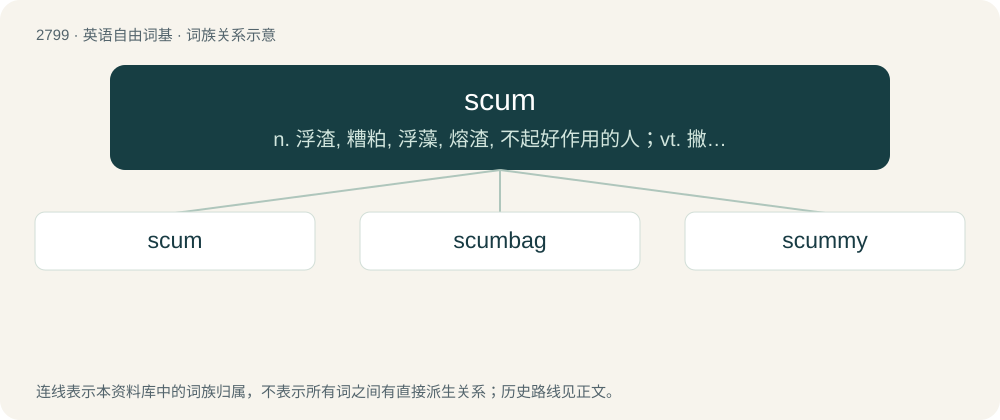

# 2904 · scum — n. 浮渣, 糟粕, 浮藻, 熔渣, 不起好作用的人；vt. 撇去(浮沫)；vi. 产生泡沫

[总目录](../00_总目录_按常用程度.md)

**类型**：英语自由词基　｜　**来源语言**：见词源记录

## 核心含义与来源

- 核心含义：n. 浮渣, 糟粕, 浮藻, 熔渣, 不起好作用的人；vt. 撇去(浮沫)；vi. 产生泡沫
- 英文含义：A layer of impurities that accumulates at the surface of a liquid (especially molten metal or water).
- 词形：scum

**来源记录 1**（名词；A layer of impurities that accumulates at the surface of a liquid (especially molten metal or water).）

From Middle English scum, scome, skum, skome, scumme, from Middle Low German or Middle Dutch schūme (“foam”), from Old Dutch \*scūm, from Frankish \*skūm, from Proto-Germanic \*skūmaz (“froth, foam”), from Proto-Indo-European \*(s)kewH- (“to cover, conceal”). Cognate with Dutch schuim (“foam”), West Frisian skuum, German Schaum (“foam”), Danish and Swedish skum (“foam”). Compare also French écume (“scum”), Italian schiuma (“foam”), Saterland Frisian Skuum, Sicilian scuma (“foam”), Walloon schome (“scum, foam”), Lithuanian šamas (“catfish”) and skanus (“tasty”) from the same Germanic source. Related to skim.

## 词族图

## 单词速览（常用到不常用）

| 单词 | 音标 | 释义 |
|---|---|---|
| [scum](#w-1) | /skʌm/ | n. 浮渣, 糟粕, 浮藻, 熔渣, 不起好作用的人；vt. 撇去(浮沫)；vi. 产生泡沫 |
| [scumbag](#w-2) | 美 /ˈskʌmˌbæɡ/ | n. &lt;俚&gt;避孕套, 卑鄙的家伙 |
| [scummy](#w-3) | /ˈskʌmi/ | a. 满是浮渣的, 浮渣一般的, 下流的 |

## 逐词详解

### 1. scum

**词性**：名词　｜　**音标**：/skʌm/

**中文释义**：n. 浮渣, 糟粕, 浮藻, 熔渣, 不起好作用的人；vt. 撇去(浮沫)；vi. 产生泡沫

**英文义项**：A layer of impurities that accumulates at the surface of a liquid (especially molten metal or water). / A greenish water vegetation (such as algae), usually found floating on the surface of ponds

**词源与演化**：

From Middle English scum, scome, skum, skome, scumme, from Middle Low German or Middle Dutch schūme (“foam”), from Old Dutch \*scūm, from Frankish \*skūm, from Proto-Germanic \*skūmaz (“froth, foam”), from Proto-Indo-European \*(s)kewH- (“to cover, conceal”). Cognate with Dutch schuim (“foam”), West Frisian skuum, German Schaum (“foam”), Danish and Swedish skum (“foam”). Compare also French écume (“scum”), Italian schiuma (“foam”), Saterland Frisian Skuum, Sicilian scuma (“foam”), Walloon schome (“scum, foam”), Lithuanian šamas (“catfish”) and skanus (“tasty”) from the same Germanic source. Related to skim.

**例句**：

> During smelting, scum rises to the surface and is then removed by the smelter.

该用例对应义项：A layer of impurities that accumulates at the surface of a liquid (especially molten metal or water).

### 2. scumbag

**词性**：名词　｜　**音标**：美 /ˈskʌmˌbæɡ/

**中文释义**：n. &lt;俚&gt;避孕套, 卑鄙的家伙

**英文义项**：A condom. / A sleazy, disreputable, despicable, or otherwise immoral person; a lowlife.

**构词拆分**：scum + bag

**词源与演化**：

From scum + bag; first recorded use 1953.

**例句**：

> Can you believe that scumbag Steve asked to sleep with her before even asking her name?

该用例对应义项：A sleazy, disreputable, despicable, or otherwise immoral person; a lowlife.

### 3. scummy

**词性**：形容词　｜　**音标**：/ˈskʌmi/

**中文释义**：a. 满是浮渣的, 浮渣一般的, 下流的

**英文义项**：Covered in scum. / sleazy, worthless, no good

**构词拆分**：From scum + -y.

**词源与演化**：

From scum + -y.

**例句**：

> We have to wash your trousers: they're all scummy.

该用例对应义项：Covered in scum.
