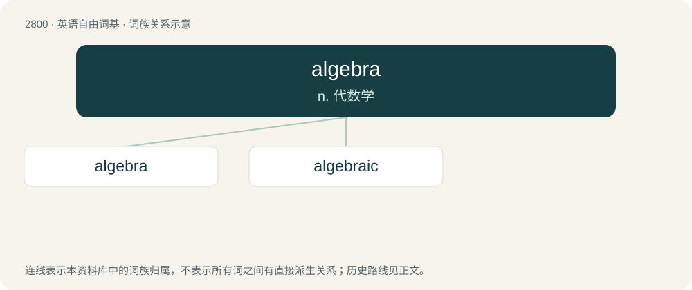

# 2906 · algebra — n. 代数学

[总目录](../00_总目录_按常用程度.md)

**类型**：英语自由词基　｜　**来源语言**：见词源记录

## 核心含义与来源

- 核心含义：n. 代数学
- 英文含义：Elementary algebra: A system for representing and manipulating unknown quantities (variables) in equations.
- 词形：algebra

**来源记录 1**（名词；Elementary algebra: A system for representing and manipulating unknown quantities (variables) in equations.）

Borrowed from Medieval Latin algebra, from the Arabic الْجَبْر (al-jabr, “reunion, resetting of broken parts”) in the title of al-Khwarizmi's influential work الْكِتَاب الْمُخْتَصَر فِي حِسَاب الْجَبْر وَالْمُقَابَلَة (al-kitāb al-muḵtaṣar fī ḥisāb al-jabr wa-l-muqābala, “The Compendious Book on Calculation by Completion and Balancing”).

## 词族图

## 单词速览（常用到不常用）

| 单词 | 音标 | 释义 |
|---|---|---|
| [algebra](#w-1) | 英 /ˈæl.dʒɪ.bɹə/；美 /ˈæl.d͡ʒɪ.bɹə/ | n. 代数学 |
| [algebraic](#w-2) | 英 /ˌæl.d͡ʒɪˈbɹeɪ.ɪk/ | a. 代数的, 代数学的 |

## 逐词详解

### 1. algebra

**词性**：名词　｜　**音标**：英 /ˈæl.dʒɪ.bɹə/；美 /ˈæl.d͡ʒɪ.bɹə/

**中文释义**：n. 代数学

**英文义项**：Elementary algebra: A system for representing and manipulating unknown quantities (variables) in equations. / Abstract algebra: A broad field of study in modern mathematics (often mentioned alongside analysis) loosely characterized by its concern for abstraction and symmetry, dealing with the behavior, classification, and application of a large class of objects (called algebraic structures) and the maps between them (called, most generally, morphisms).

**词源与演化**：

Borrowed from Medieval Latin algebra, from the Arabic الْجَبْر (al-jabr, “reunion, resetting of broken parts”) in the title of al-Khwarizmi's influential work الْكِتَاب الْمُخْتَصَر فِي حِسَاب الْجَبْر وَالْمُقَابَلَة (al-kitāb al-muḵtaṣar fī ḥisāb al-jabr wa-l-muqābala, “The Compendious Book on Calculation by Completion and Balancing”).

**例句**：

> It's not the calculus I'm getting stumped on. It's the algebra.

### 2. algebraic

**词性**：形容词　｜　**音标**：英 /ˌæl.d͡ʒɪˈbɹeɪ.ɪk/

**中文释义**：a. 代数的, 代数学的

**英文义项**：Of, or relating to, algebra. / Containing only numbers, letters, and arithmetic operators.

**构词拆分**：algebra + -ic

**词源与演化**：

Partly from algebra + -ic and partly from French algébraïque.

**例句**：

> The trigonometric functions satisfy a wide array of notable algebraic identities.
