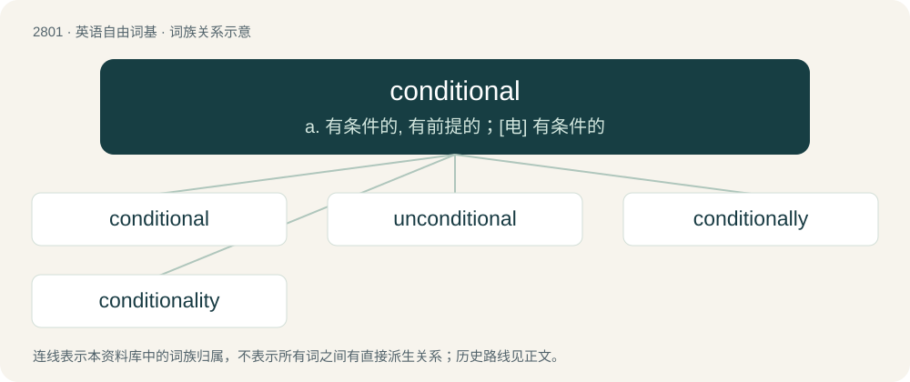

# 2907 · conditional — a. 有条件的, 有前提的；\[电\] 有条件的

[总目录](../00_总目录_按常用程度.md)

**类型**：英语自由词基　｜　**来源语言**：见词源记录

## 核心含义与来源

- 核心含义：a. 有条件的, 有前提的；\[电\] 有条件的
- 英文含义：Limited by a condition.
- 词形：conditional

**来源记录 1**（形容词；Limited by a condition.）

From French conditionnel, from Old French condicionel, equivalent to condition + -al.

## 词族图

## 单词速览（常用到不常用）

| 单词 | 音标 | 释义 |
|---|---|---|
| [conditional](#w-1) | /kənˈdɪʃ.ə.nəl/ | a. 有条件的, 有前提的；\[电\] 有条件的 |
| [unconditional](#w-2) | 美 /ˌʌnkənˈdɪʃənəl/ | a. 无条件的, 无限制的, 绝对的；\[经\] 无条件的, 无保留的 |
| [conditionally](#w-3) | /kənˈdɪʃənəli/ | adv. 有条件地 |
| [conditionality](#w-4) | /kən.diʃəˈnæliti/ | n. 受限制性, 制约性 |

## 逐词详解

### 1. conditional

**词性**：形容词　｜　**音标**：/kənˈdɪʃ.ə.nəl/

**中文释义**：a. 有条件的, 有前提的；\[电\] 有条件的

**英文义项**：Limited by a condition. / Stating that one sentence is true if another is true.

**构词拆分**：condition + -al

**词源与演化**：

From French conditionnel, from Old French condicionel, equivalent to condition + -al.

**例句**：

> I made my son a conditional promise: I would buy him a bike if he kept his room tidy.

该用例对应义项：Limited by a condition.

### 2. unconditional

**词性**：形容词　｜　**音标**：美 /ˌʌnkənˈdɪʃənəl/

**中文释义**：a. 无条件的, 无限制的, 绝对的；\[经\] 无条件的, 无保留的

**英文义项**：Absolute; without conditions, limitations, reservations or qualifications.

**构词拆分**：un- + conditional

**词源与演化**：

From un- + conditional.

**例句**：

> We demand your unconditional surrender.

该用例对应义项：Absolute; without conditions, limitations, reservations or qualifications.

### 3. conditionally

**词性**：副词　｜　**音标**：/kənˈdɪʃənəli/

**中文释义**：adv. 有条件地

**英文义项**：under specified conditions

**构词拆分**：conditional + -ly

**词源与演化**：

From conditional + -ly.

**例句**：

> My bad habit is to give money conditionally and to give thanks unconditionally. Yours?

### 4. conditionality

**词性**：名词　｜　**音标**：/kən.diʃəˈnæliti/

**中文释义**：n. 受限制性, 制约性

**英文义项**：A state of being subject to conditions. / A condition applied to the access of a government to credit facilities and other international financial assistance, especially from the IMF and the World Bank.

**构词拆分**：conditional + -ity

**词源与演化**：

From conditional + -ity.
