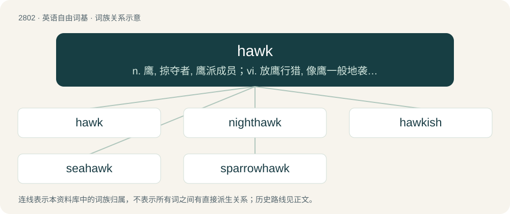

# 2908 · hawk — n. 鹰, 掠夺者, 鹰派成员；vi. 放鹰行猎, 像鹰一般地袭击, 清嗓, 咳嗽；vt. 捕捉, 咳出, 兜售, 叫卖, 散播

[总目录](../00_总目录_按常用程度.md)

**类型**：英语自由词基　｜　**来源语言**：见词源记录

## 核心含义与来源

- 核心含义：n. 鹰, 掠夺者, 鹰派成员；vi. 放鹰行猎, 像鹰一般地袭击, 清嗓, 咳嗽；vt. 捕捉, 咳出, 兜售, 叫卖, 散播
- 英文含义：A diurnal predatory bird of the family Accipitridae, smaller than an eagle.
- 词形：hawk

**多个词源／构词路径**：同一拼写可能有不同来源；以下按词性和含义分别列出。

**来源记录 1**（名词；A diurnal predatory bird of the family Accipitridae, smaller than an eagle.）

Inherited from Middle English hauk, hauke, hawke, havek, from Old English hafoc, from Proto-West Germanic \*habuk, from Proto-Germanic \*habukaz, controversially derived from Proto-Indo-European \*kopuǵos, perhaps ultimately derived from \*kap- (“seize”). Cognate with West Frisian hauk, German Low German Haavke, Dutch havik, German Habicht, Swedish hök, Danish høg, Norwegian Bokmål hauk, Norwegian Nynorsk hauk, Faroese heykur, Icelandic haukur, Finnish haukka, Estonian haugas; also Latin capys, capus (“bird of prey”), Albanian gabonjë, shkabë (“eagle”), Russian ко́бец (kóbec, “falcon”), Polish kobuz (“Eurasian Hobby”)).

**来源记录 2**（名词；A plasterer's tool, made of a flat surface with a handle below, used to hold an amount of plaster prior to application to the wall or ceiling being worked on: a mortarboard.）

Uncertain; perhaps from Middle English hache (“battle-axe”), or from a variant use of the above, for this compare with Russian со́кол (sókol, “falcon, but also a hawk (plaster's tool), mortarboard”).

**来源记录 3**（动词；To sell; to offer for sale by outcry in the street; to carry (merchandise) about from place to place for sale; to peddle.）

Back-formation from hawker.

**来源记录 4**（名词；A noisy effort to force up phlegm from the throat.）

Probably imitative, like hock (“cough”), hack (“cough”), although see the latter entry for more.

## 词族图

## 单词速览（常用到不常用）

| 单词 | 音标 | 释义 |
|---|---|---|
| [hawk](#w-1) | 英 /ˈhɔːk/；/ˈhɔk/ | n. 鹰, 掠夺者, 鹰派成员；vi. 放鹰行猎, 像鹰一般地袭击, 清嗓, 咳嗽；vt. 捕捉, 咳出, 兜售, 叫卖, 散播 |
| [nighthawk](#w-2) | 英 /ˈnʌɪthɔːk/；美 /ˈnaɪthɑk/ | n. 夜鹰, 夜生活者 |
| [hawkish](#w-3) | 英 /ˈhɔːkɪʃ/；/ˈhɔkɪʃ/ | a. 像鹰的, 鹰派的, 强硬派的 |
| [seahawk](#w-4) |  | 【英文】A rapacious gull-like bird of the genus Stercorarius. |
| [sparrowhawk](#w-5) |  | 雀鹰 |

## 逐词详解

### 1. hawk

**词性**：名词　｜　**音标**：英 /ˈhɔːk/；/ˈhɔk/

**中文释义**：n. 鹰, 掠夺者, 鹰派成员；vi. 放鹰行猎, 像鹰一般地袭击, 清嗓, 咳嗽；vt. 捕捉, 咳出, 兜售, 叫卖, 散播

**英文义项**：A diurnal predatory bird of the family Accipitridae, smaller than an eagle. / Any diurnal predatory terrestrial bird of similar size and appearance to the accipitrid hawks, such as a falcon.

**词源与演化**：

Inherited from Middle English hauk, hauke, hawke, havek, from Old English hafoc, from Proto-West Germanic \*habuk, from Proto-Germanic \*habukaz, controversially derived from Proto-Indo-European \*kopuǵos, perhaps ultimately derived from \*kap- (“seize”). Cognate with West Frisian hauk, German Low German Haavke, Dutch havik, German Habicht, Swedish hök, Danish høg, Norwegian Bokmål hauk, Norwegian Nynorsk hauk, Faroese heykur, Icelandic haukur, Finnish haukka, Estonian haugas; also Latin capys, capus (“bird of prey”), Albanian gabonjë, shkabë (“eagle”), Russian ко́бец (kóbec, “falcon”), Polish kobuz (“Eurasian Hobby”)).

**例句**：

> It is illegal to hunt hawks or other raptors in many parts of the world.

该用例对应义项：A diurnal predatory bird of the family Accipitridae, smaller than an eagle.

### 2. nighthawk

**词性**：名词　｜　**音标**：英 /ˈnʌɪthɔːk/；美 /ˈnaɪthɑk/

**中文释义**：n. 夜鹰, 夜生活者

**英文义项**：A nightjar, especially Caprimulgus europaeus (Eurasian nightjar). / A New World nightjar of the genus Chordeiles, especially Chordeiles minor.

**构词拆分**：night + hawk

**词源与演化**：

From night + hawk.

### 3. hawkish

**词性**：形容词　｜　**音标**：英 /ˈhɔːkɪʃ/；/ˈhɔkɪʃ/

**中文释义**：a. 像鹰的, 鹰派的, 强硬派的

**英文义项**：Resembling a hawk in appearance or behaviour. / Supportive of warlike foreign policy; bellicose; inclined toward military action.

**构词拆分**：hawk + -ish

**词源与演化**：

From hawk + -ish.

**例句**：

> The Prime Minister could count on the support of a hawkish majority in Parliament to support the invasion.

该用例对应义项：Supportive of warlike foreign policy; bellicose; inclined toward military action.

### 4. seahawk

**词性**：名词

**英文义项**：A rapacious gull-like bird of the genus Stercorarius. / An osprey, Pandion haliaetus.

**构词拆分**：sea + hawk

**词源与演化**：

From sea + hawk.

### 5. sparrowhawk

**词性**：名词

**中文释义**：雀鹰

**英文义项**：A Eurasian sparrowhawk, Accipiter nisus, a small, short-winged European hawk that preys on smaller birds. / A female such bird, a male being a musket.

**构词拆分**：sparrow + hawk

**词源与演化**：

From Middle English sparhauk, sperhauk, from Old English spearhafoc, spearhabuc (“sparrow-hawk”), from Proto-West Germanic \*sparwahabuk, from Proto-Germanic \*sparwahabukaz, equivalent to sparrow + hawk. Cognate with Danish spurvehøg (“sparrowhawk”), Swedish sparvhök (“sparrowhawk”), Icelandic sparrhaukur (“sparrowhawk”).

**例句**：

> I think it was a sparrowhawk or a hobby.
