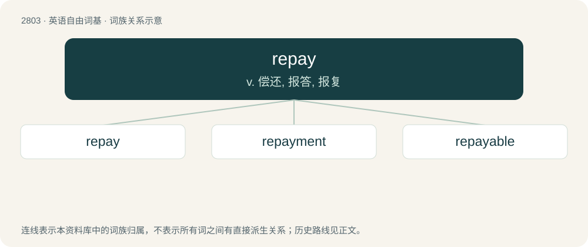

# 2909 · repay — v. 偿还, 报答, 报复

[总目录](../00_总目录_按常用程度.md)

**类型**：英语自由词基　｜　**来源语言**：见词源记录

## 核心含义与来源

- 核心含义：v. 偿还, 报答, 报复
- 英文含义：Synonym of pay back in all senses.
- 词形：repay

**来源记录 1**（动词；Synonym of pay back in all senses.）

From Old French repaier (“to pay back”), from re- + paiier (“to pay”), from Latin pācāre (“to settle, to make peaceful”), from pāx (“peace”) + -ō (forming verbs). Equivalent to re- + pay. Cognate with repacify and French repayer (“to pay again”).

## 词族图

## 单词速览（常用到不常用）

| 单词 | 音标 | 释义 |
|---|---|---|
| [repay](#w-1) | /ɹiˈpeɪ/ | v. 偿还, 报答, 报复 |
| [repayment](#w-2) | /riˈpeimənt/ | n. 付还, 偿还, 报复, 付还的钱；\[经\] 偿还, 付还 |
| [repayable](#w-3) | /riˈpeiəbl/ | a. 可偿还的, 该付还的, 可报恩的, 应报复的 |

## 逐词详解

### 1. repay

**词性**：动词　｜　**音标**：/ɹiˈpeɪ/

**中文释义**：v. 偿还, 报答, 报复

**英文义项**：Synonym of pay back in all senses. / To make worthwhile; to yield a result worth the effort; to pay off.

**构词拆分**：re- + pay

**词源与演化**：

From Old French repaier (“to pay back”), from re- + paiier (“to pay”), from Latin pācāre (“to settle, to make peaceful”), from pāx (“peace”) + -ō (forming verbs). Equivalent to re- + pay. Cognate with repacify and French repayer (“to pay again”).

**例句**：

> I'll repay this wrong asap.

该用例对应义项：Synonym of pay back in all senses.

### 2. repayment

**词性**：名词　｜　**音标**：/riˈpeimənt/

**中文释义**：n. 付还, 偿还, 报复, 付还的钱；\[经\] 偿还, 付还

**英文义项**：The act of repaying. / The money or other item that is repaid.

**构词拆分**：repay + -ment；re- + payment

**词源与演化**：

From repay + -ment, also equivalent to re- + payment.

**例句**：

> Student loan repayment begins next month.

### 3. repayable

**词性**：形容词　｜　**音标**：/riˈpeiəbl/

**中文释义**：a. 可偿还的, 该付还的, 可报恩的, 应报复的

**英文义项**：Able to be repaid. / to be repaid; owing.

**构词拆分**：repay + -able

**词源与演化**：

From repay + -able.

**例句**：

> Japan's ODA largely consists of concessionary yen credit repayable in 30 years, carrying an interest rate of 2% or so.
